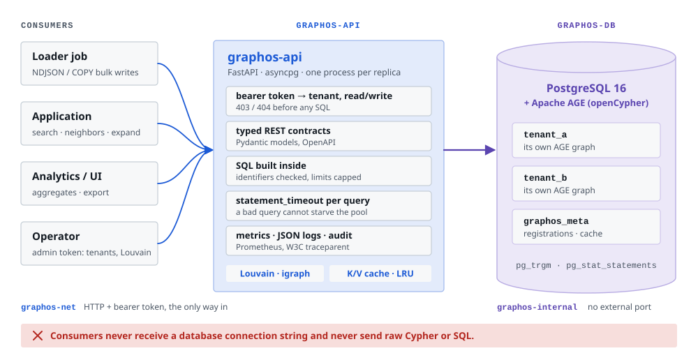
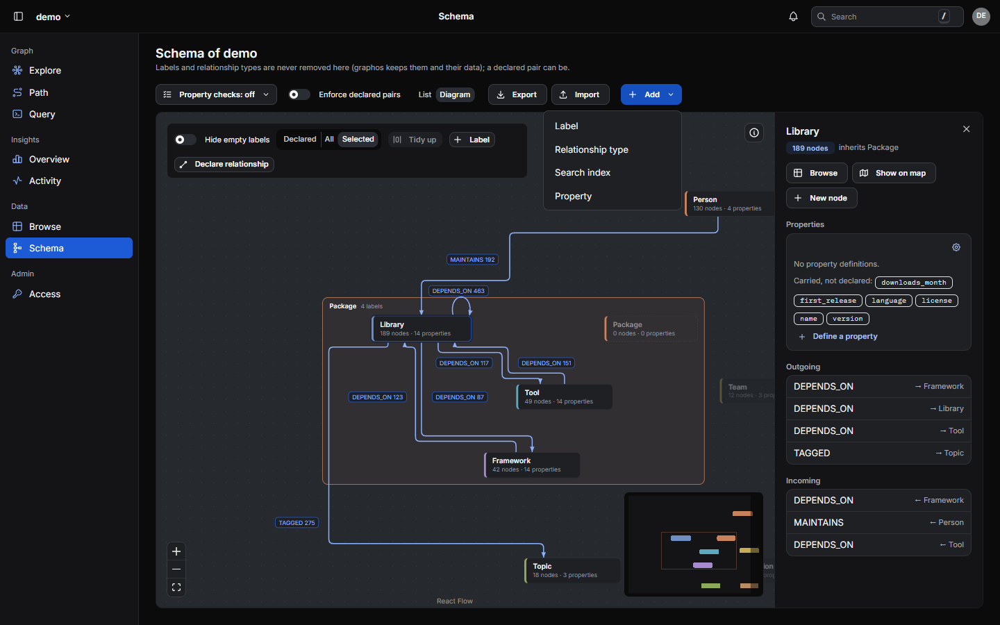
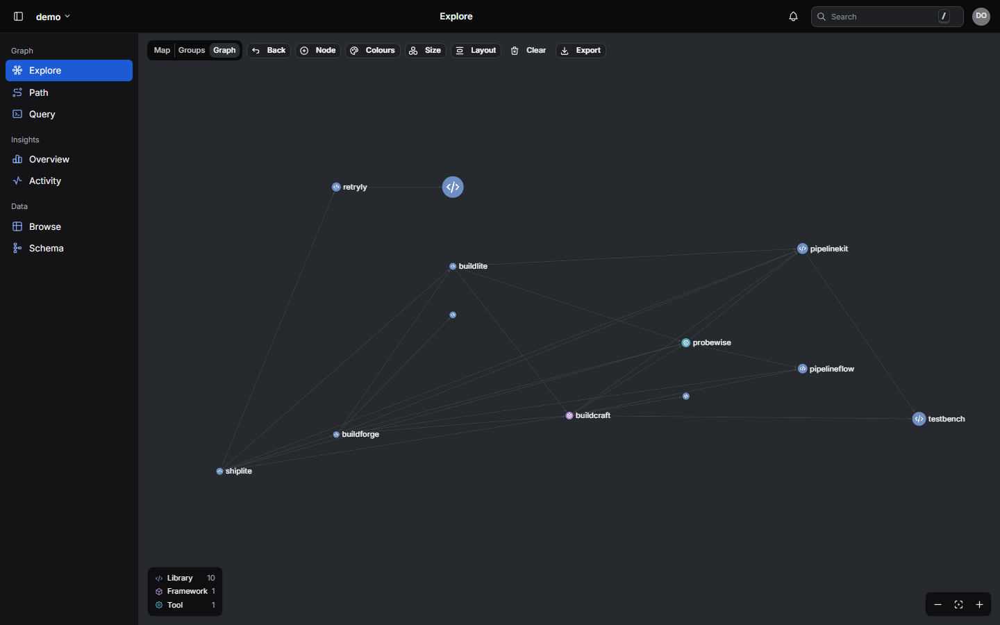
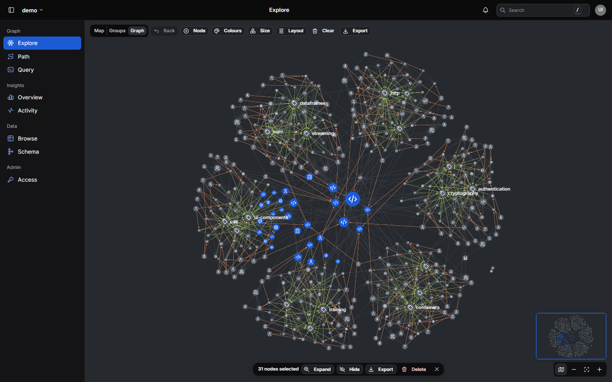
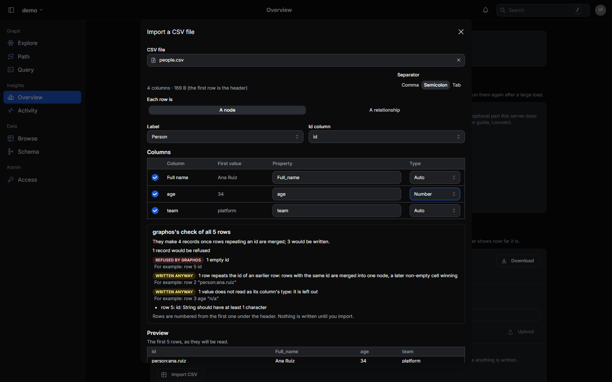

# graphos

[](LICENSE)
[](CHANGELOG.md)
[](https://www.pomentum.dev/graphos/)

A multi-tenant property-graph service: **PostgreSQL + [Apache AGE](https://age.apache.org/) behind a typed HTTP API.**

Your services send JSON over HTTP. graphos owns the database, writes the SQL against AGE's tables, enforces tenant isolation, and gives you bulk loading, traversal, aggregation, graph algorithms (communities, PageRank, betweenness, components) and a web UI. Consumers never get a connection string; raw Cypher runs only in a read-only console that graphos controls.

<picture>
  <source media="(prefers-color-scheme: dark)" srcset="docs/images/architecture-dark.svg">
  
</picture>

**Website:** [www.pomentum.dev/graphos](https://www.pomentum.dev/graphos/): the problem graphos solves, what it gives you, measured benchmarks and a quickstart.

## Features

The picture above is the map; each line below links to the section that covers it, and the [feature survey](docs/guide/features.md) lists every capability.

**Build**

- **Tenants and schema:** each tenant is its own AGE graph with its own labels; no built-in labels or property names; optional property rules, `warn` or `strict`; labels, relationship types and properties renamed in place or deprecated, with what replaces them ([usage](docs/guide/usage.md#3-tenant-registration)).
- **Fast, idempotent writes:** batches, NDJSON bulk and snapshot import as COPY-staged upserts, 37–156× faster than per-row Cypher `MERGE` in our measurements ([usage](docs/guide/usage.md#4-writing-data), [AGE notes](docs/guide/apache-age.md)).
- **Load a CSV file:** send the file itself; graphos maps its columns to properties, merges rows that repeat an id, checks every row (a dry run writes nothing) and writes them as bulk loads do ([usage](docs/guide/usage.md#csv-import)).
- **Edit in place, safely:** patch or delete one node or edge, or delete up to 1,000 nodes in one transaction; `If-Match` turns a concurrent edit into a `412` instead of a lost update ([usage](docs/guide/usage.md#4-writing-data)).
- **Composable reads:** search (substring or ranked indexes), neighbors, multi-hop expand, shortest paths, scans and subgraphs ([usage](docs/guide/usage.md#5-reads-that-compose)).
- **Rule-derived edges:** declare a property-match rule once; `edges:resolve` writes the edges in SQL ([usage](docs/guide/usage.md#9-rule-based-edges-resolve_rule)).
- **Reconcile by difference:** send the whole set of a node's or a type's edges; graphos adds, changes and removes only the difference, in one transaction ([usage](docs/guide/usage.md#reconcile-make-the-stored-edges-equal-to-a-set)).
- **Copy, back up and restore:** a tenant's schema and data as files, restored exactly or loaded into plain AGE ([usage](docs/guide/usage.md#dataset-export-and-import), [without graphos](docs/guide/without-graphos.md)).
- **Python client:** async and typed; signs in and renews its token by itself ([below](#python-client)).

**Explore**

- **Graph analytics:** a map of every label and the edges between them (about a second on ten million edges), aggregates, top-K by degree ([usage](docs/guide/usage.md#6-aggregates)).
- **Graph algorithms:** communities with Louvain or Leiden (optional extra), PageRank, betweenness, components and degree, run beside the API and written onto the nodes; re-runs write only what changed ([what each finds](docs/guide/algorithms.md)).
- **Cypher console:** read-only Cypher on one tenant, write clauses refused, with a timeout, a row cap and saved queries ([usage](docs/guide/usage.md#cypher-console)).
- **AI agents (MCP):** `/mcp` serves graphos's reads to agents as tools and resources, with the caller's grants and a schema summary made for models; MCP clients sign people in themselves ([agents guide](docs/guide/agents.md)).
- **Web UI (optional):** explore, inspect and edit, work on many nodes at once, import a CSV file, query, extend the schema, follow changes live and export what is on screen ([below](#web-ui)).

**Run**

- **Safe by default:** 15-minute tokens for people and service accounts, single sign-on, a level per tenant, stored secrets sealed with a master key, a Host allowlist, statement timeouts, the database out of reach ([installation](docs/guide/installation.md#8-before-other-people-use-it), [single sign-on](docs/guide/sso.md)).
- **Change feed:** every write recorded in its transaction; read after a cursor or follow live ([usage](docs/guide/usage.md#10-change-feed)).
- **Background jobs:** long operations answer `202` at once, then can be polled and cancelled ([usage](docs/guide/usage.md#background-jobs)).
- **Operable:** Prometheus metrics, JSON logs with `traceparent`, an audit log and per-user rate limiting ([usage](docs/guide/usage.md#11-operations)).

## Web UI


*Explore, on the [demo tenant](clients/python/examples/08_demo_ecosystem.py): coloured by community, a core library selected with the metrics graphos computed for it.*



*The schema editor: labels with their kinds, relationship types, and adding to the schema in place.*


*The Query page (where the Cypher console is on): Cypher coloured and suggested as you type, a saved query's form, the result with each node's label icon.*



*A query's result on the canvas, laid out in layers along its edges and drawn with the tenant's label styles.*



*Many nodes at once: a loop drawn with Shift-drag (or Ctrl / ⌘ click) picks them; the bar expands, hides, exports or deletes them together. A minimap frames the part on screen.*



*Importing a CSV file: the columns mapped to a label's properties, and graphos's check of every row before anything is written.*

## Quickstart

The [installation guide](docs/guide/installation.md) covers the same steps in more detail, single sign-on, and what to change before other people use it.

Requires Docker with Compose v2 and about 4 GB of memory available to Docker (the defaults are laptop-sized; [tuning](docs/guide/apache-age.md) covers larger graphs).

Already running graphos 0.9 or earlier on PostgreSQL 16? Pull and run the same `up`: the first start moves your data to PostgreSQL 18 ([upgrade guide](docs/guide/upgrade-postgresql-18.md)).

```bash
git clone https://github.com/pomentum/graphos.git && cd graphos

# 1. Create local secrets: random database passwords
bash scripts/init-secrets.sh          # or: pwsh scripts/init-secrets.ps1

# 2. Start graphos-db (Postgres 18 + AGE 1.8), graphos-api and the web UI (http://127.0.0.1:8081)
docker compose -f docker-compose.graphos.yml --profile ui up -d

# 3. Check it is up
curl -s http://127.0.0.1:8080/readyz

# 4. Sign in as graphos / graphos; the first password must be changed before anything else (uses jq)
TOKEN=$(curl -s -X POST http://127.0.0.1:8080/v1/auth/login -H "content-type: application/json" \
  -d '{"user": "graphos", "password": "graphos"}' | jq -r .access_token)
ADMIN_TOKEN=$(curl -s -X POST http://127.0.0.1:8080/v1/me/password -H "Authorization: Bearer $TOKEN" \
  -H "content-type: application/json" \
  -d '{"current": "graphos", "new": "choose-your-own-password"}' | jq -r .access_token)
```

graphos has users, not static tokens. Signing in (`POST /v1/auth/login`) returns an access token valid 15 minutes; the Python client and the UI renew it by themselves. Give each consumer a **service account** (`POST /v1/users` with `"kind": "service"`, or the UI's Access page; its secret is shown once) and **grant** it a level on its tenants (`POST /v1/grants`: `read`, `write`, `maintain` for schema and computations, `owner` for granting others), or `create_tenants` on a name pattern so it owns the tenants it creates. The first admin is `graphos` / `graphos`, changed at the first sign-in. People sign in to the UI, with a graphos password or through your OpenID Connect provider (single sign-on, with access granted to its groups and roles). The examples below use the admin token for brevity.

**Register a tenant** (idempotent — safe to call on every consumer start):

```bash
curl -s -X POST http://127.0.0.1:8080/v1/tenants \
  -H "Authorization: Bearer $ADMIN_TOKEN" -H "content-type: application/json" \
  -d '{"name": "acme",
       "vertex_labels": ["User", "Document"],
       "edge_labels":   ["AUTHORED", "FOLLOWS"]}'
```

**Write nodes, then edges** (upsert on your `id`; property updates are additive):

```bash
curl -s -X POST http://127.0.0.1:8080/v1/acme/graph/nodes \
  -H "Authorization: Bearer $ADMIN_TOKEN" -H "content-type: application/json" \
  -d '{"nodes": [
        {"id": "u1", "label": "User",     "properties": {"name": "ada"}},
        {"id": "d1", "label": "Document", "properties": {"name": "graphs-101"}}]}'

curl -s -X POST http://127.0.0.1:8080/v1/acme/graph/edges \
  -H "Authorization: Bearer $ADMIN_TOKEN" -H "content-type: application/json" \
  -d '{"edges": [{"src_id": "u1", "src_label": "User",
                  "dst_id": "d1", "dst_label": "Document", "type": "AUTHORED"}]}'
```

**Read** (node hits carry AGE's internal `id`; the id you wrote is `properties.id`):

```bash
curl -s -H "Authorization: Bearer $ADMIN_TOKEN" "http://127.0.0.1:8080/v1/acme/graph/search?q=ada"
curl -s -H "Authorization: Bearer $ADMIN_TOKEN" "http://127.0.0.1:8080/v1/acme/graph/neighbors?node_id=u1"
curl -s -H "Authorization: Bearer $ADMIN_TOKEN" "http://127.0.0.1:8080/v1/acme/graph/expand?node_id=u1&max_hops=2"
```

**Compute communities** (`maintain` on the tenant; writes `community_id` onto every node; needs the `louvain` extra, which the compose build includes):

```bash
curl -s -X POST http://127.0.0.1:8080/v1/acme/recompute-communities \
  -H "Authorization: Bearer $ADMIN_TOKEN" -H "content-type: application/json" -d '{}'
```

On a large graph, add `-H "Prefer: respond-async"`: the call answers `202` at once with a job, and `GET /v1/jobs/{id}` (the `Location` header) reports its progress and, when done, the same result.

**Compute graph metrics** (`maintain` on the tenant; writes `graphos_degree`, `graphos_pagerank`, `graphos_component`, … onto the nodes; no extra needed):

```bash
curl -s -X POST http://127.0.0.1:8080/v1/acme/graph/metrics:compute \
  -H "Authorization: Bearer $ADMIN_TOKEN" -H "content-type: application/json" \
  -d '{"metrics": ["degree", "pagerank", "components"]}'
```

The full, live API contract is at `http://127.0.0.1:8080/docs` (Swagger UI), `/redoc` (ReDoc) and
`/openapi.json`: every route with the errors it can answer, the bodies it takes and a description of
every field.

**A tenant to explore:** `GRAPHOS_URL=http://127.0.0.1:8080 GRAPHOS_USER=graphos GRAPHOS_PASSWORD=<yours> python clients/python/examples/08_demo_ecosystem.py` loads the demo tenant (an invented software ecosystem, about 450 nodes) and runs the algorithms on it; then open the UI.

### Louvain is an optional extra

Community detection uses [python-igraph](https://python.igraph.org/), which is GPL-2.0-or-later, so it is kept out of the default install. The extra gives both algorithms, Louvain (the default) and Leiden:

| Install | Louvain and Leiden |
|---|---|
| `pip install ./services/graphos` / default image | no; `recompute-communities` answers `501` |
| `pip install "./services/graphos[louvain]"` | yes |
| `docker build --build-arg GRAPHOS_EXTRAS=louvain` | yes (the image then contains GPL code) |
| `docker compose ... up` (local build) | yes by default; `GRAPHOS_EXTRAS= docker compose ...` to leave it out |
| an image without it (the published one), plus `-f docker-compose.louvain.yml` | yes, no rebuild: graphos-api downloads python-igraph into its container on first start ([example with the published images](docs/guide/installation.md#louvain-with-the-published-images)) |

`GET /v1/info` reports `features.louvain` so clients can check before calling.

## Container image

The [`graphos-image`](.github/workflows/image.yml) workflow builds and smoke-tests both variants (`linux/amd64`) on every pull request and push, and publishes the default (permissive-only) variant for `linux/amd64` and `linux/arm64`, each built on a runner of that architecture, to `ghcr.io/<owner>/graphos-api`, and the web UI to `ghcr.io/<owner>/graphos-ui`, from `main` and version tags. The `louvain` variant is built and smoke-tested but not published.

**Releasing.** What changed in each version is in [CHANGELOG.md](CHANGELOG.md). Push a version tag such as `0.14.5` to publish the images (`ghcr.io/<owner>/graphos-api:0.14.5` and `:0.14`, and the same for `graphos-ui`); set the version first with `node tools/release/version.mjs X.Y.Z`, which writes it everywhere it lives (server, client, UI, the website's page), turns the changelog's *Unreleased* heading into the release; CI and the release workflows check with `--check` that every place matches the tag. [`graphos-client`](clients/python/) is not published to PyPI automatically: the [`graphos-client-release`](.github/workflows/client-release.yml) workflow is run by hand from a version tag.

## Python client

```bash
pip install -e clients/python
```

```python
from graphos_client import GraphosClient, NodeUpsert, PasswordAuth

# A service account; or set GRAPHOS_USER / GRAPHOS_PASSWORD and pass no auth.
async with GraphosClient(base_url="http://127.0.0.1:8080", tenant="acme",
                         auth=PasswordAuth("app", APP_SECRET)) as cli:
    await cli.upsert_nodes([NodeUpsert(id="u2", label="User", properties={"name": "grace"})])
    hits = await cli.search("grace", limit=10)
```

Async, typed (Pydantic), with pooled connections and safe retries; it signs in and renews its token by itself. `GraphosPool` manages one registered client per tenant for services that write to many tenants; the `submit_*` methods run long operations as background jobs, with `wait_for_job` and `cancel_job`. See [`clients/python/`](clients/python/) and its [runnable examples](clients/python/examples/).

## Configuration

All settings are environment variables prefixed `GRAPHOS_` (full list in [`config.py`](services/graphos/src/graphos/config.py)). The ones you are most likely to touch:

| Variable | Default | Purpose |
|---|---|---|
| `GRAPHOS_DB_HOST`, `GRAPHOS_DB_PORT`, `GRAPHOS_DB_NAME` | `graphos-db`, `5432`, `graphos` | The PostgreSQL server graphos connects to, and its database |
| `GRAPHOS_DB_PASSWORD_FILE` | — | Database password (or `GRAPHOS_DB_PASSWORD`) |
| `GRAPHOS_ADMIN_PASSWORD_FILE` | — | First password of the bootstrap admin `graphos`, read only while graphos has no user (default: `graphos`); must be changed at the first sign-in |
| `GRAPHOS_LOCAL_ADMIN` | `true` | `false`: the bootstrap admin `graphos` cannot sign in (once admins sign in through SSO) |
| `GRAPHOS_ACCESS_TOKEN_TTL_S` | `900` | Lifetime of the access tokens graphos issues |
| `GRAPHOS_SESSION_IDLE_S`, `GRAPHOS_SESSION_MAX_S` | `3600`, `43200` | Browser sessions end after this long unused, and after this long in any case |
| `GRAPHOS_AUTH_SIGNING_KEY_FILE` | — | A PEM EC P-256 key to sign tokens with (e.g. from a secret manager), instead of the one graphos generates and keeps in the database |
| `GRAPHOS_MASTER_KEY_FILE` | — (compose: `master_key.txt` from `init-secrets`) | Master key that seals the signing keys and ID tokens graphos stores; without it they are stored in clear (a warning at start). Back it up apart from the database |
| `GRAPHOS_MCP` | `true` | `false` turns off the MCP endpoint `/mcp` for agents (read tools, the same tokens as the API; [agents guide](docs/guide/agents.md)) |
| `GRAPHOS_ALLOWED_HOSTS` | — (any) | Host names graphos answers to, comma-separated (`*.example.com` works), against DNS rebinding; `localhost` and `127.0.0.1` always. Add `graphos-api` when the bundled web UI proxies to it |
| `GRAPHOS_OIDC_ISSUER` | — | Single sign-on: the OpenID Connect provider's issuer (exactly the `issuer` of its discovery document); unset, no SSO |
| `GRAPHOS_OIDC_CLIENT_ID` | — | Single sign-on: graphos's public client (PKCE) at the provider |
| `GRAPHOS_OIDC_REDIRECT_URIS` | `[]` (any) | Single sign-on: the UI's callback URLs, as a JSON list, e.g. `["https://graphs.example.com/auth/callback"]` |
| `GRAPHOS_OIDC_GROUPS_CLAIM`, `GRAPHOS_OIDC_ROLES_CLAIM` | `groups`, `roles` | Single sign-on: the claims grants match on (a dotted path works: `realm_access.roles`); every OIDC setting is in the [installation guide](docs/guide/installation.md#5-single-sign-on-openid-connect) |
| `GRAPHOS_AUTH_DISABLED` | `false` | `true` makes every request an anonymous admin: local development only |
| `GRAPHOS_STATEMENT_TIMEOUT_S` | `60` | Per-statement limit; exceeded → `504` problem+json |
| `GRAPHOS_IMPORT_MAX_BYTES` | `17179869184` (16 GiB) | Most bytes `snapshot-import` reads from one body, after gzip decompression; beyond → `413` |
| `GRAPHOS_CSV_MAX_BYTES` | `268435456` (256 MiB) | Most bytes `nodes:csv` / `edges:csv` read from one file (its rows are held to merge repeated ids); beyond → `413` |
| `GRAPHOS_CYPHER` | `true` | `false` turns off the read-only Cypher console (`POST /v1/{tenant}/cypher`, the UI's Query page); see [usage](docs/guide/usage.md#cypher-console) |
| `GRAPHOS_CYPHER_LEVEL` | `read` | Level on a tenant needed to run console queries (`read`, `write`, `maintain`) |
| `GRAPHOS_CYPHER_TIMEOUT_S`, `GRAPHOS_CYPHER_MAX_ROWS` | `30`, `5000` | Per console query: time before it is stopped (504), rows returned at most |
| `GRAPHOS_CYPHER_POOL_SIZE`, `GRAPHOS_CYPHER_PER_USER` | `5`, `1` | Console queries running at once per replica, and per user |
| `GRAPHOS_CYPHER_WAIT_S` | `10` | How long a console query waits for a free connection before `429` |
| `GRAPHOS_CYPHER_TEMP_FILE_LIMIT` | `1GB` | Temporary files one console query may write (`-1`: unbounded); needs `GRANT SET ON PARAMETER temp_file_limit` for graphos's role (the bundled database grants it) |
| `GRAPHOS_AUDIT_READS` | `exports` | Reads in the audit log besides writes: `exports` (dataset and graph exports, console queries) or `data` (also every read of a tenant's data, with its query string) |
| `GRAPHOS_RATE_LIMIT_ENABLED` | `false` | Per-user sliding-window rate limit |
| `GRAPHOS_DB_USER` | `graphos` (compose: `graphos_app`) | Database role; compose uses an unprivileged role created at init |
| `GRAPHOS_BIND_HOST`, `GRAPHOS_BIND_PORT` | `0.0.0.0`, `8080` | The address and port graphos-api listens on (`python -m graphos`; the image runs it so) |
| `GRAPHOS_FORWARDED_ALLOW_IPS` | `127.0.0.1` | Proxies whose `X-Forwarded-*` headers are trusted |
| `GRAPHOS_KEEP_ALIVE_S` | `75` | Idle client connections kept open this long; longer than your proxy's idle timeout |
| `GRAPHOS_DB_POOL_MAX_SIZE` | `16` | asyncpg pool size per replica |
| `GRAPHOS_RECONCILE_MAX_EDGES` | `200000` | Most edges an NDJSON `edges:reconcile` body may carry (held in memory, about 1 KB each) |
| `GRAPHOS_JOB_CONCURRENCY` | `1` | Background jobs each replica runs at once |
| `GRAPHOS_JOB_RETENTION_H` | `168` | Hours finished jobs are kept |
| `GRAPHOS_BETWEENNESS_MAX_NODES` | `20000` | Betweenness is skipped when more nodes take part (it is the costly metric) |
| `GRAPHOS_METRICS_MIN_CHANGE` | `0.01` | A PageRank or betweenness score is rewritten only when it moved more than this share |
| `GRAPHOS_COMPUTE_THREADS` | `0` | Threads a metrics or community run may use; `0` is half the CPUs, so reads keep some |
| `GRAPHOS_VERTEX_GRAPHID_INDEXES` | `false` | Also index the graphid of every vertex table: faster endpoint resolution, 20–30% slower bulk vertex writes |
| `GRAPHOS_DB_JIT` | `false` | PostgreSQL JIT for graphos's connections |
| `GRAPHOS_REQUIRE_IF_MATCH` | `false` | Writes to one node or edge must send `If-Match` (428 without it) |
| `GRAPHOS_CHANGES_RETENTION_H` | `168` | Hours change-feed records are kept; an older cursor gets `410` |
| `GRAPHOS_CHANGES_POLL_S` | `1.0` | Live streams re-read at least this often (a commit wakes them at once) |
| `GRAPHOS_CHANGES_HEARTBEAT_S` | `15` | Keep-alive comment on an idle stream |
| `GRAPHOS_SHUTDOWN_GRACE_S` | `5` | On stop, open requests (change streams) are cancelled after this |
| `GRAPHOS_REGISTRY_SYNC_S` | `30` | With several replicas: how often each re-reads every tenant registration (changes normally arrive at once) |
| `GRAPHOS_CACHE_MAX_AGE_S` | `30` | Longest a K/V cache entry is served from a replica's memory |

## Documentation

| Doc | Read it for |
|---|---|
| [Installation guide](docs/guide/installation.md) | Installing, the first sign-in, users, single sign-on, production settings, upgrading |
| [Reading graphos's data without graphos](docs/guide/without-graphos.md) | The table layout, reading it with SQL or Cypher, taking it out, loading an export into plain AGE |
| [Upgrading the database](docs/guide/upgrade-postgresql-18.md) | Moving from PostgreSQL 16 / AGE 1.6 (no longer supported) to PostgreSQL 18 / AGE 1.8 with `docker compose up` |
| [Single sign-on](docs/guide/sso.md) | Registering graphos at an OpenID Connect provider, a Keycloak example, troubleshooting |
| [Graph algorithms](docs/guide/algorithms.md) | What the communities (Louvain, Leiden), PageRank, betweenness, components and degree find, what they are for, and how Louvain and Leiden differ |
| [Usage guide](docs/guide/usage.md) | Practical integration patterns |
| [Connecting an agent (MCP)](docs/guide/agents.md) | Where `/mcp` is, getting a token, configuring a client, the tools and resources, security |
| [Feature survey](docs/guide/features.md) | Every capability, briefly |
| [Concept](docs/guide/concept.md) | Architecture, endpoint catalogue, capacity planning |
| [Apache AGE notes](docs/guide/apache-age.md) | AGE pitfalls, indexing, Postgres tuning, measured numbers |
| [Web UI](services/graphos-ui/README.md) | Running the UI, its views, how its code and text are organised |

## Built on Apache AGE

graphos stores every tenant as an [Apache AGE](https://age.apache.org/) graph inside PostgreSQL 18 (image `apache/age:release_PG18_1.8.0`). PostgreSQL 16 with AGE 1.6, bundled up to graphos 0.9, is no longer
supported: graphos-api does not start on it, and a stack on it moves to 18 by itself on `docker compose up` ([upgrade guide](docs/guide/upgrade-postgresql-18.md)). AGE provides the property-graph model and its per-label storage tables (and an openCypher engine; graphos queries the tables with SQL instead, so statement timeouts and cancellation always apply); graphos adds the HTTP boundary, tenancy, bulk paths, indexing and analytics on top. Apache AGE is a project of the Apache Software Foundation, licensed under Apache 2.0, and is not affiliated with graphos.

## Development

The rules for working on graphos, for people and coding agents, are in [docs/guide/development.md](docs/guide/development.md), with a `DEVELOPMENT.md` in each package; [AGENTS.md](AGENTS.md) sums up the hard rules. To contribute, read [CONTRIBUTING.md](CONTRIBUTING.md); to report a vulnerability, [SECURITY.md](SECURITY.md).

```bash
pip install -e "services/graphos[dev,louvain]" -e "clients/python[dev]"
(cd services/graphos && mypy)                  # types, as CI checks them
pytest -m "not db" services/graphos/tests      # unit tests, no database
pytest clients/python/tests
bash scripts/run-db-tests.sh                   # integration tests against the compose stack
node tools/docs/diagrams.mjs                    # regenerate the diagrams, docs/images/*.svg
python tools/docs/screenshots.py --ui <url>     # retake the UI screenshots (docs/images/ui-*), of the demo tenant
python tools/docs/site.py                       # regenerate the website's page, docs/index.html
(cd services/graphos-ui && npm ci && npm test)  # the web UI: tests (npm run dev to run it)
```

`run-db-tests.sh` starts the compose file as a project of its own, `graphos-test`, sharing nothing with a graphos stack on the same machine: containers `graphos-test-*`, volumes `graphos_test_*`, networks `graphos-test-internal` and `graphos-test-net`, the API on `127.0.0.1:18089` (`GRAPHOS_TEST_API_PORT`) built as `graphos-api:test`. `--down-volumes` deletes only those volumes (the script refuses any other). `--db-image IMAGE` runs the tests on another database image (a newer AGE, say; graphos needs PostgreSQL 18 / AGE 1.8), on a volume of its own (`graphos_test_db`).

## License

[Apache License 2.0](LICENSE). See [NOTICE](NOTICE) and [THIRD_PARTY_NOTICES.md](THIRD_PARTY_NOTICES.md) for Apache AGE and other dependencies.
