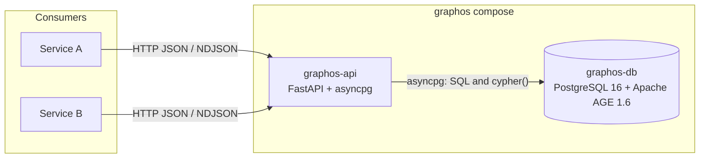
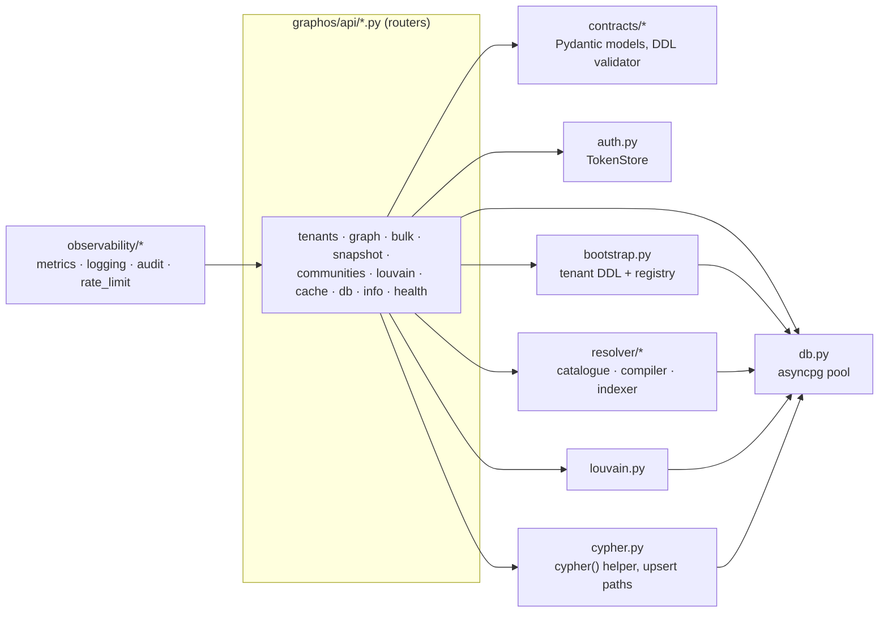
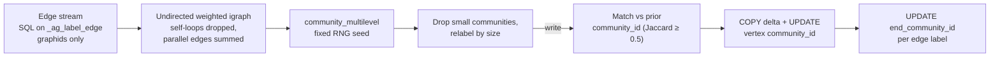

# graphos — Concept

**Audience:** engineers building on or operating graphos.

This is the architecture and reference document. For a short capability
overview see [features.md](features.md); for worked request examples see
[usage.md](usage.md); for AGE-specific lessons see [apache-age.md](apache-age.md).

---

## 1. Summary

**graphos** is a generic, multi-tenant property-graph service: PostgreSQL 16
with Apache AGE 1.6 as the data plane, and a FastAPI process (`graphos-api`)
in front of it as the only way in. Consumers speak typed HTTP/JSON (NDJSON for
bulk writes). They never receive a Postgres DSN and cannot submit Cypher or SQL.

Design points:

1. **Postgres operational model.** MVCC, WAL, `pg_dump` / `pg_basebackup`,
   autovacuum, `pg_stat_statements`: standard tooling applies.
2. **Tenant = AGE graph.** Each tenant is one AGE graph (one Postgres schema).
   Labels are declared by the tenant at registration; graphos ships none.
3. **Schema-agnostic surface.** Every label, property, and edge-type name is a
   request parameter. graphos owns storage and generic graph operations;
   consumers own the meaning of their schema.
4. **Typed endpoints, server-side guards.** Identifiers are regex-validated and
   (where they become SQL identifiers) checked against the tenant's registered
   labels; every statement runs under a server-side `statement_timeout`.

---

## 2. Architecture

### 2.1 Stack



AGE stores each label as a Postgres table in the tenant's schema:
vertex labels inherit from `"<tenant>"._ag_label_vertex` and edge labels from
`"<tenant>"._ag_label_edge`; each row has a `graphid` `id`, an agtype
`properties` bag, and (edges) `start_id` / `end_id`. graphos addresses nodes by
an external id stored in `properties.id`; edges are addressed by
`(src id, dst id, type)`.

Extensions installed in `graphos-db`: `age`, `pg_trgm`, `pg_stat_statements`.

Why an HTTP service rather than a shared database:

- No database credentials, AGE driver knowledge, or Cypher in consumers.
- Auth, rate limiting, audit logging, and tenant routing live in one process.
- Any HTTP-capable language can integrate (OpenAPI at `/openapi.json`).
- The compose network layout keeps `graphos-db` unreachable from consumers
  (§2.4).
- Tenant registration (and its DDL) runs inside graphos; consumers carry no
  schema-init logic.

### 2.2 Schema setup — two layers

#### Layer 1 — database init (tenant-agnostic, once per volume)

`services/graphos/deploy/db-init/` is mounted into
`/docker-entrypoint-initdb.d/`; its scripts run as the superuser created by
the Postgres image (`POSTGRES_USER=graphos`, password in `graphos_pw.txt`)
and only when the data volume is empty.
[`00-extensions.sql`](../services/graphos/deploy/db-init/00-extensions.sql):

- creates the `age`, `pg_trgm`, and `pg_stat_statements` extensions;
- sets `search_path = ag_catalog, "$user", public` for the `graphos` role and
  grants it `USAGE` on `ag_catalog`;
- creates the `graphos_meta` schema and the `graphos_meta.tenants` table.

[`01-app-role.sh`](../services/graphos/deploy/db-init/01-app-role.sh) then
creates `graphos_app`, the role `graphos-api` connects as (password in
`graphos_app_pw.txt`). It is `NOSUPERUSER NOCREATEDB NOCREATEROLE` and gets
only what the service needs: `CONNECT` and `CREATE` on the database (AGE puts
each tenant graph in its own schema), `USAGE` on `ag_catalog` plus DML on its
tables and sequences, ownership of `graphos_meta` and `graphos_meta.tenants`,
and membership in `pg_read_all_stats` (for `/v1/db/*`). The superuser is used
by the init scripts only. A volume initialised before `01-app-role.sh`
existed has no `graphos_app`: run the SQL from that script by hand as the
superuser, or start from a fresh volume.

On every start `graphos-api` also runs idempotent DDL for
`graphos_meta.tenants` and `graphos_meta.cache`
(`db.py::ensure_internal_schema`), so an existing volume picks up new internal
tables without re-initialisation.

#### Layer 2 — tenant registration (per tenant, idempotent)

`POST /v1/tenants` (admin scope) carries the tenant spec:

```json
{
  "name": "acme",
  "vertex_labels": ["User", "Document", "Tag"],
  "edge_labels": ["AUTHORED", "FOLLOWS",
                  {"name": "TAGGED", "resolve_rule": { ... }}],
  "indexes": [],
  "generated_columns": [],
  "label_hierarchy": {},
  "meta": {}
}
```

- `name`: `^[A-Za-z][A-Za-z0-9_]{0,62}$`. Labels: `^[A-Z][A-Za-z0-9_]{0,62}$`.
- `edge_labels` entries are strings or `{name, resolve_rule}` objects
  (resolve rules: [features.md §7](features.md#7-schema-driven-edge-derivation)).
- `label_hierarchy` maps `child → parent` vertex labels; graphos runs
  `ALTER TABLE child INHERIT parent`, so rows written under the child are
  visible when querying the parent table. Both must be in `vertex_labels`
  and a label cannot be its own parent; otherwise registration returns 422.
- `indexes` / `generated_columns` are raw DDL statements validated by
  `contracts/ddl.py`. Each must be exactly one
  `CREATE [UNIQUE] INDEX IF NOT EXISTS <name> ON <tenant>.<table> ...` or
  `ALTER TABLE <tenant>.<table> ADD COLUMN [IF NOT EXISTS] <col> <type> GENERATED ALWAYS AS (...) STORED`,
  where `<tenant>` is the tenant being registered and `<table>` is one of its
  own labels (or `_ag_label_vertex` / `_ag_label_edge`). `;` (other than one
  trailing), SQL comments, and `$` (dollar quoting) are rejected anywhere.
  Expressions inside parentheses are not inspected; Postgres enforces their
  immutability.

`bootstrap.py::bootstrap_tenant` then applies the spec under a per-tenant
`pg_advisory_lock`, so concurrent registrations of the same tenant serialise:

1. `create_graph` (duplicate swallowed).
2. `create_vlabel` per vertex label plus the per-label indexes in §2.3.
3. `end_community_id text` column on `_ag_label_edge`; `create_elabel` per
   edge label plus the per-label edge indexes and column in §2.3.
4. `label_hierarchy` inheritance links (checked in `pg_inherits` first).
5. The consumer's `indexes`, then `generated_columns` (duplicate-column errors
   swallowed).

After bootstrap the spec is persisted to `graphos_meta.tenants` and cached in
process. Persistence **merges** by default: label lists, indexes, generated
columns, hierarchy, and resolve rules are unioned with the stored spec, and
`meta` keys are overwritten per key. `?force_shrink=true` replaces the stored
spec instead (labels removed from the spec are not dropped from AGE). In both
modes the process then reloads the stored spec (`bootstrap.py::load_spec`)
and serves that, so a partial re-registration never hides labels or rules
registered earlier; the response's `vertex_labels` / `edge_labels` are the
merged sets.
Registration then refreshes the resolver catalogue and creates resolver
indexes (best-effort; failures are logged, not returned).

On startup graphos reloads every stored spec and re-runs `bootstrap_tenant`
for each, so consumers need not re-register after a restart. A tenant whose
bootstrap fails at startup is logged and skipped; the service still starts. Bootstrap, the
internal schema setup, and this reload run with a 1800 s statement timeout
(`db.py::DDL_TIMEOUT_S`), so index builds on large labels are not cut off at
the request default (§2.5.5).

### 2.3 Indexes created at registration

Created automatically for every vertex label `<L>` (all `IF NOT EXISTS`):

```sql
CREATE INDEX "<L>_properties_gin" ON "<tenant>"."<L>" USING gin (properties);
CREATE UNIQUE INDEX "<L>_id_unique" ON "<tenant>"."<L>" ((properties->'"id"'));
CREATE INDEX "<L>_community_id" ON "<tenant>"."<L>"
  ((((properties::text)::jsonb) ->> 'community_id'));
CREATE INDEX "<L>_name_trgm" ON "<tenant>"."<L>" USING gin
  ((((properties::text)::jsonb) ->> 'name') gin_trgm_ops);
```

For every edge label `<E>`:

```sql
CREATE UNIQUE INDEX "<E>_endpoints_unique" ON "<tenant>"."<E>" (start_id, end_id);
CREATE INDEX "<E>_endpoints_btree" ON "<tenant>"."<E>" USING btree (start_id, end_id);
CREATE INDEX "<E>_end_id" ON "<tenant>"."<E>" USING btree (end_id);
ALTER TABLE "<tenant>"."<E>" ADD COLUMN IF NOT EXISTS end_community_id text;
CREATE INDEX "<E>_end_comm_id" ON "<tenant>"."<E>" USING btree (end_community_id)
  WHERE end_community_id IS NOT NULL;
```

Consequences:

- `<L>_id_unique` makes the external id unique **per label** (the same id may
  exist under two labels). It serves point lookups, the edge upsert's
  endpoint JOIN, and the `ON CONFLICT` arbiter of every node write (§4).
- `<E>_endpoints_unique` allows **at most one edge of a given type between an
  ordered pair of nodes**; repeated writes merge properties. It is the
  `ON CONFLICT` arbiter for every edge write (§4). Because stored tenants are
  re-bootstrapped at startup (§2.2), a tenant created before these unique
  indexes existed gets them on the next restart.
- `end_community_id` is filled by Louvain (§5) and read by community-scoped
  `/expand`. Edges written after the last recompute have `NULL` there and are
  invisible to scoped traversals until the next recompute.
- Per-property indexes beyond these are the consumer's choice via `indexes`.
  `/nodes:scan` filters use the expression
  `(((properties::text)::jsonb) ->> '<prop>')`, so a declared index must use
  that exact expression to be usable, e.g.
  `CREATE INDEX IF NOT EXISTS "Document_category" ON acme."Document" ((((properties::text)::jsonb) ->> 'category'))`.
- Resolve rules derive further indexes automatically
  ([features.md §7](features.md#7-schema-driven-edge-derivation)).

Index effect measured during development: the `community_id` index took a
lookup on a ~117k-row label from 2.4 s to 0.5 ms, and the trigram index took
`/search` on the same label from 1.2 s to 1.3 ms.

### 2.4 Deployment (compose)

The reference deployment is
[`docker-compose.graphos.yml`](../docker-compose.graphos.yml) at the project
root. Read that file for exact values; its shape:

| | `graphos-db` | `graphos-api` |
|---|---|---|
| Image | `apache/age:release_PG16_1.6.0` | built from `services/graphos/Dockerfile`, tagged `graphos-api:${GRAPHOS_API_TAG:-dev}` |
| Networks | `graphos-internal` only | `graphos-internal` + `graphos-net` |
| Ports | `expose: 5432` (no host port) | `127.0.0.1:8080:8080` |
| Secrets | `services/graphos/deploy/secrets/` bind-mounted (directory) at `/run/graphos/secrets` | same directory |
| Healthcheck | `pg_isready -U graphos -d graphos` | Python `urllib` GET of `/healthz` |
| Memory | `mem_limit: 2g`, `mem_reservation: 512m`, `shm_size: 1g` | `mem_limit: 2g` (headroom for Louvain) |
| DB role | superuser `graphos` (init scripts only) | `graphos_app` (§2.2) |

`graphos-db` runs with `shared_preload_libraries=age,pg_stat_statements`,
`pg_stat_statements.track=all`, `log_min_duration_statement=500ms`,
`--data-checksums`, and sizing flags (`shared_buffers=1GB`,
`effective_cache_size=2GB`, `work_mem`, …) set in the compose `command:`.
These defaults fit a laptop; §7 lists what to raise for larger graphs. Data
lives in the `graphos_data` volume.

`graphos-api` is configured through `GRAPHOS_*` environment variables
(`config.py`): `GRAPHOS_DB_HOST/PORT/NAME`, `GRAPHOS_DB_USER=graphos_app`,
`GRAPHOS_DB_PASSWORD_FILE=/run/graphos/secrets/graphos_app_pw.txt`,
`GRAPHOS_BIND_HOST/PORT`, `GRAPHOS_LOG_LEVEL`, and `GRAPHOS_AUTH_TOKENS_FILE`.
`GRAPHOS_FORWARDED_ALLOW_IPS` (default `127.0.0.1`) lists the addresses whose
`X-Forwarded-*` headers are trusted; set it to the reverse proxy's address.
The image installs extras from the
`GRAPHOS_EXTRAS` build arg: empty in the Dockerfile, `louvain` by default in
the compose file (§5).

Networks:

- `graphos-internal` is `internal: true` and carries only db ↔ api traffic.
- `graphos-net` is a bridge network consumers attach to; on it they can reach
  `graphos-api:8080` but not `graphos-db`.

Consumer side:

```yaml
networks:
  graphos-net:
    external: true
    name: graphos-net

services:
  my-service:
    networks: [default, graphos-net]
    # call http://graphos-api:8080 with a bearer token
```

Bring-up:

```bash
scripts/init-secrets.sh        # creates graphos_pw.txt, graphos_app_pw.txt, graphos_tokens.json, admin_token.txt (never overwrites)
docker compose -f docker-compose.graphos.yml up -d
curl -s http://127.0.0.1:8080/readyz
```

### 2.5 REST surface

Routers are mounted under `/v1` except health (`/healthz`, `/readyz`) and
`/metrics`. FastAPI serves `/openapi.json` and `/docs`.

#### 2.5.1 Endpoint catalogue

Paths under `/v1/{tenant}/graph/...` are abbreviated to `…/graph/...`.
"Tenant" scope means the token lists the tenant or is admin.

| Method · Path | Purpose | Scope |
|---|---|---|
| **Health & introspection** | | |
| `GET /healthz` | Liveness; does not touch the DB | none |
| `GET /readyz` | Pool exists and `SELECT 1` succeeds, else 503; reports `registered_tenants` as a count | none |
| `GET /v1/info` | Service, Postgres and AGE versions, `tenants` (a count), `features.louvain` | none |
| `GET /metrics` | Prometheus exposition (§2.5.6) | none |
| **Tenant control** | | |
| `POST /v1/tenants[?force_shrink=true]` | Register / re-apply a spec (§2.2) | admin |
| `GET /v1/tenants` | List registered tenants | admin |
| `GET /v1/tenants/{name}` | One tenant's spec summary | admin |
| `DELETE /v1/tenants/{name}` | Unregister (see below) | admin |
| **Reads** | | |
| `GET …/graph/search?q=&label=&limit=` | Case-insensitive literal substring (`ILIKE`, with `%` / `_` in `q` escaped) on `name`, served by the trigram index; limit ≤200. Hit `id` = AGE graphid (integer); external id in `properties.id` | tenant |
| `GET …/graph/nodes/{external_id}` | One node by external id | tenant |
| `GET …/graph/neighbors?node_id=&rel_types=&limit=` | 1-hop out + in edges; limit default 50, ≤500 | tenant |
| `GET …/graph/expand?node_id=&seeds=&rel_types=&max_hops=&direction=&communities=&limit=` | BFS; `max_hops` default 2, ≤5; limit default 100, ≤1000 | tenant |
| `POST …/graph/induced_edges` `{node_ids, rel_types?, limit}` | Edges with both ends in the set; ≤1000 ids, limit ≤5000 | tenant |
| `POST …/graph/scoped_subgraph` | Nodes sharing one property value plus their induced edges; nodes are `{id (external id), label, properties}` | tenant |
| `POST …/graph/sample_subgraph` | First `per_rel` edges of each type plus endpoint properties; `filter_property` works with or without `include_properties` | tenant |
| `POST …/graph/nodes:scan` | Paginated node enumeration with filters/projection | tenant |
| `POST …/graph/edges:scan` | Paginated edge enumeration with filters/projection | tenant |
| `GET …/graph/export?node_ids=&rel_types=&limit_nodes=` | graphology JSON (§6); `limit_nodes` default 5000, ≤50000 | tenant |
| `GET …/graph/catalogue?refresh=` | Resolver property → labels map | tenant |
| **Aggregates & communities** | | |
| `POST …/graph/nodes/aggregate` `{label, group_by, values?, limit}` | Group one label by a property | tenant |
| `POST …/graph/edges/aggregate` | Group edges by endpoint properties and type | tenant |
| `GET …/graph/labels/{label}/histogram?property=&limit=` | Property-value histogram; limit default 100, ≤1000 | tenant |
| `GET …/graph/labels/{label}/top?by_edge=&direction=&k=` | Top-k nodes by degree on one edge type; k default 20, ≤200 | tenant |
| `GET …/graph/stats` | Exact per-label row counts and bytes | tenant |
| `GET …/graph/communities?min_size=&include_members=&limit=` | Communities from the last Louvain write | tenant |
| `GET …/graph/community-summary?top=` | Counts, largest/smallest size, top-N communities | tenant |
| `POST …/graph/community-ids` `{ids}` | External id → `community_id`; ≤500 ids, `truncated` flag | tenant |
| **Cache** | | |
| `PUT / GET / DELETE …/graph/cache/{key}` | Per-tenant K/V cache (§2.5.9) | tenant |
| **Writes** | | |
| `POST …/graph/nodes` `{nodes}` | Upsert ≤1000 nodes | tenant |
| `POST …/graph/edges` `{edges}` | Upsert ≤1000 edges | tenant |
| `POST …/graph/nodes/{external_id}/properties` `{properties}` | Merge properties onto an existing node | tenant |
| `POST …/graph/nodes:bulk` (NDJSON) | Streamed node upsert (§4) | tenant |
| `POST …/graph/edges:bulk` (NDJSON) | Streamed edge upsert (§4) | tenant |
| `POST …/graph/snapshot-import` (NDJSON) | Mixed node + edge import (§4) | tenant |
| `POST …/graph/edges:resolve` `{edge_types?}` | Run registered resolve rules | tenant |
| `DELETE …/graph/nodes/{node_id}` | `DETACH DELETE` one node | tenant |
| `DELETE …/graph/nodes?property_key=&property_value=` | `DETACH DELETE` every node with that property value | tenant |
| **Community detection** | | |
| `POST /v1/{tenant}/recompute-communities` | Louvain (§5); 501 without the extra | admin |
| **Operational** | | |
| `GET /v1/db/stats` | Version, DB size, top 200 tables by size with tuple counts and vacuum/analyze times | admin |
| `GET /v1/db/slow-queries?limit=` | Top-N by mean time from `pg_stat_statements` (default 25, ≤200); `available: false` without the extension | admin |
| `POST /v1/db/vacuum` `{tables?, full=false, analyze=true}` | `VACUUM` named tables (identifier-validated) or the whole database | admin |

`DELETE /v1/tenants/{name}` deletes the row in `graphos_meta.tenants` and the
in-process registry entry, then returns `{"tenant": name, "status":
"unregistered"}` (404 if it was not registered). It does **not** drop the AGE
graph, its tables, indexes, or data, and does not delete the tenant's
`graphos_meta.cache` rows. Data-plane calls for the tenant then return 404;
re-posting the spec restores access to the existing data.

Not in the surface: raw Cypher or SQL execution, connection-string
passthrough, and any `DROP`. The only consumer-supplied DDL accepted is the
validated `indexes` / `generated_columns` forms at registration.

#### 2.5.2 Requests, responses, errors

Request and response bodies are Pydantic models in
`services/graphos/src/graphos/contracts/` (some cache and Louvain models live
next to their routers) and appear in `/openapi.json`. Most responses include
`tenant` and `elapsed_ms`; list-returning reads include `truncated`.

Error shapes:

| Status | When | Body |
|---|---|---|
| 400 | Unknown label, compile/Cypher error, bad cursor, missing resolve rule, broken `:bulk` stream | `{"detail": "..."}`; a `:bulk` or `snapshot-import` stream error names only the exception type and points to the server log |
| 401 | Missing/invalid bearer token | `{"detail": "..."}` |
| 403 | Token lacks the tenant, or admin scope required | `{"detail": "..."}` |
| 404 | Tenant not registered, node or cache key not found | `{"detail": "..."}` |
| 409 | Louvain already running for the tenant | `{"detail": "..."}` |
| 413 | `snapshot-import` over 50,000,000 lines | `{"detail": "..."}` |
| 422 | Request validation; bad `label_hierarchy` at registration | `{"detail": [...]}` (FastAPI) or `{"detail": "..."}` |
| 429 | Rate limit (when enabled) | `{"detail": ..., "retry_after_s": ...}` + `Retry-After` |
| 501 | Louvain extra not installed | `{"detail": "..."}` |
| 504 | Statement timeout, on reads and writes (`/nodes`, `/edges`, `:bulk`, `snapshot-import`) | `application/problem+json`, below |

```json
{
  "type": "about:blank",
  "title": "Query timed out",
  "status": 504,
  "detail": "The database statement exceeded the server's statement timeout (60s). Narrow the request (lower limit, fewer hops, a label or property filter) and retry."
}
```

#### 2.5.3 Auth and tenant model

- **Fail-closed startup.** Without `GRAPHOS_AUTH_TOKENS_FILE`, `graphos-api`
  refuses to start unless `GRAPHOS_AUTH_DISABLED=true`. With auth disabled,
  every request is an anonymous admin; this is for local development only.
  If the variable is set but the file is missing, unreadable or not a JSON
  object, graphos also refuses to start.
- **Tokens file:**
  `{"<token>": {"consumer": "<name>", "tenants": ["acme"], "admin": false}}`.
  A token's scope is its tenant list plus the `admin` flag; nothing finer.
  A malformed entry is skipped with an error log and the rest still load.
  The file is reloaded on `SIGHUP` (Unix); a reload that finds the file
  unusable logs the error and keeps the tokens already loaded.
- **Tenant access.** The tenant is in the URL path. A non-admin token gets
  403 for a tenant it does not list; admin tokens may access every tenant.
  Unregistered tenants return 404 (after the scope check).
- **Admin-only routes:** `/v1/tenants*`, `/recompute-communities`, `/v1/db/*`.
  There is no `/admin` prefix.
- `/healthz`, `/readyz`, `/v1/info`, `/metrics`, `/docs`, and `/openapi.json`
  are unauthenticated; restrict them at a reverse proxy if needed. They report
  tenant counts, never tenant names; admins list tenants with
  `GET /v1/tenants`.

#### 2.5.4 Python client

[`clients/python`](../clients/python) provides `GraphosClient`, an async
wrapper over `httpx.AsyncClient` bound to one tenant
(`GraphosClient(base_url=..., tenant=..., token=...)`), with typed methods for
most endpoints. Behaviour (`_client.py`):

- Connection pool of up to 20 connections, 10 s keep-alive expiry, default
  30 s timeout.
- Retries (default 3, exponential backoff from 0.5 s) on connection-level
  errors and on 5xx responses other than 504. `edges:resolve` and
  `recompute-communities` are never retried. Read/write timeouts are not
  retried.
- 4xx raises `GraphosError`; 503 raises `GraphosNotReady`.
- `bulk_upsert_nodes` / `bulk_upsert_edges` serialise the whole iterable into
  one NDJSON request body; there is no client-side batching or streaming.
- `scan_nodes_iter` / `scan_edges_iter` follow `next_cursor` automatically.
- No methods for `snapshot-import` or `catalogue`.

#### 2.5.5 Timeouts

Every pooled connection is opened with the server-side
`statement_timeout = GRAPHOS_STATEMENT_TIMEOUT_S` (default 60 s). That
Postgres setting is the only per-statement limit: the pool is created with
`command_timeout=None`, because a client-side timeout cannot be raised per
connection and would cut long operations short. A cancelled statement
(`QueryCanceledError`) becomes 504 `application/problem+json` (§2.5.2). Write
paths let it through too: `cypher.py` re-raises it, and the `:bulk` and
`snapshot-import` handlers do not turn it into a 400.

Deliberately long operations raise the timeout for their own connection
(`db.py::allow_long_statements`; the pool's `RESET ALL` on release restores
the default):

| Operation | Limit |
|---|---|
| Tenant bootstrap, internal schema setup, startup reload of stored tenants | 1800 s (`DDL_TIMEOUT_S`) |
| Louvain edge stream / vertex writeback | 600 s each |
| Louvain edge `end_community_id` update | 300 s per edge label |
| `edges:resolve` INSERT | 1800 s per edge type |
| `POST /v1/db/vacuum` | 3600 s |

#### 2.5.6 Observability

**Metrics** (`GET /metrics`, default registry):

| Metric | Labels |
|---|---|
| `graphos_requests_total` | `method`, `route` (path template), `status` |
| `graphos_request_duration_seconds` (histogram) | `method`, `route` |
| `graphos_db_pool_size` (refreshed on scrape) | `state` = `total` / `idle` / `active` |
| `graphos_registered_tenants` | — |
| `graphos_rate_limited_total` | `token_id` (first 12 hex characters of the token's SHA-256; never the token itself) |

Requests to `/metrics` itself are not counted.

**Logging.** structlog over stdlib logging; JSON to stdout by default
(`GRAPHOS_LOG_JSON=false` for console output). Each request binds `method`
and `route`, plus `trace_id` when a valid W3C `traceparent` header is present;
the header is echoed on the response. graphos does not create spans or export
traces.

**Audit log.** On by default (`GRAPHOS_AUDIT_ENABLED`), covering POST, PUT,
PATCH, and DELETE only (`GRAPHOS_AUDIT_ENDPOINTS_ONLY_WRITES`). Because the
filter is by method, POST-bodied reads (`nodes:scan`, aggregates,
`community-ids`, …) are audited too. Each record is a `write` line from the
`graphos.audit` logger, rendered with all its fields in the JSON log
(structlog's `ExtraAdder` in `observability/logging.py`): `method`, `path`,
`tenant` (parsed from the path), `consumer` (the token's consumer name;
`anonymous` without one), `args_hash` (first 16 hex characters of the
SHA-256 of the request body), `status`, and `elapsed_ms`. A request that
raises is recorded as 500 before the error propagates. To compute the hash the
middleware reads the full request body into memory.

**Rate limiting.** Off by default (`GRAPHOS_RATE_LIMIT_ENABLED`). When on, it
is an in-memory sliding window per bearer token (`GRAPHOS_RATE_LIMIT_RPS`,
default 100, over `GRAPHOS_RATE_LIMIT_WINDOW_S`, default 1 s). Buckets are
keyed by the first 12 hex characters of the token's SHA-256. Only tokens
present in the tokens file are limited: an unknown bearer string goes straight
to auth (401) and creates no bucket and no metric series. `/healthz`,
`/readyz`, and `/metrics` are exempt; requests without a bearer token pass
through to auth.

#### 2.5.7 Failure model and process state

`graphos-db` holds all durable state. `graphos-api` also keeps process-local
state: the tenant registry (loaded at startup and updated by registrations on
that process), the cache LRU, rate-limit buckets, the resolver catalogue, and
the resolver-index memo. The service is built and deployed as a single
replica; with several replicas, a registration on one would not be visible
to the others until they restart.

- DB unreachable: `/readyz` returns 503 with only
  `{"status": "not_ready", "reason": "db_unreachable"}`; the error itself goes
  to the server log. There is no dedicated mapping for data endpoints; they
  fail with a 5xx.
- `graphos-api` down: consumers have no path to the data (by design, §2.4).

#### 2.5.8 Generic analytics — examples

Examples use tenant `acme` with labels `User`, `Document`, `Tag` and edge
types `AUTHORED` (User → Document) and `FOLLOWS` (User → User). They assume
the shell variables from [usage.md §1.1](usage.md#11-secrets-stack-token):

```bash
export G=http://localhost:8080
export TOKEN=$(cat services/graphos/deploy/secrets/admin_token.txt)
```

**Merge properties onto a node** (`POST …/nodes/{external_id}/properties`).
One `UPDATE` on `_ag_label_vertex` (inheritance covers every label); top-level
keys overwrite, other keys are kept.

```bash
curl -X POST "$G/v1/acme/graph/nodes/doc-42/properties" \
  -H "Authorization: Bearer $TOKEN" -H "Content-Type: application/json" \
  -d '{"properties": {"view_count": 1287, "updated_at_ms": 1767225600000}}'
# {"tenant": "acme", "external_id": "doc-42", "label": "Document",
#  "properties_merged": 2, "elapsed_ms": 4}
```

404 if no node has `properties.id == external_id`. If the id exists under
several labels, all matching rows are updated and one label is echoed.

**Histogram** (`GET …/labels/{label}/histogram`). One `GROUP BY` on the label
table.

```bash
curl "$G/v1/acme/graph/labels/Document/histogram?property=category&limit=10" \
  -H "Authorization: Bearer $TOKEN"
# {"tenant": "acme", "label": "Document", "property": "category",
#  "n_distinct": 3, "n_total": 512,
#  "bins": [{"value": "report", "count": 312}, {"value": "memo", "count": 150},
#           {"value": "", "count": 50}],
#  "elapsed_ms": 6}
```

Missing values are reported as `""`. `n_distinct` is exact only when fewer
than `limit` bins came back; otherwise it is `-1`.

**Top by degree** (`GET …/labels/{label}/top`). Counts edges of `by_edge`
where the node is source (`out`), destination (`in`), or either (`both`).
Both names must be registered.

```bash
curl "$G/v1/acme/graph/labels/User/top?by_edge=AUTHORED&direction=out&k=3" \
  -H "Authorization: Bearer $TOKEN"
# {"tenant": "acme", "label": "User", "by_edge": "AUTHORED", "direction": "out",
#  "rows": [{"node_id": "u-7", "edge_count": 41}, {"node_id": "u-2", "edge_count": 29},
#           {"node_id": "u-9", "edge_count": 17}],
#  "elapsed_ms": 9}
```

**Community lookup** (`POST …/community-ids`). Body `{"ids": [...]}`; at most
500 ids are looked up and `truncated` reports whether more were sent.

```bash
curl -X POST "$G/v1/acme/graph/community-ids" \
  -H "Authorization: Bearer $TOKEN" -H "Content-Type: application/json" \
  -d '{"ids": ["u-1", "u-2", "u-unknown"]}'
# {"tenant": "acme", "n_requested": 3, "n_resolved": 2,
#  "community_by_id": {"u-1": 4, "u-2": 4}, "truncated": false, "elapsed_ms": 3}
```

Ids are absent from the result when the node does not exist or has no
`community_id`.

**Edge aggregate** (`POST …/edges/aggregate`). Group edges by a source-node
property and a destination-node property:

```json
// request
{"group_by_src": "team", "group_by_dst": "team",
 "rel_types": ["FOLLOWS"], "require_different": true, "limit": 200}
// response
{"tenant": "acme", "group_by_src": "team", "group_by_dst": "team",
 "rel_types": ["FOLLOWS"], "truncated": false, "elapsed_ms": 38,
 "groups": [{"src_value": "sales", "dst_value": "support",
             "rel_type": "FOLLOWS", "count": 14}]}
```

One query per edge type, run serially. If one type's query fails with a
database error other than a timeout, it is logged and that type is omitted
from the result.

#### 2.5.9 K/V cache — example

A per-tenant key/value store for computed results that have no natural node
to live on.

- **In process:** an LRU of 256 entries (shared across tenants, keyed by
  `(tenant, key)`), with TTL checked on read.
- **In Postgres:** `graphos_meta.cache` (primary key `(tenant, key)`), durable
  across restarts.

```bash
curl -X PUT "$G/v1/acme/graph/cache/dashboard:home" \
  -H "Authorization: Bearer $TOKEN" -H "Content-Type: application/json" \
  -d '{"value": {"active_users": 1247, "documents": 18432}, "ttl_seconds": 600}'
# {"tenant": "acme", "key": "dashboard:home", "expires_at": "...",
#  "bytes_written": 42, "elapsed_ms": 5}

curl "$G/v1/acme/graph/cache/dashboard:home" -H "Authorization: Bearer $TOKEN"
# {"tenant": "acme", "key": "dashboard:home", "value": {...},
#  "expires_at": "...", "cached_at": "...", "source": "lru", "elapsed_ms": 0}

curl -X DELETE "$G/v1/acme/graph/cache/dashboard:home" -H "Authorization: Bearer $TOKEN"
# 204 No Content
```

- Keys: 1–256 characters. `ttl_seconds`: 1 s to 30 days, or omitted for no
  expiry.
- PUT writes the row, then the LRU. GET checks the LRU, then Postgres
  (ignoring expired rows) and backfills the LRU; `source` is `lru` or `pg`.
  Missing or expired → 404.
- DELETE removes the row and the LRU entry and always returns 204.
- Expired rows stay in the table until overwritten or deleted; there is no
  sweeper.
- Nothing else in graphos reads the cache.

---

## 3. Internal layout



The pool (`db.py`) tries `LOAD 'age'` once per physical connection
(best-effort: as the unprivileged `graphos_app` role the load is refused and
graphos relies on AGE being in `shared_preload_libraries`, which the compose
file sets) and sets
`search_path = ag_catalog, "$user", public` on every acquire (asyncpg's
`RESET ALL` on release clears it). Middleware order on a request:
request-context logging → rate limit → metrics → audit → router.

### 3.1 Cypher / SQL boundary

graphos issues Cypher through AGE's `cypher('<tenant>', $$ … $$, $1)` and
plain SQL against the AGE storage tables. Most read paths use direct SQL
because AGE's planner scans every inheritance child for those queries;
plain SQL lets graphos pick the tables and indexes directly.

| Operation | Language |
|---|---|
| Every node upsert (`/nodes`, `nodes:bulk`, `snapshot-import`) | SQL: binary `COPY` into a temp table, `INSERT … ON CONFLICT ((properties->'"id"')) DO UPDATE` |
| Every edge upsert (`/edges`, `edges:bulk`, `snapshot-import`) | SQL: binary `COPY` into a temp table, `INSERT … ON CONFLICT (start_id, end_id) DO UPDATE` |
| `nodes/aggregate`, `export`, node deletes (`DETACH DELETE`), `communities?include_members=true` member lists | Cypher |
| `search`, `nodes/{id}`, `nodes/{id}/properties`, `neighbors`, `expand`, `induced_edges`, `scoped_subgraph`, `sample_subgraph`, `nodes:scan`, `edges:scan`, `edges/aggregate` | SQL |
| `histogram`, `top`, `stats`, `communities`, `community-summary`, `community-ids`, `catalogue` | SQL |
| `edges:resolve` | SQL: one `INSERT … SELECT … ON CONFLICT (start_id, end_id) DO NOTHING` per edge type |
| Louvain edge stream and writeback | SQL (`COPY` + `UPDATE … FROM`) |
| Registration DDL, `/v1/db/*`, advisory locks | SQL |

`neighbors` and `expand` resolve the seed id(s) to graphids, then query
`"<tenant>"._ag_label_edge` (which routes to each edge-label table and its
`(start_id, end_id)` / `(end_id)` indexes), filtering edge types by
`pg_class.relname`. `expand` runs the BFS hop by hop in Python: one query per
direction per hop (out and in run concurrently for `direction=both`), at most
`max(limit × 4, 1000)` edge rows per direction per hop, first arrival wins,
seeds excluded from results. A non-timeout database error during a hop skips
that hop instead of failing the request. On a tenant with no edge labels both
return an empty result.

Operators can still use `psql` inside the compose for ad-hoc inspection:

```sql
SELECT * FROM cypher('acme', $$
  MATCH (u:User)-[:AUTHORED]->(d:Document)
  RETURN d.category, count(*) ORDER BY count(*) DESC LIMIT 10
$$) AS (category agtype, n agtype);
```

---

## 4. Write paths

All write paths are idempotent upserts: nodes keyed by `(label, id)`, edges by
`(src, dst, type)`. Properties merge at the top level (new keys overwrite,
absent keys are kept). Labels and edge types must be registered; edge
endpoints must already exist. Input rows with a missing endpoint are counted
in `edges_skipped`, so write nodes before edges. `nodes_upserted` /
`edges_upserted` are the distinct rows written (from the `INSERT` command
tag): duplicates of one id, or of one src/dst pair, within a batch collapse
into one row.

| Path | Body | Unit of work |
|---|---|---|
| `POST /nodes`, `/edges` | JSON, ≤1000 rows | One transaction per label (nodes) or per `(src_label, dst_label, type)` (edges). Unknown labels → 400 before any write. |
| `POST /nodes:bulk`, `/edges:bulk` | NDJSON, one row per line | Buffers per label / per edge key; flushes every 500 rows and at end of stream. **Each flush is its own transaction**; an error stops the request but earlier flushes stay committed. Invalid lines are skipped (`rows_invalid`, first 50 in `errors`). |
| `POST /snapshot-import` | NDJSON lines tagged `"_kind": "node"` or `"edge"` (default node) | Buffers per label / edge key. When any node buffer reaches 5,000 rows all node buffers are flushed. Before every edge flush (an edge buffer reaching 5,000 rows, or end of stream) all buffered nodes are flushed first, so an edge never misses an endpoint sent earlier in the stream. Nodes and edges use the same COPY-staged SQL upsert as the other paths (below); one transaction per label / edge key per flush, so the import is not atomic. >50,000,000 lines → 413. |

**graphos writes no rows through Cypher.** Every write endpoint uses the same
COPY-staged SQL upsert (`cypher.py::upsert_nodes_inline` delegates to
`bulk_upsert_nodes_via_copy`, and `upsert_edges_inline` to
`bulk_upsert_edges_via_copy`); there is no flag to select another path. Two
reasons:

- **Throughput.** In a development benchmark the COPY-staged upsert wrote
  1,153–4,840 edges/s against 31 edges/s for per-row Cypher `MERGE`
  ([apache-age.md](apache-age.md)).
- **Stability.** When an AGE label table has any column beyond AGE's own
  (bootstrap's `end_community_id` on edge tables, §2.3, or any registration
  `generated_columns` on a vertex or edge label), AGE 1.6 segfaults the
  Postgres backend on a Cypher `SET` / `MERGE … SET` that writes a row into
  that table, which restarts the server and drops every connection. Plain SQL
  never enters AGE's tuple-building code, so generated columns on vertex
  labels are safe and are filled correctly by these writes.

The SQL path keeps the upsert contract: properties merge additively, and edge
rows with a missing endpoint are counted as skipped. Per flush:

1. `CREATE TEMP TABLE … ON COMMIT DROP` and binary `COPY` of the batch;
2. de-duplicate within the batch (last row wins);
3. one `INSERT … SELECT` per label or edge group with
   `ON CONFLICT ((properties->'"id"'))` (nodes) or, after joining endpoint
   ids, `ON CONFLICT (start_id, end_id)` (edges), both
   `DO UPDATE SET properties = properties || EXCLUDED.properties`.

It relies on the unique indexes from §2.3 and runs with
`synchronous_commit = off` for that transaction. Cypher is still used for some
reads and for node deletes (`DETACH DELETE`), which are not affected by the
crash above.

With audit enabled (the default), the audit middleware reads each write
request's full body into memory before the handler parses it (§2.5.6).

---

## 5. Community detection (Louvain)

> **Optional extra.** Louvain needs python-igraph (GPL-2.0-or-later),
> installed with `pip install "graphos[louvain]"` or an image built with
> `--build-arg GRAPHOS_EXTRAS=louvain`. Without it, `recompute-communities`
> answers 501 and `GET /v1/info` reports `features.louvain: false`.

`POST /v1/{tenant}/recompute-communities` (admin) runs synchronously and
in-process. It is single-flight per tenant via
`pg_try_advisory_lock(hashtext(tenant))`; a concurrent call gets 409.

Request:

| Field | Default | Meaning |
|---|---|---|
| `rel_types` | all | Edge types to include |
| `rel_weights` | 1.0 each | Weight per edge type |
| `node_filter` | none | `{property: value or [values]}`; both endpoints must match |
| `resolution` | 1.0 | Louvain resolution, (0, 10] |
| `min_community_size` | 3 | Smaller communities are dropped (members unassigned) |
| `dry_run` | false | Compute and report; write nothing |



Steps (`louvain.py`):

1. **Edge stream.** One SQL query returns `(start_id, end_id, type)` as bigint
   graphids for all matching edges, filtered by `rel_types` and (with a vertex
   join) `node_filter`. The full result is held in `graphos-api` memory.
2. **Graph build.** `Graph.TupleList` over graphids; weights from
   `rel_weights`; `simplify(combine_edges={"weight": "sum"})`.
3. **Louvain.** `community_multilevel` with igraph's RNG seeded from a fixed
   constant, so identical input gives an identical partition.
4. **Filter and relabel.** Communities below `min_community_size` are dropped;
   the rest are numbered by descending size. `dry_run` stops here.
5. **Stable ids.** Prior `community_id` values are streamed through a
   server-side cursor (`prefetch=20000`) into `array.array` columns. Each new
   community inherits the id of the prior community with the highest Jaccard
   overlap if it is ≥ 0.5 and not already claimed (larger communities choose
   first); otherwise it gets a fresh id. This is the standard
   Jaccard-overlap method for tracking communities across snapshots.
6. **Vertex writeback.** Only vertices whose id changed are written: `COPY`
   into a temp table, then one `UPDATE … FROM` on `_ag_label_vertex` merging
   `{"community_id": <int>}` into `properties`. Skipped when nothing changed.
7. **Edge denormalisation.** All assignments are copied into a temp table and
   each edge-label table gets `end_community_id = <end vertex's id>` where it
   differs. Each label's update commits separately.

Vertices that receive no assignment (in a dropped community, or with no edges
in the stream) keep whatever `community_id` they had before.

Response:

```json
{
  "tenant": "acme", "n_nodes": 48210, "n_edges_scanned": 391004,
  "n_communities": 212, "n_assigned": 47120, "n_singletons": 640,
  "largest_community_size": 3921, "modularity": 0.71,
  "edge_stream_ms": 2100, "igraph_ms": 1800, "writeback_ms": 4300,
  "elapsed_ms": 8240, "dry_run": false
}
```

(Values illustrative.) `n_singletons` counts raw communities smaller than
`min_community_size`. Modularity is reported only here; the read endpoints
(`communities`, `community-summary`) report sizes and counts.

---

## 6. Export and visualisation

`GET …/graph/export` returns one format: graphology's native serialization.
It is consumable by `Graph.from()` in graphology / sigma.js.

- Nodes: up to `limit_nodes` nodes (default 5000, max 50000), or only
  `node_ids` if given.
- Edges: every edge among those nodes, optionally filtered by `rel_types`.
- Both steps run as Cypher.

```json
{
  "attributes": {},
  "options": {"type": "directed", "multi": false, "allowSelfLoops": true},
  "nodes": [{"key": "u-1",
             "attributes": {"id": "u-1", "name": "Ada", "label": "Ada", "_kind": "User"}}],
  "edges": [{"key": "e_1125899906842625", "source": "u-1", "target": "doc-42",
             "undirected": false,
             "attributes": {"label": "AUTHORED", "_type": "AUTHORED"}}]
}
```

Node attributes are the node's properties plus `label` (the `name` property,
else the id) and `_kind` (the vertex label). Edge attributes are the edge's
properties plus `label` and `_type` (the edge type).

graphos does not produce GraphML, GEXF, Mermaid, or Cytoscape formats.
Converting graphology JSON to another tool's format is the caller's job.
`sample_subgraph` and `scoped_subgraph` return their own JSON shapes; note that
`sample_subgraph` identifies nodes by AGE graphid, not external id.

---

## 7. Sizing

The compose file is sized to start on a laptop: `graphos-db` with a 2 GiB
memory limit (512 MiB reservation), `shared_buffers=1GB`,
`effective_cache_size=2GB`, `work_mem=64MB`, `max_connections=50`, 1 GiB
`/dev/shm`; `graphos-api` with a 2 GiB limit and an asyncpg pool of 2–16
connections (`GRAPHOS_DB_POOL_MIN_SIZE` / `GRAPHOS_DB_POOL_MAX_SIZE`). For
graphs with millions of edges, raise `shared_buffers` (4GB),
`effective_cache_size` (6GB) and the `graphos-db` limit (6g) together
([apache-age.md §7](apache-age.md#7-tuning-postgres-for-graphos)).

What drives memory:

- **Postgres:** working set of label tables and indexes (`GET …/graph/stats`
  and `GET /v1/db/stats` report sizes); per-query `work_mem` for aggregates.
  The 1 GiB `/dev/shm` is there because large `GROUP BY` / hash-aggregate
  queries allocate shared-memory segments that can exceed the 64 MiB Docker
  default.
- **graphos-api:** Louvain holds the full edge list as Python tuples plus the
  igraph graph; this is what the `graphos-api` limit is for. 2 GiB covers
  roughly 3 M edges; raise it to 4g for 6 M+. Other endpoints are
  bounded by their `limit` caps and the 10 MiB `nodes:scan` / `edges:scan`
  payload cap.

graphos ships no partitioning or sharding; a tenant lives in one schema on one
Postgres instance.

---

## 8. Known limitations

1. **Single replica.** Tenant registry, cache LRU, rate limiter, and resolver
   caches are per process (§2.5.7).
2. **Bulk writes are not atomic per request.** Each 500-row (bulk) or
   5,000-row (snapshot) flush commits independently.
3. **One edge per type per ordered node pair** (§2.3).
4. **`edges:resolve` only inserts.** Edges whose rule no longer matches are not
   removed; delete them explicitly.
5. **Community freshness.** `end_community_id` and `community_id` change only
   when Louvain writes; new edges are invisible to community-scoped `expand`
   until then, and unassigned vertices keep old ids.
6. **`DELETE /v1/tenants/{name}` keeps data** (§2.5.1).
7. **Generated columns on tables that already hold rows** rewrite the table;
   add them early.
8. **AGE version.** The compose pins `apache/age:release_PG16_1.6.0`; several
   code paths work around AGE 1.6 behaviour (e.g. a Cypher `SET` on a label
   table carrying extra columns such as `end_community_id` or a generated
   column crashes the backend, so all rows are written through SQL, §4).
   Re-test on upgrade.
9. **Backups** are operator-owned: `pg_dump` / `pg_basebackup` or a snapshot of
   the `graphos_data` volume.
