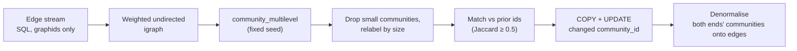

# graphos — Feature Survey

**Audience:** engineers evaluating graphos as a graph backend.
**Scope:** capabilities at a glance. Endpoint shapes, limits, and internals are
in [concept.md](concept.md); request/response models are in
`services/graphos/src/graphos/contracts/`.

---

## 1. What graphos is

graphos is a generic, multi-tenant property-graph service: PostgreSQL 18 with
Apache AGE 1.8 (or 16 with 1.6) behind a typed FastAPI REST surface. Storage is ordinary
Postgres (MVCC, WAL, standard backup tooling). Requests are JSON, with NDJSON
for bulk writes. Internally graphos runs plain SQL against AGE's per-label
tables, never Cypher ([concept §3.1](concept.md#31-cypher--sql-boundary)).

graphos ships no labels, property keys, or relationship types. Every analytics
endpoint takes label, property, and edge names as request parameters.
Consumers never see a Postgres DSN and cannot submit Cypher or SQL. In the
bundled compose the API itself connects as `graphos_app`, an unprivileged
role (no superuser, no role or database creation); the superuser is used only
by the database init scripts.

---

## 2. Tenant model

A tenant is one AGE graph plus the spec that describes it. There are no
built-in tenants. An admin, or a user with `create_tenants` on a matching name
pattern (who then owns it), registers each one with `POST /v1/tenants`:
`vertex_labels`, `edge_labels` (optionally with a `resolve_rule`, §7),
`property_indexes`, `generated_columns`, `label_hierarchy` (child → parent
label inheritance), free-form `meta`, `display` (how the web UI draws
each label and relationship type) and `property_schema` (the properties each
carries).

- **Label styles.** `display` declares, per vertex label, a colour, an icon
  (from a fixed list), a caption property and a size property, and per edge
  type a colour and a caption. Merged by entry (`null` removes one), checked
  against the tenant's labels, carried in the schema file and the change
  feed, served by `GET /v1/{tenant}/schema` to every reader; the dry run warns
  about a colour hard to see on either canvas. Cosmetic: no effect on data.
- **Property schema.** `property_schema` declares, per vertex label and edge
  type (or `*` for all), each property's type, whether it is required or
  recommended, and its allowed values (enum, pattern, date formats, numeric
  bounds, array items), combined down the label hierarchy. `off` only records
  it, `warn` writes and counts, `strict` refuses: a batch with 422, a bulk or
  snapshot line as invalid, a patch checked on the row it leaves. A report
  (`properties:check`) reads the stored rows as if every rule applied, so a
  schema can be tried before it is turned on.

- **Idempotent.** Re-posting is safe. By default the stored spec is merged
  (labels and declarations unioned); `?force_shrink=true` replaces it. graphos
  serves, and the response reports, the merged spec, so a partial
  re-registration never hides earlier labels. A bad `label_hierarchy` → 422.
- **Schema as a file.** `GET /v1/tenants/{name}/spec` exports the whole schema
  (rules, pairs, indexes, columns and `meta` included) as a registration body;
  posting it imports it, into the same tenant or, renamed, another one.
  `?dry_run=true` on a registration answers what it would change and what
  applying it would cost, writing nothing. The web UI's Schema page has
  Export and Import (with that preview).
- **No client SQL.** Indexes and generated columns are declared
  (`{label, properties, kind, unique}`, `{label, column, property, type}`) and
  graphos writes the DDL, as for search indexes and resolve rules. SQL
  statements, accepted before 0.6.0, are refused with 422 (the empty lists
  older clients send are accepted).
- **Specs persist** in `graphos_meta.tenants` and are re-applied at startup;
  a tenant whose re-apply fails is logged and skipped, and the service still
  starts.

**Users and grants**, not static tokens. People and service accounts sign in
with a name and password (`POST /v1/auth/login`; only a scrypt hash is kept)
and get an access token valid 15 minutes, signed by graphos (ES256); people
also get a rotating refresh token for their browser session. A grant gives a
user a level on a tenant or a name pattern (`sol_*`, `*`): `read`, `write`,
`maintain` (schema, recompute, metrics) or `owner` (grants on the tenant,
unregister, restore, delete with its data), each including the ones before it; `create_tenants` on a
pattern lets a user create tenants it then owns, and `admin` allows
everything. Admins manage users and grants (API or the UI's Access page);
an owner manages access to its tenant.

**Single sign-on.** With `GRAPHOS_OIDC_ISSUER` and `GRAPHOS_OIDC_CLIENT_ID`,
people sign in through any OpenID Connect provider. The UI tries a silent
sign-in on every page load (`prompt=none`), so someone signed in at the
provider is let straight in; graphos holds the PKCE verifier, exchanges the
code and validates the ID token itself, and the browser stores nothing.
Grants name the provider's subjects, groups, roles and clients
(`oidc-group:analysts`); signing out ends the provider session too. Programs
may send the provider's own access tokens.

- Every operation declares the access it needs, shown as its bearer scope in
  `/openapi.json`; a test fails on an operation that declares none.
- Changes apply at once: tokens carry their user's version (bumped by a
  password change, reset or disable) and grants are read from memory on every
  request, kept in step across replicas with `NOTIFY`.
- The first start creates the admin `graphos` with the password `graphos`
  (or one from `GRAPHOS_ADMIN_PASSWORD_FILE`); it must be changed at the
  first sign-in. `python -m graphos reset-admin-password`
  recovers a lost one. Sign-in failures lock the account after five tries.
- `GRAPHOS_AUTH_DISABLED=true` makes every request an anonymous admin
  (development only).
- The tenant is in the URL path. No access or too low a level → 403;
  unregistered tenant → 404.

`DELETE /v1/tenants/{name}` removes only the registration (stored spec and
in-process entry). The AGE graph, its data and indexes, and the tenant's cache
rows stay. Re-registering restores access.

---

## 3. Write primitives

All writes are idempotent upserts. Nodes are keyed by `(label, id)`; edges by
`(src, dst, type)`, with at most one edge of a type per ordered node pair.
Properties merge at the top level: keys in the payload overwrite, absent keys
are kept. Labels must be registered (else 400 or a per-line error). Edges
whose endpoint does not exist are counted in `edges_skipped`, not written.
`nodes_upserted` / `edges_upserted` count distinct rows written: duplicates of
one id (or one src/dst pair) in a batch collapse into one row.

- **One write path.** Every endpoint below writes rows the same way: binary
  `COPY` into a temp table, then one `INSERT … ON CONFLICT … DO UPDATE` per
  label or edge group, merging properties (`ON CONFLICT
  ((properties->'"id"'))` for nodes, `ON CONFLICT (start_id, end_id)` for
  edges). graphos writes no rows through Cypher, for two reasons: the
  COPY-staged upsert is far faster than per-row Cypher `MERGE` in our
  benchmark, and AGE 1.6 crashes the Postgres backend on a Cypher `SET` into a
  label table that carries extra columns (graphos's `end_community_id` and
  `start_community_id` on edges, or any registered generated column)
  ([concept §4](concept.md#4-write-paths)).
- **Small batch** (`POST …/graph/nodes`, `…/graph/edges`): JSON, up to 1000
  rows.
- **Property merge** (`POST …/graph/nodes/{external_id}/properties`): merges a
  property bag onto an existing node found by external id across all labels.
  Echoes the label; 404 if no node has that id; 409 if the id is in several
  labels and `label` does not pick one.
- **Patch one node or one edge** (`PATCH …/graph/nodes/{external_id}`,
  `PATCH …/graph/edges/{type}?src=&dst=`): JSON Merge Patch (RFC 7396) of its
  properties (`null` removes a key, nested objects merge), read, locked and
  written back in one transaction; returns the row as written. An edge is
  named by its type and end ids; `GET` and `DELETE` on the same path read or
  remove it.
- **Revisions and optimistic concurrency:** every node and edge carries a
  revision, bumped by every write. One node or edge is returned with an
  `ETag`; `If-Match` on its patch, delete or property merge writes only if it
  has not changed since (412 otherwise). `GRAPHOS_REQUIRE_IF_MATCH=true`
  makes `If-Match` mandatory on those writes (428).
- **NDJSON bulk** (`POST …/graph/nodes:bulk`, `…/graph/edges:bulk`): one row
  per line, flushed in 500-row batches per label / edge key, each batch in its
  own transaction. Invalid lines are skipped and reported (`rows_invalid`, up
  to 50 messages in `errors`).
- **Dataset export** (`GET …/graph/snapshot`): the whole tenant as one NDJSON
  file (gzip optional), framed by a header (format, counts, the schema) and an
  end line; each node once with its own label, nodes before edges; one
  consistent snapshot, flat memory. `snapshot-import` reads it back, into an
  empty tenant (`mode=empty`) for an exact restore, gzip or not, and says
  whether the file was complete.
- **Snapshot import** (`POST …/graph/snapshot-import`): one NDJSON stream
  mixing nodes and edges (`"_kind": "node" | "edge"`). Buffers up to 5,000
  rows per group, written through the same COPY-staged upsert as the `:bulk`
  endpoints. Buffered nodes are flushed before
  every edge flush, so edges find endpoints sent earlier in the stream. Each
  batch commits separately (not atomic). Limit 50,000,000 lines (413 beyond).
- **Deletes:** `DELETE …/graph/nodes/{id}` (the node and its edges, returns
  counts, 0/0 if absent) and `DELETE …/graph/nodes?property_key=&property_value=`
  (every node with that string value, across labels, and their edges). Each
  is one SQL statement: nodes and edges go together or not at all.

---

## 4. Read primitives

Each read returns a typed JSON shape with hard `limit` caps; truncation is
reported in the response.

- **Search** (`GET …/graph/search`): case-insensitive literal substring
  match (`ILIKE`, with `%` and `_` in `q` escaped) on `name`, optional
  `label`. Served by the trigram index graphos
  creates on every vertex label. `property=` matches another property
  instead, read row by row (no index). Each hit's `id` is the AGE internal graphid
  (an integer); the caller's external id is in `properties.id`.
- **Ranked search** (`GET …/graph/search?index=`): through a named search
  index the tenant declares at registration, as with Neo4j's full-text
  indexes: chosen labels (or all) and properties, and an analyzer.
  `identifier` reads names, identifiers and paths as words (camelCase,
  acronyms and punctuation split; `getUserById` is found by
  `get user by id`, `getuserbyid` or `GetUserByID`), ranks exact > prefix > contained > similar words, and
  with `fuzzy=true` also finds misspellings when nothing matches literally. `text` is Postgres
  full-text search with stemming and web-search syntax. Each hit has a
  `score` in [0, 1] and the property it `matched`; the indexes are Postgres
  GIN indexes, updated in the same transaction as the write.
- **Point read** (`GET …/graph/nodes/{external_id}`): one node with label and
  properties. Ids may contain `/` (file paths): the rest of the path is the id.
- **Neighbors** (`GET …/graph/neighbors`): one hop, outgoing and incoming, with
  direction, edge type, and both property bags; the neighbor is identified by
  external id (`neighbor_id`). Optional `rel_types`. Limit default 50, max 500.
- **Shortest paths** (`POST …/graph/paths`): every shortest path between two
  nodes, up to `limit` (≤100) and `max_hops` (≤8), by a bidirectional
  breadth-first search that issues one batched SQL statement per level.
  `direction` (`out|in|both`) and `rel_types` narrow it; a level touching
  more than 100,000 edges stops it with `truncated`. AGE's own
  `shortestPath` is not used.
- **Expand** (`GET …/graph/expand`): breadth-first traversal from `node_id`,
  or from several `seeds`.
  - Options: `direction` (`out|in|both`), `rel_types`, `max_hops` (default 2,
    max 5), `limit` (max 1000).
  - `communities` restricts the walk to nodes in the listed Louvain
    communities, in every direction, via the communities of each edge's ends
    denormalised onto it (`end_community_id`, `start_community_id`).
  - Returns each reached node (external id in `end_id`) with its hop count
    and edge-type path.
  - Runs as direct SQL, one query per direction per hop.

  ```mermaid
  flowchart LR
      H["Request<br/>node_id / seeds, max_hops,<br/>rel_types, communities"]
      S["Resolve seed ids<br/>to graphids"]
      Q["Per hop: SQL on _ag_label_edge<br/>start_id / end_id IN frontier<br/>+ optional community filter"]
      P["Resolve reached nodes<br/>label + properties"]
      H --> S --> Q --> P
  ```

- **Induced edges** (`POST …/graph/induced_edges`): all edges among up to 1000
  given ids, optionally filtered by type.
- **Scoped subgraph** (`POST …/graph/scoped_subgraph`): nodes whose
  `scope_property` equals `scope_value` plus the edges among them.
  - Optional per-group balancing (`group_property` / `group_values`).
  - Substring exclusion (`exclude_property` / `exclude_substrings`).
  - Property projection (`include_properties`).
  - Caps: `node_cap` ≤4000, `edge_limit` ≤12000.
  - Nodes come back as `{id, label, properties}` with `id` = external id.
  - Every property name is supplied by the caller.
- **Sample subgraph** (`POST …/graph/sample_subgraph`): the first `per_rel`
  edges (≤500) of each edge type, with selected endpoint and edge properties;
  intended for visualisation. Nodes are identified by AGE graphid. The
  optional `filter_property` / `filter_value` endpoint filter works without
  `include_properties`.
- **Node scan** (`POST …/graph/nodes:scan`): enumerate one or more `labels`.
  - `where` clauses: `=`, `!=`, `in`, `not in`, `exists`, `not exists`;
    comparisons are on the text form of the value.
  - `project` (default `id` only, `["*"]` for everything).
  - `order_by`: a property (default `id`), `_node` (graphid), a multi-key list
    with per-key `desc`, or `null` for no ordering and no cursor. Rows missing
    an ordering key are not returned; ties are ordered by graphid.
  - A parent label in `label_hierarchy` includes its children's nodes; each
    item carries the label the node was written under.
  - Opaque `cursor`; `limit` ≤2000; 10 MiB payload cap.
  - No relationship patterns: compose with `neighbors` / `induced_edges`.
- **Edge scan** (`POST …/graph/edges:scan`): same idea over edge `types`,
  ordered by edge graphid. Each item carries `src_id`, `src_label`, `dst_id`,
  and `dst_label`, so it round-trips into `edges:bulk`.
- **Export** (`GET …/graph/export`): graphology JSON (sigma.js /
  graphology `Graph.from()`), bounded by `limit_nodes` (default 5000, max
  50000). This is the only export format; converting to other formats is up
  to the caller.

---

## 5. Community detection

What each algorithm (communities and the graph metrics below) finds and what it is for:
[algorithms.md](algorithms.md).

> **Optional extra.** Louvain needs python-igraph (GPL-2.0-or-later),
> installed with `pip install "graphos[louvain]"`, an image built with
> `--build-arg GRAPHOS_EXTRAS=louvain`, or, with no rebuild, the
> `docker-compose.louvain.yml` overlay (graphos-api downloads it on first
> start). Without it, `recompute-communities` answers 501 and
> `GET /v1/info` reports `features.louvain: false`.

`POST /v1/{tenant}/recompute-communities` (`maintain`) runs Louvain in a separate
worker process, so the API keeps serving meanwhile, and answers when done, or
at once as a background job with `Prefer: respond-async`. It is single-flight
per tenant via a Postgres advisory lock (concurrent calls get 409).



- **Inputs:** `rel_types`, `rel_weights`, `node_filter` (property predicates
  both endpoints must satisfy), `resolution`, `min_community_size` (default 3),
  `dry_run`. A dry run stops after relabelling and writes nothing.
- **Stable ids:** each new community inherits the integer id of its
  best-overlapping predecessor when Jaccard ≥ 0.5; otherwise it gets a fresh
  id. Only changed vertices are written.
- **Response:** node, edge, and community counts, `largest_community_size`,
  `modularity`, and timings (`edge_stream_ms`, `igraph_ms`, `writeback_ms`,
  `elapsed_ms`).
- **Community map:** each recompute also summarises the communities from the
  edges it clustered and stores it: size, members per label, best-connected
  member, internal edges, and edges between communities per type.
  `GET …/graph/communities/map` serves it, exact and instant at any size.
- **Reads over the result:**
  - `GET …/graph/communities`: sizes, sample labels, optional member ids.
  - `GET …/graph/community-summary`: counts, largest/smallest size, top N.
  - `POST …/graph/community-ids`: `{"ids": [...]}` → `community_by_id`, at
    most 500 ids, with a `truncated` flag.

Vertices outside any kept community keep their previous `community_id`. Edges
added after a run have no `end_community_id` / `start_community_id` until the
next run.

**Graph metrics.** `POST …/graph/metrics:compute` (`maintain`) computes degree,
PageRank, weakly connected components and betweenness with rustworkx (a default
dependency) in a child process, and stores them on the nodes as
`graphos_degree` / `graphos_in_degree` / `graphos_out_degree`,
`graphos_pagerank`, `graphos_component` and `graphos_betweenness` (exact; skipped
above `GRAPHOS_BETWEENNESS_MAX_NODES`). Only changed values are written, so an
unchanged graph is not rewritten; component ids are kept across runs. One
whole-graph job per tenant: metrics and community recompute exclude each other.
`graphos_*` and `community_id` are reserved: writes using them are refused (400).

---

## 6. Aggregation

Generic group-by-and-count primitives. Label and edge names are validated
against the tenant's registered schema; property names against an identifier
pattern.

- **Node aggregate** (`POST …/graph/nodes/aggregate`): group one label (parent
  labels include their children) by a property, optionally restricted to
  given values.
- **Edge aggregate** (`POST …/graph/edges/aggregate`): group edges by a
  source-node property, a destination-node property, and type. Options:
  `src_values` / `dst_values` filters and `require_different`. Edge types are
  queried one after another.
- **Histogram** (`GET …/graph/labels/{label}/histogram`): `{value, count}` bins
  plus `n_total`, and `n_distinct` (`-1` when truncated).
- **Top by degree** (`GET …/graph/labels/{label}/top`): top-k nodes by number
  of edges of one type (`out|in|both`).
- **Tenant stats** (`GET …/graph/stats`): exact row count and total bytes per
  vertex and edge label (a parent label includes its children), and tenant
  totals that count each node and edge once.
- **Graph map** (`GET …/graph/map`): every label with its own node count and
  every (source label, type, target label) with its edge count, read from
  AGE's storage without joins (an edge's ends carry their labels in their
  graph ids). Edge tables above 300,000 rows are sampled and their counts
  flagged `estimated` (about a second on ten million edges); `exact=true`
  counts everything. `GET …/graph/map/hubs?label=` lists a label's
  best-connected nodes.

---

## 7. Schema-driven edge derivation

For edges that follow from property values, an edge label can carry a
`resolve_rule`. Each rule says: create an edge from a source node to a
destination node when a value in an array on the source equals an expression
over the destination's properties. graphos compiles the rule to SQL and writes
the edges server-side. No data leaves the database.

**Declaration** (at registration):

```jsonc
{
  "name": "acme",
  "vertex_labels": ["User", "Document", "Tag"],
  "edge_labels": [
    "AUTHORED",
    {
      "name": "TAGGED",
      "resolve_rule": {
        "src_has_array":     "tags",          // Document.tags: ["Finance", ...]
        "dst_value_from":    "name",          // Tag.name
        "match_op":          "eq_ci",
        "require_dst_label": ["Tag"]
      }
    },
    {
      "name": "FOLLOWS",
      "resolve_rule": {
        "src_array_of_objects": "following",  // User.following: [{"handle": "..."}]
        "src_match_field":      "handle",
        "dst_value_from":       "concat('@', handle)",
        "require_same":         ["org_id"]
      }
    }
  ]
}
```

**The DSL is closed.** Unknown keys reject the registration. Accepted keys:

| Key | Meaning |
|---|---|
| `src_has_array` | Source property holding an array of scalars (exactly one of this or the next is required) |
| `src_array_of_objects` | Source property holding an array of objects |
| `src_match_field` | Field read from each object; required with `src_array_of_objects`, not allowed with `src_has_array` |
| `dst_value_from` | Required. A destination property name, or `concat(...)` of property names and single-quoted string literals |
| `match_op` | `eq` (default), `eq_ci` (`lower()` on both sides), or `eq_norm` (lower-case, collapse whitespace, trim on both sides) |
| `require_different` | List of properties that must differ between source and destination |
| `require_same` | List of properties that must be equal between source and destination |
| `require_dst_label` | Non-empty list of allowed destination labels |
| `require_dst_property` | `{property: [allowed string values]}` filter on the destination |

Several entries in `edge_labels` may share a `name`; each rule is kept and run.

**Candidate labels** come from a per-tenant catalogue of which vertex labels
carry each property (`GET …/graph/catalogue`), recorded as nodes are written,
so it is current after every commit. A rule that references a property no node carries yet still
registers; it writes nothing and reports a `warning`.

**Indexes are derived automatically** at registration on the labels that
currently carry each property. Creation is best-effort and idempotent.

| Rule input | Index |
|---|---|
| `src_has_array` / `src_array_of_objects` | GIN on the array property |
| `dst_value_from` properties, `require_different` / `require_same`, `require_dst_property` keys | btree on `properties ->> '<prop>'` |
| `match_op: eq_ci` / `eq_norm` | additional `lower(...)` / normalised btree on the `dst_value_from` properties |
| multi-part `concat(...)` | btree on the full concatenated expression |

Index names follow `idx_<label>_<property>_<kind>` (hashed when too long). If
a property first appears after registration, re-register to create its
indexes. graphos remembers (per process) the last fully successful run; a
re-registration with unchanged resolve rules and `meta` skips this step, so
change a `meta` value to force it.

**Execution:**

```jsonc
POST /v1/acme/graph/edges:resolve
{ "edge_types": ["TAGGED", "FOLLOWS"] }   // omit to run every type with a rule
```

- Each edge type runs as one `INSERT … SELECT … ON CONFLICT (start_id, end_id)
  DO NOTHING`; up to 4 types run in parallel.
- New edges have empty properties; self-loops are excluded.
- Returns per-type `edges_written`, `duration_ms`, and `warning`, plus totals.
- Requesting a type with no rule → 400.
- Re-running adds only missing edges. Edges that no longer match are **not**
  removed.

---

## 8. Schema-agnostic K/V cache

A per-tenant key/value store for computed results that have no natural graph
node (dashboard rollups, cross-label aggregates).

- `PUT …/graph/cache/{key}`: JSON `value`, optional `ttl_seconds` (1 s to
  30 days). Keys are 1–256 characters.
- `GET …/graph/cache/{key}`: served from an in-process LRU (256 entries) or,
  on a miss, from the `graphos_meta.cache` table. `source` (`lru` or `pg`)
  says which. Missing or expired → 404.
- `DELETE …/graph/cache/{key}`: removes from both tiers; always 204.

Nothing in graphos reads the cache implicitly. Expired rows are not swept.

---

## 9. Change feed

- Every write is recorded in the same transaction: upserts per batch with the
  ids written, merges and patches with the new revision, deletes with the
  ids and the edges removed with them, and one summary for a rule
  resolution, a Louvain write-back or a graph-metrics write-back. Schema
  changes are recorded too (`op: schema`: what a registration added or
  removed, a declared pair removed, unregistering); a re-registration that
  changes nothing records nothing. Records say what changed and who changed
  it, not the values.
- `GET …/changes?after=` pages through the records after a cursor;
  `GET …/changes/head` is where to start after reading the data afresh;
  `GET …/changes/stream` follows them live as Server-Sent Events, resumable
  with `Last-Event-ID` and woken by Postgres `NOTIFY`;
  `GET …/changes/history?before=&op=` reads the past newest first, for
  people.
- Never skips a committed change, even when transactions commit out of
  order; delivery is at least once. Records are kept for
  `GRAPHOS_CHANGES_RETENTION_H` (7 days); an older cursor gets 410.

## 10. Operational surface

- **Health:** `GET /healthz` (process alive, no DB), `GET /readyz` (DB
  round-trip; 503 with only a reason code if not ready), `GET /v1/info`
  (versions, tenant count, `features.louvain`). These and `/metrics` need no
  token and never list tenant names (admins use `GET /v1/tenants`).
- **Postgres introspection (admin):**
  - `GET /v1/db/stats`: DB size and the 200 largest tables with live/dead
    tuples, total and index bytes, and last vacuum/autovacuum/analyze.
  - `GET /v1/db/slow-queries`: top N by mean time from `pg_stat_statements`,
    or `available: false` when it is missing.
  - `POST /v1/db/vacuum`: named tables or the whole database; `analyze`
    defaults on, `full` off.
- **Web UI** (`services/graphos-ui`, optional): Explore opens a large tenant
  on its graph map or its communities and a small one on its whole graph; a
  canvas that adds neighbours a page at a time with undo, focus and collapse;
  inspect and edit (saved with `If-Match`); shortest paths; counts per label;
  activity (what runs now, with cancel, and the writes, computations and
  schema changes of the last days, filterable, with a running indicator in
  the toolbar on every page); a label as a table; the schema as a list or a diagram (laid out
  along the relationships, lines routed between the boxes with their captions; a large schema as
  a grid), which maintainers can extend (labels, relationship types, declared label pairs);
  creating a tenant (empty or from a schema file), unregistering it, restoring it, and deleting it
  with its data; exports of what is on screen: the canvas as PNG, SVG or JSON, a label's nodes and
  the overview's counts as CSV; the tenant's label styles (colour, caption, size, icon per label,
  colour and caption per relationship type) on the canvas, the map, the legend, the schema diagram
  and query results, set by maintainers on the Schema page; the Graph canvas laid out by force,
  on a circle label by label, or in layers along the edges;
  an Access page for owners and admins (users, service accounts, grants). An
  nginx image with no backend of its own; people sign in with their graphos
  user name and password, so permissions and attribution are graphos's; the
  session is one HttpOnly cookie no page script can read (nothing in browser
  storage), so a reload or a new tab stays signed in until the session ends; the theme and the
  last tenant are kept by graphos as the user's preferences.
  It reads labels and search indexes from `GET /v1/{tenant}/schema`, which
  anyone on the tenant may call, and `GET /v1/me` lists the user's tenants and
  levels. All its text is in one i18n JSON file.
- **Declared relationship endpoints:** each relationship type can declare the
  label pairs it joins (`edge_endpoints`), the schema's associations; a child
  label satisfies its parent's pair. With `strict_endpoints` on, graphos
  refuses edge writes outside them (types that declare none stay open).
- **Background jobs:** community recompute, graph metrics, `edges:resolve` and
  vacuum accept `Prefer: respond-async` and answer 202 with a job
  (`Location: /v1/jobs/{id}`). Called directly they are listed as jobs too
  (`sync: true`) while they run, so others see them and can cancel them.
  `GET /v1/jobs/{id}` returns its status and, when done, the synchronous
  response body or the error it would have returned; `GET /v1/jobs` lists
  recent jobs; `POST /v1/jobs/{id}:cancel` cancels. Jobs run on any replica,
  once each, and are not re-run automatically.
- **Timeouts:** every statement runs under a server-side `statement_timeout`
  (`GRAPHOS_STATEMENT_TIMEOUT_S`, default 60 s); it is the only per-statement
  limit (no client-side command timeout). Tenant bootstrap and the startup
  reload (1800 s), Louvain stages, `edges:resolve`, and vacuum raise it for
  their own statements. A timeout, on a read or a write (including `:bulk`
  and `snapshot-import`), returns 504 `application/problem+json`. Other errors use FastAPI's
  `{"detail": ...}` body with 400/401/403/404/409/413/422 (and 429 when rate
  limiting is on); a missing Louvain extra returns 501.
- **Metrics** (`GET /metrics`):
  - `graphos_requests_total` (method, route template, status);
  - `graphos_request_duration_seconds` (histogram by method and route);
  - `graphos_db_pool_size` (total/idle/active);
  - `graphos_registered_tenants`;
  - `graphos_rate_limited_total` (`token_id` = first 12 hex characters of the
    SHA-256 of the user name).
- **Logging:** structured JSON. Each request's lines carry `method`, `route`,
  and `trace_id` taken from an inbound W3C `traceparent` (echoed back). No
  spans are produced.
- **Audit:** on by default for writes: the operations declared `write`,
  whatever their method (a `POST` read such as `nodes:scan` is not audited).
  One JSON log line per request with `method`, `path`, `tenant`, `consumer` (the user
  name), `args_hash` (truncated SHA-256 of the body), `status`, and
  `elapsed_ms`.
- **Rate limiting:** per-user in-memory sliding window keyed by a SHA-256
  hash of the user name, off by default (`GRAPHOS_RATE_LIMIT_ENABLED`); returns
  429 with `Retry-After`. Only valid tokens are limited; unknown or expired
  bearer strings go straight to 401 and create no bucket or metric series.
- **Reverse proxy:** `X-Forwarded-*` headers are trusted only from
  `GRAPHOS_FORWARDED_ALLOW_IPS` (default `127.0.0.1`).
- **Credentials:** access tokens last 15 minutes and clients renew them;
  revoke or rotate by disabling a user or resetting its secret (API or UI),
  effective at once on every replica, with no restart.

---

## 11. What graphos does not do

- **No SQL endpoint, and Cypher only read-only and opt-in.** The surface stays
  typed so limits, timeouts, and tenant checks remain enforceable; the
  optional Cypher console reads one tenant's graph under graphos's checks. The bundled compose gives
  `graphos-db` no published port and keeps it on an internal-only network.
- **No consumer concepts at the wire.** Labels, property keys, and edge types
  are strings the caller supplies.
- **No pattern matching in scans.** `nodes:scan` filters by label and
  properties only. Use `neighbors`, `expand`, or `induced_edges` for
  relationships.
- **No `DROP` through the API**, except deleting a whole tenant with its data
  (`DELETE /v1/tenants/{name}?drop_data=true`, owner). Schema changes go
  through (validated) registration. Unregistering a tenant keeps its data
  and its registration, to restore it.
- **No shared rate limit.** Each replica limits on its own (sign-in
  attempts too). Users, grants, tenant registrations and the K/V cache are
  kept in step across replicas (`LISTEN` / `NOTIFY`, with periodic
  reconciliation as a fallback).
- **No export formats besides graphology JSON**, and no server-side layout.

---

## 12. Performance and indexing

- **Built-in indexes per vertex label:** unique btree on `properties.id`, GIN
  on `properties`, an expression index on `community_id`, and a trigram GIN on
  `name`.
- **Built-in indexes per edge label:** unique and plain btrees on
  `(start_id, end_id)`, a btree on `end_id`, and partial btrees on
  `end_community_id` and `start_community_id`. Details in
  [concept §2.3](concept.md#23-indexes-created-at-registration).
- **Property indexes:** declare any other hot property in `property_indexes`
  (`equality` for `where` filters, optionally `unique`; `trigram` for
  substring search). graphos builds them on the expression `nodes:scan`
  filters compile to, without blocking writes.
- **Generated columns:** promote a property to a stored column for direct SQL
  readers (`generated_columns`, typed `text`, `numeric`, `boolean` or
  `jsonb`). Plan them before a label fills up, since adding one rewrites the
  table. Because graphos writes rows through SQL, not Cypher,
  a generated column on a vertex label is filled correctly and does not
  trigger the AGE crash described in [concept §4](concept.md#4-write-paths).
- **Caps:** every read has a hard `limit`; scans also stop at a 10 MiB payload;
  small-batch writes cap at 1000 rows.
- **Direct SQL on hot paths:** search, neighbors, expand, scans, and most
  aggregates bypass Cypher and query AGE's label tables with these indexes.
- **Diagnosis:** `pg_stat_statements` via `/v1/db/slow-queries`, plus
  per-route latency histograms. Postgres logs statements slower than 500 ms in
  the bundled compose.
