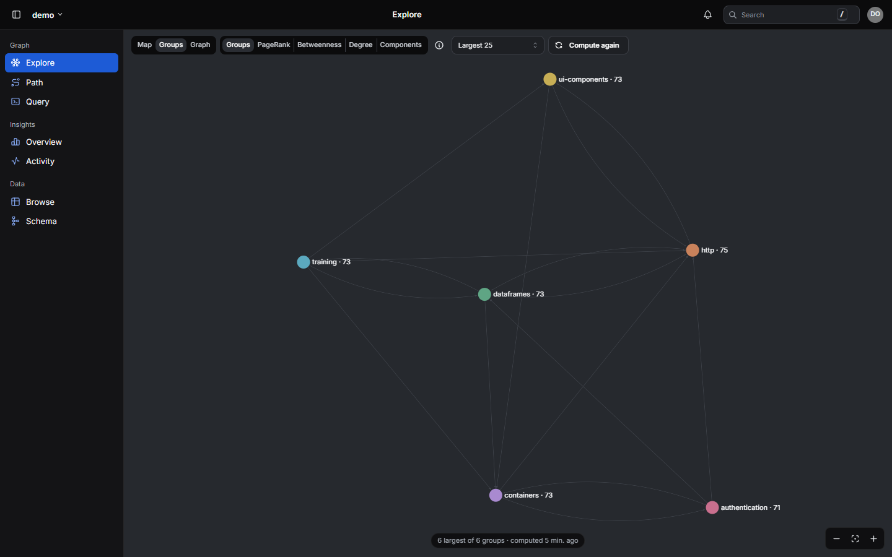

# Graph algorithms

graphos computes a few whole-graph algorithms itself, next to the data, and writes the results onto
the nodes, where every read, filter, sort and the web UI can use them. This page says what each one
finds, what it is good for, how to run it and what it costs. The endpoints and every parameter are in
[usage §8](usage.md#8-communities-louvain-leiden).

| Algorithm | Writes | Finds | Use it for |
|---|---|---|---|
| [Communities (Louvain, Leiden)](#communities-louvain-leiden) | `community_id` | groups of nodes more connected to each other than to the rest | navigating and summarising a large graph by its parts; scoping a traversal; colouring a picture |
| [PageRank](#pagerank) | `graphos_pagerank` | how much a node is pointed at, by nodes that are themselves pointed at | what everything depends on; ranking by importance |
| [Betweenness](#betweenness) | `graphos_betweenness` | how often a node lies on the shortest paths between others | bridges, bottlenecks, single points of failure |
| [Components](#components) | `graphos_component` | the separate islands of the graph | data quality (orphans, loads that did not link up); splitting work |
| [Degree](#degree) | `graphos_degree`, `graphos_in_degree`, `graphos_out_degree` | how many relationships a node has, each way | hubs, fan-in and fan-out, outliers |

**In the web UI:** Overview → *Graph algorithms* shows what each last run found and runs them;
Explore → *Groups* shows each one as its own view (the groups, the top nodes by PageRank,
betweenness or degree with the relationships among them, or the components); the node panel
shows a node's group and metrics.

## How they run

- **On request only.** Writes never trigger a computation: the values are as current as the last
  run. Run them after a bulk load, or on a schedule.
- **Next to the data, out of the way.** The edges are read with plain SQL as integer ids, the
  computation runs in a child process (so the API keeps serving), and the results are written back
  in bulk. A long run can be a background job (`Prefer: respond-async`); cancelling it stops the
  child and frees its memory.
- **Who may run them:** a user with `maintain` on the tenant (or an admin). Reading the results
  needs only `read`.
- **One at a time per tenant.** A community recompute and a metrics run exclude each other (`409`
  while one runs).
- **Scoped as you choose.** `rel_types` picks the relationship types that count, and `node_filter`
  keeps only nodes with given property values (both ends of an edge must match). Run the same
  algorithm over different scopes to answer different questions: PageRank over `DEPENDS_ON` answers
  "what does everything rely on", over `CITES` "what is most cited".
- **Stable results.** The same edges give the same results whatever order their rows are stored
  in. Community and component ids carry over between runs, and only values that changed are
  written, so re-running the metrics or Louvain on an unchanged graph changes nothing (no
  revisions, no change records). Leiden from the stored communities still moves a few nodes while
  its partition settles ([compared](#louvain-and-leiden-compared)).

## The demo

[`08_demo_ecosystem.py`](../../clients/python/examples/08_demo_ecosystem.py) loads a tenant built to
show what these find: an invented open-source ecosystem of about 450 packages, maintainers, teams,
organisations and topics in six ecosystems (web, frontend, data, machine learning, operations,
security), joined by a few shared core libraries and some cross-ecosystem dependencies. It then
runs every algorithm and prints:

```text
demo: 443 nodes, 1870 edges
metrics: 280 packages, 2 components, 280 values written
most depended on (PageRank): corelog, testbench, fmtcore, cipherlite, proxynest
bridges (betweenness): shiplite, buildforge, gradientwise, guardium, routeflow
communities: 6, modularity 0.741
```

- **Communities** recover the six ecosystems from the edges alone; nothing in the data names them.
- **PageRank** puts the core libraries first, led by the logging library that every other core
  library depends on.
- **Betweenness** picks out the packages through which one ecosystem reaches another: remove one
  and two ecosystems drift apart.
- **Components** finds two packages that depend only on each other, apart from everything else.


*Explore, coloured by community: six ecosystems around the shared core. The selected library's
panel shows its `community_id` and the `graphos_*` metrics.*

---

## Communities (Louvain, Leiden)

**What it finds.** A partition of the nodes into communities, groups with many relationships inside
and few between them. Both algorithms maximise *modularity*, which compares the edges inside communities
with what a random graph of the same degrees would have; values above about 0.3 mean a real
structure, the demo scores 0.74.

**What it is for.**

- **Navigation.** A graph of a million nodes cannot be drawn, but its communities can: the UI's
  *Groups* view and `GET …/graph/communities/map` show each community with its size, its members
  per label, its best-connected member (it is named after it) and the relationships between
  communities.
- **Summaries.** "Which part of the system is this in", "what does this part consist of",
  "which parts talk to each other most".
- **Scoped traversal.** `GET …/graph/expand?communities=4&communities=9` reaches only nodes in
  those communities, in every direction; each edge carries the communities of both its ends in
  indexed columns, so each hop is an index lookup.
- **Pictures.** Colour by community (the UI's *Colours → By group*).

**How graphos runs it.** Louvain (the default) or Leiden, both from python-igraph, an
[optional extra](../../README.md#louvain-is-an-optional-extra) (GPL), on an undirected graph; `rel_weights` weighs each relationship type (the demo weighs a
dependency twice a maintainer link). `resolution` above 1 gives more, smaller communities; below 1,
fewer and larger. Communities smaller than `min_community_size` (default 3) get no id. The seed is
fixed and vertices are numbered by their internal id, so the same edges give the same partition
(a tenant imported again gets new internal ids, and with them possibly another partition).

**Stable ids.** Both algorithms number their clusters arbitrarily, so a plain re-run would rename
every community. graphos matches each new cluster with the previous run's and keeps the old id
when they overlap by a Jaccard index of at least 0.5: dashboards, caches and saved filters that
hold a `community_id` keep working while membership drifts.

### Louvain and Leiden compared

Both look for the partition with the highest modularity, and both work in passes: move single
nodes to the neighbouring community that raises modularity most, then merge each community into
one node and repeat on the smaller graph. They differ in where they start and in one step.

- **Louvain** ([Blondel et al., 2008](https://doi.org/10.1088/1742-5468/2008/10/P10008)) starts
  every run with each node alone and repeats its passes until nothing improves.
- **Leiden** ([Traag, Waltman and van Eck, 2019](https://doi.org/10.1038/s41598-019-41695-z))
  adds a refinement step before each merge, which splits a community that is held together badly
  or not at all. It can also start from a given partition: graphos gives it the stored one and
  lets it make two passes (`LEIDEN_ITERATIONS`) per run.

| | Louvain | Leiden |
|---|---|---|
| Starts from | scratch, every run | the stored communities, when the last run was Leiden over the same scope, weights and resolution; otherwise scratch |
| Same edges, same result | yes: an unchanged graph rewrites nothing | from scratch, yes; from the stored communities, a few percent of the nodes still move each run while the partition settles |
| After a small change | can land on a quite different partition: most nodes and ids change | moves only the nodes the change gives a reason to move |
| Connected communities | not guaranteed: a community can be badly connected, even in pieces | each community is connected after every pass |
| Modularity | high | as high or higher |
| Use it when | you recompute rarely, want a run that depends only on the edges, or compare with earlier Louvain results | you recompute often and want communities, and the ids that name them, to stay put |

Measured on a synthetic graph of 250,080 nodes and 951,272 edges, one recompute per step:

| | Louvain | Leiden |
|---|---|---|
| Re-run, nothing changed: nodes rewritten / run | 0 / 24 s | 8,005 / 31 s |
| Re-run after 1 % more edges: nodes rewritten / run | 190,911 / 103 s | 5,083 / 28 s |
| Re-run after 10 % more edges: nodes rewritten / run | 190,891 / 131 s | 7,076 / 43 s |
| Community ids kept after 1 % more edges | 1 of 62 | 63 of 63 |
| Modularity after 1 % more edges | 0.420 | 0.439 |

Most of a run's time is writing back what moved, so Leiden's re-runs are faster because they move
less. It is the start, not the algorithm, that keeps the communities: measured apart from the
server on the same graph, after 1 % more edges, 37 % of the nodes stayed together with Louvain from scratch (a
change of seed gives about as many), 34 % with Leiden from scratch (in 3.8 s instead of Louvain's
16.7 s), and 97.5 % with Leiden from the previous partition. The matching of stable ids applies
to both, but after a Louvain run it has little to keep: 24 % of the nodes kept their id.

**Choosing.** Louvain is the default for every tenant. Ask for Leiden with `"algorithm": "leiden"`
in a recompute, or set `"community_algorithm": "leiden"` in the tenant's registration so every
recompute without an algorithm uses it. `"from_scratch": true` makes Leiden ignore the stored
communities. The first Leiden run after a Louvain one starts from scratch, and so does one over
another scope, other weights or another resolution. The response says which algorithm ran and
whether it started from scratch.

```bash
curl -s -X POST "$G/v1/demo/recompute-communities" -H "Authorization: Bearer $TOKEN" \
  -H "Content-Type: application/json" \
  -d '{"rel_types": ["DEPENDS_ON", "MAINTAINS", "MEMBER_OF", "TAGGED"],
       "rel_weights": {"MAINTAINS": 0.5, "MEMBER_OF": 0.5, "TAGGED": 0.3}}'
```



*The community map in the UI: one bubble per community, named after its best-connected member.*

## Graph metrics

`POST /v1/{tenant}/graph/metrics:compute` computes any of the four below in one pass, with
[rustworkx](https://www.rustworkx.org/) (Apache-2.0, always installed), on the **directed** graph of
the chosen relationship types: only nodes with at least one such edge take part, and parallel
edges and self-loops count. Scores are rounded to 6 significant digits.

```bash
curl -s -X POST "$G/v1/demo/graph/metrics:compute" -H "Authorization: Bearer $TOKEN" \
  -H "Content-Type: application/json" \
  -d '{"metrics": ["degree", "pagerank", "components", "betweenness"], "rel_types": ["DEPENDS_ON"]}'
```

Read the top nodes with a sorted scan (nodes without the value are left out):

```bash
curl -s -X POST "$G/v1/demo/graph/nodes:scan" -H "Authorization: Bearer $TOKEN" \
  -H "Content-Type: application/json" \
  -d '{"labels": ["Package"], "project": ["name", "graphos_pagerank"], "limit": 10,
       "order_by": [{"property": "graphos_pagerank", "desc": true}]}'
```

### PageRank

**What it finds.** A node scores high when many nodes point at it, and more so when those are high
scorers themselves. The scores sum to 1. `damping` (default 0.85) is the chance of following an
edge rather than jumping to a random node.

**What it is for.** Importance by reference: the libraries everything depends on, the documents
most cited, the services most called. Direction matters: point the edges from the dependant to what
it depends on (`A -DEPENDS_ON-> B` raises B).

### Betweenness

**What it finds.** For each node, the share of shortest paths between other pairs of nodes that go
through it (exact, normalised to 0–1, following edge direction).

**What it is for.** Bridges and bottlenecks: the package two ecosystems share, the service every
request passes through, the person who connects two teams. A high score with a low degree is a
quiet single point of failure.

**Cost.** Exact betweenness is the expensive one, roughly the number of nodes times the number of
edges. It is not in the default set, and it is skipped (with a warning in the response) when more
nodes take part than `GRAPHOS_BETWEENNESS_MAX_NODES` (20,000): scope it with `rel_types` or
`node_filter`. It is computed on several threads, `GRAPHOS_COMPUTE_THREADS` of them (by default
half the CPUs, so reads keep the rest). With `GRAPHOS_BETWEENNESS_MAX_NODES` raised, 250,000 nodes
and 950,000 edges took 451 s of computing, on about 14 cores: measured before that thread limit,
when betweenness used as many cores as it could get.

### Components

**What it finds.** The weakly connected components: sets of nodes linked to each other in either
direction and not at all to the rest. The largest is `0`, then by size; ids carry over between
runs like community ids.

**What it is for.** Data quality first: a load that left nodes unlinked, a reference to a node that
was never written, an island that should not exist. Also work that never needs to cross an island
can be split by component.

### Degree

**What it finds.** The number of relationships of the chosen types each node has: `graphos_degree`
in total, `graphos_in_degree` and `graphos_out_degree` each way.

**What it is for.** The cheapest view of importance and shape: hubs, nodes with an unusual fan-out,
nodes with nothing coming in.

## Using the results in a client

The algorithms turn the graph's structure into values on each node, and every read returns them:
search hits and node reads carry `community_id` and the `graphos_*` metrics in their properties,
neighbours in `neighbor_properties`, `/expand` in each reached node's `end_properties`. Using them
costs no extra request. Five ways a client gets better answers with them:

| Need | Use | How |
|---|---|---|
| The important matches first | PageRank | combine the search score with `graphos_pagerank` |
| Less noise around a node | communities | `/expand?communities=…`: the walk stays in the node's community |
| A varied answer | communities | keep the best hit of each `community_id` |
| How two areas connect | betweenness | the highest `graphos_betweenness` among the nodes in between |
| Hubs that drown everything | degree | weigh down a very high `graphos_degree` |

**Rank by importance.** Text search finds what matches the words, not what matters. With a search
index every hit has a score; weigh it by PageRank against the best PageRank among the hits:
`score × (1 + pagerank / max pagerank)`. On the demo, searching `flow` gives 28 packages whose
names all score about the same; weighted, the ones the ecosystem depends on come first:

```text
by text score alone          ranked by importance (PageRank)
formflow     0.001054        pipelineflow   0.01204
shipflow     0.002407        trainflow      0.009249
batchflow    0.001233        vaultflow      0.003836
```

The same weighting orders neighbours, or picks entry points: `nodes:scan` with
`"order_by": [{"property": "graphos_pagerank", "desc": true}]` returns a label's most central nodes.

**Focus the walk.** Two hops from a hub can reach far into the graph. Pass the community of the
node (or of the best few hits) to `/expand?communities=…`: the walk reaches only nodes in those
communities, in every direction, and stays an index lookup per hop. From the demo's `pipelineflow`,
two hops reach 83 nodes in all six ecosystems; scoped to its own community, the 64 of them in its
ecosystem. A scoped walk does not follow edges added since the last community recompute.

**Diversify and summarise.** Group results by `community_id` and keep the best of each, so the
answer covers several areas rather than one. The community map names each community after its
best-connected member: "this touches *http* and *dataframes*" is a summary a reader, or a language
model given one paragraph per community, can use.

**Explain links and impact.** When results span communities, the nodes with the highest
`graphos_betweenness` among those reached are the bridges between them; for "what is affected if
this changes", they are the nodes to look at first. On a graph larger than
`GRAPHOS_BETWEENNESS_MAX_NODES` betweenness is skipped: compute it on a subgraph (`rel_types`,
`node_filter`), or use PageRank and degree.

**Keep hubs in check.** Utility nodes (a logging library, a shared base class) connect to
everything. When expanding, weigh a very high `graphos_degree` down unless PageRank or betweenness
says the node matters too. Nodes outside component `0` are islands: leave them out of an answer,
or report them.

**Keep the values meaningful.** Compute the metrics over the relationship types that fit the
question (PageRank over dependencies is "what everything relies on", over every relationship "what
is most connected"); run the metrics and the community recompute again after large loads; and key
caches by `community_id`, which stays the same from run to run.

[`09_better_answers.py`](../../clients/python/examples/09_better_answers.py) runs all of this on the
demo tenant: search by text score next to search ranked by importance, a walk unscoped and scoped,
the best hit per community, and the bridges among the nodes reached.

### On a large graph

The same steps on a large code graph (about ten million edges):

- **Communities.** The recompute kept 258 communities. Two hops from the hubs of the largest ones
  reached many nodes outside the starting community; scoped, none. The first recompute after
  upgrading to a version with `start_community_id` fills that column on every edge, so it takes
  much longer than later ones, which write only what moved.
- **PageRank needs the right relationships.** Computed over every relationship type, the name hits
  of a search (mostly folders and files) all had the same base value, so weighting by it changed
  nothing. Computed over the code relationships only (calls, imports, inheritance, type
  references, dependencies), it told them apart. Nodes outside those relationships get no
  PageRank, so leave their score as it is.
- **Generic hubs dominate functions.** The most central functions were `equals`, `toString`,
  `add` and the like, with very high degrees. Weigh a very high `graphos_degree` down, or compute
  on a subgraph that leaves them out.
- **Diversify works.** Keeping the best hit per community put several communities in each top 10.

## Reserved properties

graphos writes `graphos_*` properties itself, so any write that uses one (node or edge, single,
batch or bulk, a merge-patch removing one included) is refused with `400`: computed values never
collide with a consumer's own data. `community_id` is written by the community recompute only:
a write that sets or removes it is refused the same way.
Snapshot import is the exception: it writes both as the file has them, so a dataset export
(`GET …/graph/snapshot`) restores with them. `graphos_derived` on an edge marks one a resolve rule
wrote (`edges:resolve`), so a run by difference knows which edges are the rules' own.

## Sizing

The first metrics run writes every node taking part, in statements of 25,000 nodes in one
transaction (all or nothing); a first run of degree, PageRank and components took 51 s on 270,000
nodes and 1 million edges, and 152 s on 810,000 nodes and 3 million edges
([measurements](apache-age.md#12-measured-on-postgresql-18--age-18)), most of it updating the
nodes' indexes. A later run on an unchanged graph reads the edges, computes, compares and writes
nothing. After a change it writes the degrees that changed and the scores that moved by more than
`GRAPHOS_METRICS_MIN_CHANGE` (1 %): on 250,000 nodes, 1 % more edges moved 94 % of the PageRank
scores by more than 0.1 % but only 4.7 % by more than 1 %, so a re-run rewrites 7.7 % of the
nodes (those and the changed degrees) instead of all of them, in 17 s instead of 41 s, and the
100 highest-ranked nodes stay the same. A large change still rewrites most nodes: after 10 % more
edges most scores move by more than 1 %. A community recompute on the same graph reads the edges once more
and writes only the nodes whose community changed. Both hold the edges as compact integer arrays,
so memory grows with the number of edges, not with their properties.
