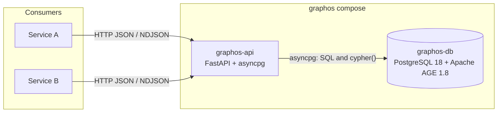
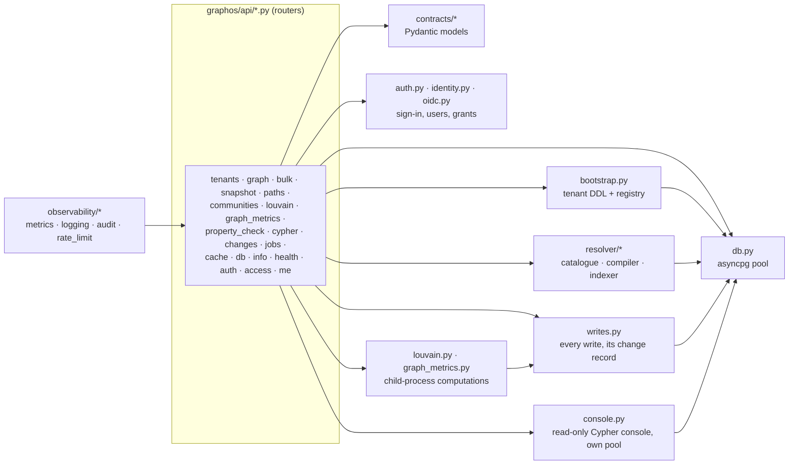
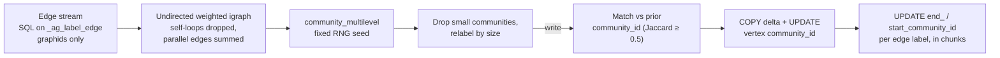

# graphos — Concept

**Audience:** engineers building on or operating graphos.

This is the architecture and reference document. For a short capability
overview see [features.md](features.md); for worked request examples see
[usage.md](usage.md); for AGE-specific lessons see [apache-age.md](apache-age.md).

---

## 1. Summary

**graphos** is a generic, multi-tenant property-graph service: PostgreSQL 18
with Apache AGE 1.8 as the data plane (graphos refuses older databases: §2.4),
and a FastAPI process (`graphos-api`)
in front of it as the only way in. Consumers speak typed HTTP/JSON (NDJSON for
bulk writes). They never receive a Postgres DSN and cannot submit SQL, nor
Cypher outside the read-only console (§3.1).

Design points:

1. **Postgres operational model.** MVCC, WAL, `pg_dump` / `pg_basebackup`,
   autovacuum, `pg_stat_statements`: standard tooling applies.
2. **Tenant = AGE graph.** Each tenant is one AGE graph (one Postgres schema).
   Labels are declared by the tenant at registration; graphos ships none.
3. **Schema-agnostic surface.** Every label, property, and edge-type name is a
   request parameter. graphos owns storage and generic graph operations;
   consumers own the meaning of their schema.
4. **Typed endpoints, server-side guards.** Identifiers are regex-validated and
   (where they become SQL identifiers) checked against the tenant's registered
   labels; every statement runs under a server-side `statement_timeout`.

---

## 2. Architecture

### 2.1 Stack



AGE stores each label as a Postgres table in the tenant's schema:
vertex labels inherit from `"<tenant>"._ag_label_vertex` and edge labels from
`"<tenant>"._ag_label_edge`; each row has a `graphid` `id`, an agtype
`properties` bag, and (edges) `start_id` / `end_id`. graphos addresses nodes by
an external id stored in `properties.id`; edges are addressed by
`(src id, dst id, type)`.

Extensions installed in `graphos-db`: `age`, `pg_trgm`, `pg_stat_statements`.

Why an HTTP service rather than a shared database:

- No database credentials, AGE driver knowledge, or Cypher in consumers.
- Auth, rate limiting, audit logging, and tenant routing live in one process.
- Any HTTP-capable language can integrate (OpenAPI at `/openapi.json`).
- The compose network layout keeps `graphos-db` unreachable from consumers
  (§2.4).
- Tenant registration (and its DDL) runs inside graphos; consumers carry no
  schema-init logic.

### 2.2 Schema setup — two layers

#### Layer 1 — database init (tenant-agnostic, once per volume)

`services/graphos/deploy/db-init/` is mounted into
`/docker-entrypoint-initdb.d/`; its scripts run as the superuser created by
the Postgres image (`POSTGRES_USER=graphos`, password in `graphos_pw.txt`)
and only when the data volume is empty.
[`00-extensions.sql`](../../services/graphos/deploy/db-init/00-extensions.sql):

- creates the `age`, `pg_trgm`, and `pg_stat_statements` extensions;
- sets `search_path = ag_catalog, "$user", public` for the `graphos` role and
  grants it `USAGE` on `ag_catalog`;
- creates the `graphos_meta` schema and the `graphos_meta.tenants` table.

[`01-app-role.sh`](../../services/graphos/deploy/db-init/01-app-role.sh) then
creates `graphos_app`, the role `graphos-api` connects as (password in
`graphos_app_pw.txt`). It is `NOSUPERUSER NOCREATEDB NOCREATEROLE` and gets
only what the service needs: `CONNECT` and `CREATE` on the database (AGE puts
each tenant graph in its own schema), `USAGE` on `ag_catalog` plus DML on its
tables and sequences, ownership of `graphos_meta` and `graphos_meta.tenants`,
membership in `pg_read_all_stats` (for `/v1/db/*`), and
`SET ON PARAMETER temp_file_limit` (for the console's temporary-file limit,
§3.1; an existing database needs that grant run once, and graphos logs a
warning at start while it is missing). The superuser is used
by the init scripts only. A volume initialised before `01-app-role.sh`
existed has no `graphos_app`: run the SQL from that script by hand as the
superuser, or start from a fresh volume.

On every start `graphos-api` also runs idempotent DDL for its internal tables
(`db.py::ensure_internal_schema`): `graphos_meta.tenants`,
`unregistered_tenants`, `tenant_settings`, `edge_endpoints` and `cache`, the
property record (`node_properties`, `node_properties_complete`), background
`jobs`, the change feed (`changes`, `change_horizon`), the community map
(`community_map`, `community_links`, `community_map_runs`, written by each
Louvain recompute), the last written run of each analysis with its change-feed position
(`analysis_runs`), identity (`users`, `grants`, `sessions`, `signing_keys`,
`oidc_pending`, and `oauth_clients` and `oauth_codes` for MCP clients' sign-in),
`user_preferences` and the console's `saved_queries`, so
an existing volume picks up new internal tables without re-initialisation.

#### Layer 2 — tenant registration (per tenant, idempotent)

`POST /v1/tenants` (`create_tenants` for a new tenant, `maintain` for an
existing one; §2.5.3) carries the tenant spec:

```json
{
  "name": "acme",
  "vertex_labels": ["User", "Document", "Tag"],
  "edge_labels": ["AUTHORED", "FOLLOWS",
                  {"name": "TAGGED", "resolve_rule": { ... }}],
  "property_indexes": [{"label": "Document", "properties": ["kind"]}],
  "generated_columns": [],
  "label_hierarchy": {},
  "meta": {}
}
```

- `name`: `^[A-Za-z][A-Za-z0-9_]{0,62}$`. Labels: `^[A-Z][A-Za-z0-9_]{0,62}$`.
- `edge_labels` entries are strings or `{name, resolve_rule}` objects
  (resolve rules: [features.md §7](features.md#7-schema-driven-edge-derivation)).
- `label_hierarchy` maps `child → parent` vertex labels; graphos runs
  `ALTER TABLE child INHERIT parent`, so rows written under the child are
  visible when querying the parent table. Both must be in `vertex_labels`
  and a label cannot be its own parent; otherwise registration returns 422.
- `property_indexes` (`{label, properties, kind, unique, name}`) and
  `generated_columns` (`{label, column, property, type}`) are declarations;
  graphos writes their DDL (`declared.py`) from names the contract validated,
  so no client SQL is run. An index uses the expression the reads it serves
  compile to (§2.3). A generated column may not take a name graphos uses
  itself (`id`, `properties`, `start_id`, `end_id`, `end_community_id`,
  `start_community_id`, any `graphos_…`), and cannot change once registered.
  Before 0.6.0 both were SQL statements; specs stored then are converted at
  startup (`declared.convert_legacy`: statements a declaration expresses
  become one, keeping the index name; the rest are logged and left out of the
  spec, while what they created stays in Postgres).
- The spec also takes `search_indexes` (§2.3), `edge_endpoints` and
  `strict_endpoints` (the label pairs each edge type joins, and whether edge
  writes outside them are refused), `display` (label styles for the web UI)
  and `property_schema` (property definitions and how writes are held to
  them: `off`, `warn` or `strict`, §4), and `deprecated` (names on their
  way out, merged by entry as `display` is); see
  [features.md §2](features.md#2-tenant-model).
- Names change outside registration (ADR-0009, `schema_rename.py`): a label
  or edge type is renamed in place, in one transaction under the tenant's
  lock (AGE's `ag_label` row, the table, its sequence and the `id` default,
  graphos's indexes, every `graphos_meta` row naming it, the spec), so its
  rows, ids, edges and inheritance stay; a property is renamed by a
  `rename_property` job (§2.6). The spec keeps every rename in `renames`,
  and a name renamed away answers 409 with where it went, on writes and on
  registration. A deprecated label or type with no rows is dropped with
  `DELETE /v1/tenants/{name}/labels/{label}`.
- `?dry_run=true` checks the spec as a registration would and answers what it
  would change and cost, and what would stop working (`breaking`,
  `schema_breaking.py`: compared on the compiled property rules, so `*` and the
  label hierarchy count as they do on writes), writing nothing. `GET /v1/tenants/{name}/spec`
  (`maintain`) exports the whole stored spec as a registration body.

`bootstrap.py::bootstrap_tenant` then applies the spec under a per-tenant
`pg_advisory_lock`, so concurrent registrations of the same tenant serialise:

1. `create_graph` (duplicate swallowed), then the revision column
   `graphos_rev bigint NOT NULL DEFAULT 1` on AGE's parent tables
   `_ag_label_vertex` and `_ag_label_edge`, when it is missing: Postgres adds
   it to every existing label table through inheritance, and every label
   created later inherits it. A constant default is metadata-only, so no table
   is rewritten (on a copy with an 8M-row edge table, all 149 label tables got
   it in under 0.1 s); existing rows read as revision 1.
2. `create_vlabel` per vertex label plus the per-label indexes in §2.3.
3. `end_community_id` and `start_community_id` (`text`) columns on
   `_ag_label_edge`; `create_elabel` per edge label plus the per-label edge
   indexes and columns in §2.3.
4. `label_hierarchy` inheritance links (checked in `pg_inherits` first).
5. Declared `generated_columns` missing from their label table (checked in
   the catalog first). Declared `property_indexes` are built later, after the
   search indexes, with `CREATE INDEX CONCURRENTLY`.

After bootstrap the spec is persisted to `graphos_meta.tenants` and cached in
process. Persistence **merges** by default: label lists, property indexes,
generated columns, hierarchy, and resolve rules are unioned with the stored spec, and
`meta` keys are overwritten per key (a key sent as `null` is removed). `?force_shrink=true` replaces the stored
spec instead (labels removed from the spec are not dropped from AGE). In both
modes the process then reloads the stored spec (`bootstrap.py::load_spec`)
and serves that, so a partial re-registration never hides labels or rules
registered earlier; the response's `vertex_labels` / `edge_labels` are the
merged sets.
Registration then creates resolver indexes (best-effort; failures are
logged, not returned) on the labels the resolver catalogue lists.

**Resolver catalogue.** Which vertex labels carry which property names is
recorded as nodes are written: every node write (upsert, bulk, snapshot,
merge, patch, community write-back) adds its property names to
`graphos_meta.node_properties` in the same transaction, the upsert in the
same statement. A name already recorded costs one unique-index lookup.
The catalogue is therefore current after every commit and costs one small
indexed query, where it used to read every row of the tenant (80 s for
572k vertices, measured). The record only grows: a name stays after the
last node carrying it is patched or deleted, which the resolver tolerates;
`GET …/graph/catalogue?refresh=true` re-reads every node and drops such
names. A graph created by graphos starts complete; a graph that predates
the record is read once, in the background at startup, or when a lookup
first needs it.

On startup graphos reloads every stored spec and re-runs `bootstrap_tenant`
for each, so consumers need not re-register after a restart. A tenant whose
bootstrap fails at startup is logged and skipped; the service still starts. Bootstrap, the
internal schema setup, and this reload run with a 1800 s statement timeout
(`db.py::DDL_TIMEOUT_S`), so index builds on large labels are not cut off at
the request default (§2.5.5).

### 2.3 Indexes created at registration

Created automatically for every vertex label `<L>` (all `IF NOT EXISTS`):

```sql
CREATE INDEX "<L>_properties_gin" ON "<tenant>"."<L>" USING gin (properties);
CREATE UNIQUE INDEX "<L>_id_unique" ON "<tenant>"."<L>" ((properties->'"id"'));
CREATE INDEX "<L>_community_id" ON "<tenant>"."<L>"
  ((((properties::text)::jsonb) ->> 'community_id'));
CREATE INDEX "<L>_name_trgm" ON "<tenant>"."<L>" USING gin
  ((((properties::text)::jsonb) ->> 'name') gin_trgm_ops);
```

For every edge label `<E>`:

```sql
CREATE UNIQUE INDEX "<E>_endpoints_unique" ON "<tenant>"."<E>" (start_id, end_id);
CREATE INDEX "<E>_endpoints_btree" ON "<tenant>"."<E>" USING btree (start_id, end_id);
CREATE INDEX "<E>_end_id" ON "<tenant>"."<E>" USING btree (end_id);
ALTER TABLE "<tenant>"."<E>" ADD COLUMN IF NOT EXISTS end_community_id text;
CREATE INDEX "<E>_end_comm_id" ON "<tenant>"."<E>" USING btree (end_community_id)
  WHERE end_community_id IS NOT NULL;
ALTER TABLE "<tenant>"."<E>" ADD COLUMN IF NOT EXISTS start_community_id text;
CREATE INDEX "<E>_start_comm_id" ON "<tenant>"."<E>" USING btree (start_community_id)
  WHERE start_community_id IS NOT NULL;
CREATE INDEX CONCURRENTLY "<E>_graphid" ON "<tenant>"."<E>" (id);
```

With `GRAPHOS_VERTEX_GRAPHID_INDEXES=true`, every vertex label also gets
`"<L>_graphid" (id)`. Finally, every label table that has never been analyzed
gets `ANALYZE`.

Consequences:

- `<L>_id_unique` makes the external id unique **per label** (the same id may
  exist under two labels). It serves point lookups, the edge upsert's
  endpoint JOIN, and the `ON CONFLICT` arbiter of every node write (§4).
- `<E>_endpoints_unique` allows **at most one edge of a given type between an
  ordered pair of nodes**; repeated writes merge properties. It is the
  `ON CONFLICT` arbiter for every edge write (§4). Because stored tenants are
  re-bootstrapped at startup (§2.2), a tenant created before these unique
  indexes existed gets them on the next restart.
- `end_community_id` and `start_community_id` (the communities of an edge's
  two ends) are filled by Louvain (§5) and read by community-scoped `/expand`:
  a hop that walks an edge forwards checks its end, one that walks it backwards
  its start, so the walk reaches only nodes in the listed communities. Edges
  written after the last recompute have `NULL` there and are invisible to
  scoped traversals until the next recompute.
- `<E>_graphid`: AGE does not index the graphid. Paging edges in graphid
  order (`/edges:scan`) reads it instead of sorting the table. It is built
  `CONCURRENTLY`, so on the first start after an upgrade it is added to large
  existing tables without blocking writes (12 s for an 8M-row table); an
  interrupted build is detected and redone. Measured cost: about 5% on bulk
  edge writes.
- Vertex `<L>_graphid` (opt-in): resolving edge endpoints by graphid then
  probes an index instead of scanning every vertex table (`/edges:scan`
  pages ~1 s → ~60 ms on an 8M-edge type), at a measured 20–30% cost on bulk
  vertex writes, hence off by default.
- `ANALYZE` of never-analyzed tables: autovacuum only analyzes a table after
  50+ changed rows, so small and empty label tables could stay without
  statistics; the planner then assumed ~10 pages for each, and a query across
  80 of them was costed as millions of rows.
- Per-property indexes beyond these are declared in `property_indexes`.
  `/nodes:scan` filters use the expression
  `(((properties::text)::jsonb) ->> '<prop>')`, and graphos builds a declared
  `equality` index on exactly that expression (one per property, in order;
  `trigram` wraps it in `gin_trgm_ops`), named `<Label>_<props>_<kind>_idx`
  and built `CONCURRENTLY`. A unique one turns a duplicate write into 409.
- Resolve rules derive further indexes automatically
  ([features.md §7](features.md#7-schema-driven-edge-derivation)).
- Search indexes (`search_indexes`) derive one GIN index per covered label
  and property, built `CONCURRENTLY`: `identifier` gets two `gin_trgm_ops`
  indexes, on the property's words (camelCase split, lower-cased,
  punctuation as spaces) for similar-word matches and on the same words
  run together for exact, prefix and contained matches, as Lucene's
  word-delimiter filter can also index the catenated token; `text` gets one
  on `to_tsvector(<language>, …)`. The query computes the identical
  expression, the only form the planner matches to an expression index. An
  index over every label (`*`) is extended to labels registered later. Over
  `*`, one query on the AGE parent table `_ag_label_vertex` reaches each
  label's own index through inheritance.

Index effect measured during development: the `community_id` index took a
lookup on a ~117k-row label from 2.4 s to 0.5 ms, and the trigram index took
`/search` on the same label from 1.2 s to 1.3 ms.

### 2.4 Deployment (compose)

The reference deployment is
[`docker-compose.graphos.yml`](../../docker-compose.graphos.yml) at the project
root. Read that file for exact values; its shape:

| | `graphos-db` | `graphos-api` |
|---|---|---|
| Image | `apache/age:release_PG18_1.8.0` (by digest) | built from `services/graphos/Dockerfile`, tagged `graphos-api:${GRAPHOS_API_TAG:-dev}` |
| Networks | `graphos-internal` only | `graphos-internal` + `graphos-net` |
| Ports | `expose: 5432` (no host port) | `127.0.0.1:8080:8080` |
| Secrets | `services/graphos/deploy/secrets/` bind-mounted (directory) at `/run/graphos/secrets` | same directory |
| Healthcheck | `pg_isready -U graphos -d graphos` | Python `urllib` GET of `/healthz` |
| Memory | `mem_limit: 2g`, `mem_reservation: 512m`, `shm_size: 1g` | `mem_limit: 2g` (headroom for Louvain) |
| DB role | superuser `graphos` (init scripts only) | `graphos_app` (§2.2) |

`graphos-db` runs with `shared_preload_libraries=age,pg_stat_statements`,
`pg_stat_statements.track=all`, `log_min_duration_statement=500ms`,
`--data-checksums`, and sizing flags (`shared_buffers=1GB`,
`effective_cache_size=2GB`, `work_mem`, …) set in the compose `command:`.
These defaults fit a laptop; §7 lists what to raise for larger graphs. Data
lives in the `graphos_data_pg18` volume (`PGDATA` set to the mount point, as
before PostgreSQL 18's images moved it). The optional `graphos-ui` service
(`--profile ui`) serves the web UI on `127.0.0.1:8081`, on `graphos-net`
only.

**PostgreSQL 16 / AGE 1.6** (bundled up to 0.9) is no longer supported
([ADR-0007](adrs/ADR-0007-drop-postgresql-16.md)): AGE has no release after
1.6 for PostgreSQL 16, and 1.6 carries out some Cypher writes in a read-only
transaction and can wedge a database process on a variable-length pattern.
`db.py::unsupported_database` refuses any PostgreSQL before 18 or AGE before
1.8, and graphos-api stops at start with the reason. The compose moves a
PostgreSQL 16 stack by itself with two one-shot services that run on every
`up` and exit at once when there is nothing to move:

- `graphos-db-export` (the PostgreSQL 16 image, `network_mode: none`) starts
  PostgreSQL 16 on the old `graphos_data` volume, dumps it (`pg_dump -Fc`) to
  the `graphos_upgrade` volume and stops it;
- `graphos-db-import` (the PostgreSQL 18 image) restores the dump into a
  database of its own, points AGE's catalogue (`ag_graph.graphid`,
  `ag_label.graph`) at the restored schemas' new OIDs, adds AGE 1.8's
  statement-level `_age_cache_invalidate` trigger to every label table
  lacking it (AGE's own upgrade script would; a restore runs none), puts it
  in place of the new, empty `graphos` database, and gathers planner
  statistics in parallel;
- `graphos-api` waits for the import to succeed. At every start it also adds
  that trigger, where missing, to its registered tenants' label tables
  (`bootstrap.ensure_cache_invalidation_triggers`; nothing before AGE 1.8).

A failed import leaves nothing behind and runs again on the next `up`; the
dump is never loaded over a database graphos has used; `graphos_data` is only
read, and stays as the way back. A dump and restore rather than `pg_upgrade`:
the official images carry one PostgreSQL version each, and `pg_upgrade`
refuses AGE's `regnamespace` column, which AGE 1.6 cannot prepare
([upgrade-postgresql-18.md](upgrade-postgresql-18.md)).

`graphos-api` is configured through `GRAPHOS_*` environment variables
(`config.py`): `GRAPHOS_DB_HOST/PORT/NAME`, `GRAPHOS_DB_USER=graphos_app`,
`GRAPHOS_DB_PASSWORD_FILE=/run/graphos/secrets/graphos_app_pw.txt`,
`GRAPHOS_BIND_HOST/PORT` and `GRAPHOS_LOG_LEVEL`.
`GRAPHOS_FORWARDED_ALLOW_IPS` (default `127.0.0.1`) lists the addresses whose
`X-Forwarded-*` headers are trusted; set it to the reverse proxy's address.
The image installs extras from the
`GRAPHOS_EXTRAS` build arg: empty in the Dockerfile, `louvain` by default in
the compose file (§5).

Networks:

- `graphos-internal` is `internal: true` and carries only db ↔ api traffic.
- `graphos-net` is a bridge network consumers attach to; on it they can reach
  `graphos-api:8080` but not `graphos-db`.

Consumer side:

```yaml
networks:
  graphos-net:
    external: true
    name: graphos-net

services:
  my-service:
    networks: [default, graphos-net]
    # sign in as its service account, then call http://graphos-api:8080 with the token
```

Bring-up:

```bash
scripts/init-secrets.sh        # creates graphos_pw.txt, graphos_app_pw.txt (never overwrites)
docker compose -f docker-compose.graphos.yml up -d
curl -s http://127.0.0.1:8080/readyz
```

### 2.5 REST surface

Routers are mounted under `/v1` except health (`/healthz`, `/readyz`) and
`/metrics`. FastAPI serves `/openapi.json` and `/docs`.

#### 2.5.1 Endpoint catalogue

Paths under `/v1/{tenant}/graph/...` are abbreviated to `…/graph/...`.
"Tenant" scope means the caller's level on the tenant (§2.5.3): `read` for
the reads, `write` for the writes; `maintain`, `owner` and `admin` are named.

| Method · Path | Purpose | Scope |
|---|---|---|
| **Health & introspection** | | |
| `GET /healthz` | Liveness; does not touch the DB | none |
| `GET /readyz` | Pool exists and `SELECT 1` succeeds, else 503; reports `registered_tenants` as a count | none |
| `GET /v1/info` | Service, Postgres and AGE versions, `tenants` (a count), `features.louvain`, `features.metrics`, `features.cypher` | none |
| `GET /metrics` | Prometheus exposition (§2.5.6) | none |
| **Tenant control** | | |
| `POST /v1/tenants[?force_shrink=true][&dry_run=true]` | Register / re-apply a spec (§2.2); a dry run answers what it would change, cost and break | new: `create_tenants` (the caller becomes owner); existing: `maintain` |
| `GET /v1/tenants[?unregistered=true]` | The registered tenants the caller may maintain; also the unregistered ones it owns | signed in |
| `GET /v1/tenants/{name}` | One tenant's spec summary | `maintain` |
| `GET /v1/tenants/{name}/spec` | The whole schema as a registration body (the schema file) | `maintain` |
| `GET /v1/me` | The caller: user, kind, `admin`, `must_change`, its tenants, its level on each, `create_tenants` patterns, its web UI preferences | signed in |
| `PATCH /v1/me/preferences` | Change one's web UI preferences (`theme`, `last_tenant`) | signed in |
| `GET /v1/{tenant}/schema/summary[?format=text]` | The schema as a model needs it: labels with counts and properties (declared type, rows, distinct values, the values when few), label pairs per edge type, search indexes, saved queries, deprecated names and the latest renames; cached per tenant | tenant |
| `/oauth/authorize`, `/oauth/login`, `/oauth/token`, `/oauth/register`, `/oauth/revoke`, `/.well-known/oauth-authorization-server` | Without single sign-on, graphos signs people in for MCP clients: registration (public clients, loopback callbacks), a sign-in page, single-use codes, graphos sessions as refresh tokens (`graphos.oauth`, ADR-0008) | none (the page takes a password) |
| `/mcp` (MCP, on unless `GRAPHOS_MCP=false`) | Read tools for agents over Streamable HTTP, each running the REST route it wraps as the caller (an in-process token lent for the call), audited with the tool's name; the same tokens as the REST API ([agents.md](agents.md), ADR-0008) | per tool |
| `GET /v1/{tenant}/schema` | Labels, label hierarchy, search indexes, rule-derived edge labels, declared edge endpoints and `strict_endpoints`, `display`, `property_schema` and `deprecated` as declared, and the renames (no DDL, rules or `meta`) | tenant |
| `DELETE /v1/tenants/{name}/edge_endpoints` | Remove one declared pair | `maintain` |
| `POST /v1/tenants/{name}/schema:rename[?dry_run=true]` | Rename a label or edge type in place, or a property by a job (202); a dry run answers what it would change | `owner` |
| `DELETE /v1/tenants/{name}/labels/{label}` | Drop a deprecated label or edge type that has no rows | `owner` |
| `DELETE /v1/tenants/{name}[?drop_data=true]` | Unregister, keeping the data; or delete with the data (see below) | `owner` (an orphan: admin) |
| `POST /v1/tenants/{name}/restore` | Register an unregistered tenant again, as it was | `owner` |
| **Sign-in, users and grants** (§2.5.3) | | |
| `POST /v1/auth/login`, `/refresh`, `/logout` | Access token (and a person's refresh token); renew; end a session (and the provider's URL to end it there) | none |
| `GET /v1/auth/config`, `POST /v1/auth/oidc/start`, `/oidc/callback` | How to sign in; single sign-on with PKCE held by graphos | none |
| `GET /v1/auth/mcp/request`, `POST /v1/auth/mcp/approve` | The web UI's Allow card for an MCP client's sign-in: who asks, and the person's answer, which issues the code (ADR-0008) | a person |
| `POST /v1/me/password` | Change one's password | signed in |
| `GET/POST /v1/users`, `PATCH/DELETE /v1/users/{name}`, `POST /v1/users/{name}:reset-secret` | Users and service accounts | admin |
| `GET/POST/DELETE /v1/grants` | Grants | admin; an owner for its tenant |
| **Reads** | | |
| `GET …/graph/search?q=&label=&property=&limit=` | Case-insensitive literal substring (`ILIKE`, with `%` / `_` in `q` escaped) on `name` (served by the trigram index), or on `property` (read row by row); limit ≤200. Hit `id` = AGE graphid (integer); external id in `properties.id` | tenant |
| `GET …/graph/search?q=&index=&label=&fuzzy=&min_score=&limit=` | Ranked search through a named search index (`identifier` or `text` analyzer); hits carry `score` and `matched` | tenant |
| `GET …/graph/nodes/{external_id}?label=` | One node by external id; 409 if the id is in several labels and `label` is absent | tenant |
| `GET …/graph/edges/{type}?src=&dst=&src_label=&dst_label=` | One edge by type and end ids; 409 if several match | tenant |
| `POST …/graph/edges:check` `{edges: [{type, src_id, dst_id}]}` | Up to 1,000 edges, each `present`, `absent` or `ambiguous`, from one snapshot | tenant |
| `GET …/graph/neighbors?node_id=&rel_types=&limit=` | 1-hop out + in edges; limit default 50, ≤500; capped in graph-id order (§3.1) | tenant |
| `GET …/graph/expand?node_id=&seeds=&rel_types=&max_hops=&direction=&communities=&limit=` | BFS; `max_hops` default 2, ≤5; limit default 100, ≤1000; capped in graph-id order (§3.1) | tenant |
| `POST …/graph/induced_edges` `{node_ids, rel_types?, limit}` | Edges with both ends in the set; ≤1000 ids, limit ≤5000 | tenant |
| `POST …/graph/paths` `{src, dst, rel_types?, direction, max_hops, limit}` | Shortest paths between two nodes (bidirectional BFS, one statement per level); hops ≤8 | tenant |
| `POST …/graph/scoped_subgraph` | Nodes sharing one property value plus their induced edges; nodes are `{id (external id), label, properties}` | tenant |
| `POST …/graph/sample_subgraph` | First `per_rel` edges of each type plus endpoint properties; `filter_property` works with or without `include_properties` | tenant |
| `POST …/graph/nodes:scan` | Paginated node enumeration with filters/projection | tenant |
| `POST …/graph/edges:scan` | Paginated edge enumeration with filters/projection | tenant |
| `GET …/graph/export?node_ids=&rel_types=&limit_nodes=` | graphology JSON (§6); `limit_nodes` default 5000, ≤50000 | tenant |
| `GET …/graph/catalogue?property=&refresh=` | Resolver property → labels map, recorded at write time; `property` narrows it, `refresh=true` re-reads every node | tenant |
| `GET …/graph/properties` | Per label and edge type: the property-check mode, the rule for undeclared properties, and each definition as combined down the hierarchy, with the entry it comes from | tenant |
| **Aggregates & communities** | | |
| `POST …/graph/nodes/aggregate` `{label, group_by, values?, missing?, limit}` | Group one label by a property; `missing` counts the nodes without it under `""`; returns `total` (every node counted) and `distinct` (distinct values), both before `limit` cuts the groups; non-string values as JSON | tenant |
| `POST …/graph/edges/aggregate` | Group edges by endpoint properties and type | tenant |
| `GET …/graph/labels/{label}/top?by_edge=&direction=&k=` | Top-k nodes by degree on one edge type; k default 20, ≤200 | tenant |
| `GET …/graph/stats` | Exact per-label row counts (a parent includes its children) and bytes; totals count each node and edge once; when metrics and communities were computed and the rows written since (`analyses`) | tenant |
| `GET …/graph/map?exact=` | Labels with their own node counts, and edge counts per (source label, type, target label); large edge tables sampled and flagged `estimated` unless `exact` | tenant |
| `GET …/graph/map/hubs?label=&limit=` | A label's best-connected nodes; limit default 40, ≤200 | tenant |
| `GET …/graph/communities?min_size=&include_members=&limit=` | Communities from the last Louvain write | tenant |
| `GET …/graph/community-summary?top=` | Counts, largest/smallest size, top-N communities | tenant |
| `GET …/graph/communities/map?limit=` | The community map stored by the last recompute: sizes, members per label, hubs, internal edges, edges between communities; limit default 150, ≤1000 | tenant |
| `POST …/graph/community-ids` `{ids}` | External id → `community_id`; ≤500 ids, `truncated` flag | tenant |
| **Cache** | | |
| `PUT / GET / DELETE …/graph/cache/{key}` | Per-tenant K/V cache (§2.5.9) | tenant |
| **Writes** | | |
| `POST …/graph/nodes` `{nodes}` | Upsert ≤1000 nodes | tenant |
| `POST …/graph/edges` `{edges}` | Upsert ≤1000 edges | tenant |
| `POST …/graph/nodes/{external_id}/properties?label=` `{properties}` | Merge top-level properties onto an existing node | tenant |
| `PATCH …/graph/nodes/{external_id}?label=` | JSON Merge Patch of one node's properties (§4) | tenant |
| `PATCH …/graph/edges/{type}?src=&dst=&src_label=&dst_label=` | JSON Merge Patch of one edge's properties (§4) | tenant |
| `POST …/graph/nodes:bulk` (NDJSON) | Streamed node upsert (§4) | tenant |
| `POST …/graph/edges:bulk` (NDJSON) | Streamed edge upsert (§4) | tenant |
| `POST …/graph/nodes:csv?label=` (CSV) | A CSV file as nodes of a label: mapped, typed, repeated ids merged, written as `nodes:bulk` writes; `dry_run` checks only (§4) | tenant |
| `POST …/graph/edges:csv?type=&src_label=&dst_label=` (CSV) | A CSV file as relationships, as `edges:bulk` writes them (§4) | tenant |
| `POST …/graph/snapshot-import` (NDJSON) | Mixed node + edge import (§4); reads a dataset export's header and end lines, gzip, `?mode=empty` | tenant |
| `GET …/graph/snapshot` | Dataset export: header, nodes, edges, end, as NDJSON (gzip optional), one consistent snapshot | tenant (`read`, audited) |
| `POST …/graph/edges:resolve` `{edge_types?, mode?}` | Run registered resolve rules; `mode: reconcile` also removes derived edges no rule derives any more | tenant |
| `POST …/graph/edges:reconcile` (JSON or NDJSON) | Make the stored edges of a scope (one node's, or a whole type's between two labels) exactly a given set, in one transaction (§4) | tenant |
| `DELETE …/graph/nodes/{external_id}?label=` | Delete one node and its edges | tenant |
| `DELETE …/graph/edges/{type}?src=&dst=&src_label=&dst_label=` | Delete one edge | tenant |
| `DELETE …/graph/nodes?property_key=&property_value=` | Delete every node with that property value, and their edges | tenant |
| `POST …/graph/nodes:delete` `{nodes: [{label, id}]}` | Delete up to 1,000 nodes and their edges, in one transaction | tenant |
| **Computations** | | |
| `POST /v1/{tenant}/recompute-communities` | Louvain (§5); 501 without the extra | `maintain` |
| `POST …/graph/metrics:compute` | Degree, PageRank, weakly connected components and betweenness, stored on the nodes as `graphos_*` properties | `maintain` |
| `POST …/graph/properties:check` | Check the stored rows against the property schema as if every rule applied; writes nothing | `maintain` |
| **Cypher console** (§3.1; on unless `GRAPHOS_CYPHER=false`, 404 while off) | | |
| `POST /v1/{tenant}/cypher` `{query, params?, limit?}` | Run read-only Cypher; a table and the graph it makes | `GRAPHOS_CYPHER_LEVEL` (`read`) |
| `GET /v1/{tenant}/cypher/saved` | The tenant's saved queries | as running one |
| `PUT / DELETE /v1/{tenant}/cypher/saved/{name}` | Save (replace) or delete a named, parameterised query | `maintain` |
| `POST /v1/{tenant}/cypher/saved/{name}:run` `{params}` | Run a saved query; each declared parameter of its type (422 otherwise) | as running one |
| **Operational** | | |
| `GET /v1/db/stats` | Version, DB size, top 200 tables by size with tuple counts and vacuum/analyze times | admin |
| `GET /v1/db/slow-queries?limit=` | Top-N by mean time from `pg_stat_statements` (default 25, ≤200); `available: false` without the extension | admin |
| `POST /v1/db/vacuum` `{tables?, full=false, analyze=true}` | `VACUUM` named tables (identifier-validated) or the whole database | admin |
| **Change feed** (§4.1) | | |
| `GET …/changes?after=&limit=` | Records after a cursor; `next`, `more` | tenant |
| `GET …/changes/head` | The cursor to start following from after a fresh read | tenant |
| `GET …/changes/history?before=&op=&limit=` | Earlier records, newest first | tenant |
| `GET …/changes/stream` | Server-Sent Events, resumable with `Last-Event-ID` | tenant |
| **Background jobs** (§2.6) | | |
| `GET /v1/jobs/{id}`, `GET /v1/jobs?tenant=&status=&limit=` | A job's status and outcome; recent jobs (`status` repeatable) | the job's tenant, or admin |
| `POST /v1/jobs/{id}:cancel` | Cancel a queued or running job | as to start it |

The last column is the tenant or admin scope.  Each operation also needs
`read` or `write` access (§2.5.3): `read` for every row under **Reads** and
**Aggregates & communities**, the dataset export, cache `GET`, `GET /v1/tenants*`,
`GET /v1/db/*`, `GET /v1/jobs*` and running console queries; `write` for the rest.
`/openapi.json` lists it per operation as the bearer scope.

`DELETE /v1/tenants/{name}` unregisters a tenant and keeps its data: in one
transaction its registration (spec, declared endpoints, settings) moves from
`graphos_meta.tenants` to `graphos_meta.unregistered_tenants` (a table of its
own, so a server that predates it, after a rollback, cannot bring the tenant
back), and the in-process registry forgets it. The AGE graph, its data, cache
rows and the grants on its name stay. Data-plane calls for the tenant return
404. `POST /v1/tenants/{name}/restore` moves the registration back as it was;
registering the name restores it the same way, for its owner or an admin, and
answers 409 to anyone else, so a name another user may create never hands
them the old data. A graph unregistered before 0.8.2 has no kept registration
(an *orphan*): only an admin may register it again or delete it.

`DELETE /v1/tenants/{name}?drop_data=true` deletes a tenant, registered or
unregistered, in one transaction: its graph (`drop_graph`, cascading), its
registration, K/V cache, property-name record, community map, finished jobs
and change records (the tenant's change horizon moves past them, so a reader
holding a cursor into them gets 410), then the grants on its name. It holds
the tenant's bootstrap lock, waits at most 5 s for its tables (an export, an
import or a long query; 409 after that) and is refused while a job is queued
or running on the tenant.

Not in the surface: SQL execution, Cypher that writes, connection-string
passthrough, any `DROP` other than deleting a whole tenant as above, and any
consumer-supplied DDL: indexes and generated columns are declared, and
graphos writes their SQL. Read-only Cypher runs only in the console
(§3.1).

#### 2.5.2 Requests, responses, errors

Request and response bodies are Pydantic models in
`services/graphos/src/graphos/contracts/` (some cache and Louvain models live
next to their routers) and appear in `/openapi.json`. Most responses include
`tenant` and `elapsed_ms`; list-returning reads include `truncated`.

Error shapes:

| Status | When | Body |
|---|---|---|
| 400 | Unknown label, compile/Cypher error, bad cursor, missing resolve rule, broken `:bulk` stream | `{"detail": "..."}`; a `:bulk` or `snapshot-import` stream error names only the exception type and points to the server log |
| 401 | Missing, invalid or expired bearer token; failed sign-in | `{"detail": "..."}` |
| 403 | No access to the tenant, a level below what the operation needs, admin required, or a password to change first | `{"detail": "..."}` |
| 404 | Tenant not registered, node or cache key not found, Cypher console off | `{"detail": "..."}` |
| 409 | A whole-graph job (Louvain, graph metrics) already running for the tenant; an id in several labels without `label`; a duplicate on a declared unique index; `mode=empty` into a tenant with nodes | `{"detail": "..."}`; the unique-index conflict as `application/problem+json` |
| 410 | Change-feed cursor older than the retention | `{"detail": "..."}` |
| 412 | `If-Match` does not match the row's ETag | `{"detail": "..."}` |
| 413 | `snapshot-import` over 50,000,000 lines, or past `GRAPHOS_IMPORT_MAX_BYTES` after decompression; a CSV file past `GRAPHOS_CSV_MAX_BYTES` | `{"detail": "..."}` |
| 422 | Request validation; bad `label_hierarchy` at registration; a batch write refused by a `strict` property schema (with its `violations`) | `{"detail": [...]}` (FastAPI) or `{"detail": "..."}` |
| 428 | `If-Match` missing with `GRAPHOS_REQUIRE_IF_MATCH=true` | `{"detail": "..."}` |
| 429 | Rate limit (when enabled); the caller's other console query still running, or no free console connection, after `GRAPHOS_CYPHER_WAIT_S` | `{"detail": ..., "retry_after_s": ...}` + `Retry-After` (rate limit) or `{"detail": "..."}` |
| 499 | A console query whose caller went away | `{"detail": "..."}` |
| 500 | A read the database refused (`neighbors`, `expand`, `sample_subgraph`): never a smaller result; the error is logged | `{"detail": "..."}` |
| 501 | Louvain extra not installed | `{"detail": "..."}` |
| 504 | Statement timeout, on reads and writes (`/nodes`, `/edges`, `:bulk`, `snapshot-import`); a console query past `GRAPHOS_CYPHER_TIMEOUT_S` (`{"detail": "..."}`) | `application/problem+json`, below |

```json
{
  "type": "about:blank",
  "title": "Query timed out",
  "status": 504,
  "detail": "The database statement exceeded the server's statement timeout (60s). Narrow the request (lower limit, fewer hops, a label or property filter) and retry."
}
```

#### 2.5.3 Identity, access and tenant model

- **Users** (`identity.py`, table `graphos_meta.users`): people and service
  accounts, each with a scrypt hash of its password or secret, `must_change`,
  `disabled`, failed-sign-in counter and lock, and a `token_version`.
- **Sign-in** (`api/auth.py`): `POST /v1/auth/login` checks the password
  (an unknown user costs the same scrypt time; one 401 message whatever the
  cause; `GRAPHOS_LOGIN_MAX_FAILURES` failures lock the account for
  `GRAPHOS_LOGIN_LOCKOUT_S`; at most `GRAPHOS_LOGIN_ATTEMPTS_PER_MIN` attempts a
  minute per client address, per replica) and answers an access token: a JWT
  signed ES256 with the newest key of `graphos_meta.signing_keys` (generated at
  the first start under an advisory lock, or `GRAPHOS_AUTH_SIGNING_KEY_FILE`;
  stored sealed with the master key, see *Secrets at rest* below),
  claims `iss` (`GRAPHOS_AUTH_ISSUER`), `aud` `graphos`, `sub` (the user),
  `iat`/`nbf`/`exp` (`GRAPHOS_ACCESS_TOKEN_TTL_S`, 900) and `ver` (the
  user's `token_version`). A person also gets a refresh token (256 random
  bits; only its SHA-256 is stored in `graphos_meta.sessions`), rotated on
  each `POST /v1/auth/refresh`; a rotated one used again revokes its family.
  Sessions end after `GRAPHOS_SESSION_IDLE_S` without a refresh and
  `GRAPHOS_SESSION_MAX_S` in all.
- **Checking a request** (`auth.py`): `TokenAuthenticator` verifies the
  signature (key by `kid`, algorithm ES256 only), issuer, audience and expiry
  (30 s leeway), then looks the user up in memory: a missing or disabled user,
  or a `ver` other than its current `token_version`, is refused. A password
  change, reset or disable bumps the version, so older tokens stop at the next
  request, not at expiry. The grants are read from memory on every request.
- **Secrets at rest** (`vault.py`): the signing keys and each session's ID token
  from the identity provider are stored sealed with `GRAPHOS_MASTER_KEY_FILE`,
  which the database never sees: AES-256-GCM with a key derived per row by
  HKDF from the master key and a random salt, and the row (`signing_key:<kid>`,
  `session:<family>`) as associated data, so a sealed value copied to another
  row does not open. The newest master key version seals, every listed one
  opens; `python -m graphos.vault reseal` re-seals everything. A key stored in
  clear is sealed at the next start; without a master key, values are stored in
  clear with a warning; a sealed key graphos cannot open stops the start.
- **Host names** (`GRAPHOS_ALLOWED_HOSTS`): Starlette's `TrustedHostMiddleware`,
  outermost, refuses a request for another `Host` (400), against DNS rebinding;
  `localhost` and `127.0.0.1` are always allowed. Empty: off.
- **Grants** (`graphos_meta.grants`): `(subject, tenant_pattern, level)`. The
  subject is `user:<name>`; the pattern a tenant name or a glob with `*`;
  the level `read` < `write` < `maintain` < `owner`, or the global rights
  `create_tenants` (on a pattern) and `admin` (on `*`). A user's level on a
  tenant is the highest matching grant; an admin is `owner` everywhere.
  Registering a new tenant needs `create_tenants` on a matching pattern and
  grants the creator `owner` on it; re-registering needs `maintain` or a
  matching `create_tenants`; unregistering, restoring and deleting with the
  data need `owner`; the tenant's exact grants stay while it is unregistered
  and go when its data does. Admins manage users and every grant; an owner
  manages grants on its tenant's exact name. graphos refuses to remove its
  last enabled admin.
- **Replicas.** Each replica keeps users and grants in memory
  (`AccessStore`), reloads them on a `NOTIFY` on `graphos_access` (sent in the
  writing transaction), when the listener reconnects, and every 60 s.
- **Bootstrap.** With no user, the first start creates `graphos` (the `admin`
  grant, `must_change`) with the password `graphos`, or the one in
  `GRAPHOS_ADMIN_PASSWORD_FILE`, and logs a warning at every start while it is
  unchanged; an advisory lock makes concurrent replicas
  create it once. A `must_change` user may call only `GET /v1/me`,
  `POST /v1/me/password` and logout until it changes its password; nothing
  turns this off. `python -m graphos reset-admin-password` sets a new random
  password (`must_change`), restores a disabled or deleted `admin`, and
  revokes its sessions. `GRAPHOS_LOCAL_ADMIN=false` refuses the `graphos`
  sign-in.
- **Single sign-on** (`oidc.py`, `api/auth.py`). With `GRAPHOS_OIDC_ISSUER`
  and `GRAPHOS_OIDC_CLIENT_ID`, `Provider` reads the discovery document
  (issuer must match; cached an hour) and the published keys (cached; an
  unknown key id refetched at most once a minute). `POST /v1/auth/oidc/start`
  stores `state`, `nonce` and a PKCE verifier in `graphos_meta.oidc_pending`
  (5 minutes) and answers the authorization URL (`prompt=none` when silent);
  `/callback` deletes the row (single use), exchanges the code at the token
  endpoint as a public client, validates the ID token (signature with an
  asymmetric algorithm only, issuer, audience = client id, nonce, expiry,
  60 s leeway), adds groups and roles from the access token when it is a JWT
  for graphos's audience, and issues graphos tokens whose `sub` is
  `oidc:<sub>` and whose `idn` claim carries the identity (subject, name,
  groups, roles, client). Such a session renews from the identity stored on
  it (`sessions.kind = 'oidc'`, `claims`). `AccessStore.principal_for` unions
  the grants of `oidc-sub:`, `oidc-group:`, `oidc-role:` and `oidc-client:`
  subjects; ownership grants go to `oidc-sub:<sub>`. A bearer that is not a
  graphos token is tried as a provider access token for
  `GRAPHOS_OIDC_AUDIENCE`. Logout answers the provider's
  `end_session_endpoint` with the session's ID token (`sessions.id_token`,
  server-side only) as `id_token_hint`. The provider being unreachable never stops the
  start.
- **Authentication off only on purpose.** `GRAPHOS_AUTH_DISABLED=true` makes
  every request an anonymous admin (local development only), and graphos logs
  an error at every start while it is set.
- **Declared access.** Every authenticated operation declares the access it
  needs: its handler takes the caller as `ReadPrincipal`, `WritePrincipal`,
  `MaintainPrincipal`, `OwnerPrincipal` or `AdminPrincipal`, a FastAPI
  `Security` dependency whose scope OpenAPI shows on the operation. On a route
  with `{tenant}` in its path the same dependency checks the caller's level
  on that tenant before the request body is validated, so a tenant route
  cannot skip it; routes that name a tenant elsewhere (`/v1/tenants/{name}`,
  the register body, a job) check it themselves (`require_level`). A test
  fails if an operation declares nothing and is not public, and checks each
  tenant operation against a caller one level too low and one for another
  tenant. Unregistered tenants return 404 (after the access check).
- `/healthz`, `/readyz`, `/v1/info`, `/metrics`, `/docs`, `/openapi.json` and
  the sign-in endpoints are unauthenticated; restrict them at a reverse proxy
  if needed. They report tenant counts, never tenant names.

#### 2.5.4 Python client

[`clients/python`](../../clients/python) provides `GraphosClient`, an async
wrapper over `httpx.AsyncClient` bound to one tenant
(`GraphosClient(base_url=..., tenant=..., auth=PasswordAuth(user, secret))`;
`PasswordAuth` signs in, renews at 80% of the token's life and once more on a
401), with typed methods for
most endpoints. Behaviour (`_client.py`):

- Connection pool of up to 20 connections, 10 s keep-alive expiry, default
  30 s timeout.
- Retries (default 3, exponential backoff from 0.5 s) on connection-level
  errors and on 5xx responses other than 504. `edges:resolve`,
  `recompute-communities`, `metrics:compute`, vacuum, `snapshot_import`,
  console queries (`cypher`, `run_saved_query`), restoring a tenant, deleting
  one with its data, cancelling a job and every `submit_*` (job) call are never
  retried. Read/write timeouts are not retried.
- 4xx raises `GraphosError`; 503 raises `GraphosNotReady`.
- `bulk_upsert_nodes` / `bulk_upsert_edges` serialise the whole iterable into
  one NDJSON request body; there is no client-side batching or streaming.
- `scan_nodes_iter` / `scan_edges_iter` follow `next_cursor` automatically.
- `export_dataset` / `import_dataset` stream a dataset file to and from disk
  (no whole body in memory); `snapshot_import` builds its body in memory.

#### 2.5.5 Timeouts

Every pooled connection is opened with the server-side
`statement_timeout = GRAPHOS_STATEMENT_TIMEOUT_S` (default 60 s). That
Postgres setting is the only per-statement limit: the pool is created with
`command_timeout=None`, because a client-side timeout cannot be raised per
connection and would cut long operations short. A cancelled statement
(`QueryCanceledError`) becomes 504 `application/problem+json` (§2.5.2). Write
paths let it through too: `writes.py` re-raises it, and the `:bulk` and
`snapshot-import` handlers do not turn it into a 400.

Every pooled connection also starts with `plan_cache_mode = force_custom_plan`
and `jit = off` (`GRAPHOS_DB_JIT=true` turns JIT on), as server settings that
`RESET ALL` keeps (§3).

Deliberately long operations raise the timeout for their own connection
(`db.py::allow_long_statements`; the pool's `RESET ALL` on release restores
the default):

| Operation | Limit |
|---|---|
| Tenant bootstrap, internal schema setup, startup reload of stored tenants | 1800 s (`DDL_TIMEOUT_S`) |
| Louvain edge stream / vertex writeback | 600 s each |
| Louvain edge `end_community_id` / `start_community_id` update | 300 s per statement (a chunk of 50,000 vertices per edge label) |
| Graph metrics: edge stream, reading the stored values, each write-back batch | 600 s |
| `edges:resolve` INSERT | 1800 s per edge type |
| Dataset export (`GET …/graph/snapshot`) | 900 s |
| `POST /v1/db/vacuum` | 3600 s |

The Cypher console's own pool runs with `GRAPHOS_CYPHER_TIMEOUT_S` (30 s)
instead, and a watchdog (§3.1).

#### 2.5.6 Observability

**Metrics** (`GET /metrics`, default registry):

| Metric | Labels |
|---|---|
| `graphos_requests_total` | `method`, `route` (path template), `status` |
| `graphos_request_duration_seconds` (histogram) | `method`, `route` |
| `graphos_db_pool_size` (refreshed on scrape) | `state` = `total` / `idle` / `active` |
| `graphos_registered_tenants` | — |
| `graphos_rate_limited_total` | `token_id` (first 12 hex characters of the SHA-256 of the user name) |
| `graphos_property_violations_total` | `kind`, `outcome` (`refused` or `warned`), `rule` |

Requests to `/metrics` itself are not counted. `/metrics` needs no sign-in, so no metric names a
tenant or a user: per-tenant property problems are in the write responses, and
`graphos_rate_limited_total` carries a hash, not the user name.

**Logging.** structlog over stdlib logging; JSON to stdout by default
(`GRAPHOS_LOG_JSON=false` for console output). Each request binds `method`
and `route`, plus `trace_id` when a valid W3C `traceparent` header is present;
the header is echoed on the response. graphos does not create spans or export
traces.

**Audit log.** On by default (`GRAPHOS_AUDIT_ENABLED`), covering writes:
the operations that declare `write` access, whatever their method, including
writes refused with 401 or 403; a request that reaches no operation's auth (an
unknown path) falls back to its method. Reads are added by
`GRAPHOS_AUDIT_READS`: `exports` (the default) logs the reads that hand out a
lot at once, the dataset export, the graph export (`GET …/graph/export`) and
every Cypher console query; `data` logs every read of a tenant's data as well
(any operation under `/v1/{tenant}/` that needs `read`, POST-bodied ones such
as `nodes:scan` included), so the trail says who looked at what. Health,
metrics and the caller's own account are never logged that way;
`GRAPHOS_AUDIT_ENDPOINTS_ONLY_WRITES=false` logs every request. Each record is
a `write` or `read` line from the `graphos.audit` logger, rendered with all its
fields in the JSON log (structlog's `ExtraAdder` in `observability/logging.py`):
`method`, `path`, `query` (on `read` lines: which node, which search),
`tenant` (parsed from the path), `consumer` (the user name; `anonymous`
without one), `args_hash` (first 16 hex characters of the SHA-256 of the
request body, hashed chunk by chunk as the endpoint reads it), `status`, and
`elapsed_ms`. A request that raises is recorded as 500 before the error
propagates.

**Rate limiting.** Off by default (`GRAPHOS_RATE_LIMIT_ENABLED`). When on, it
is an in-memory sliding window per signed-in user (`GRAPHOS_RATE_LIMIT_RPS`,
default 100, over `GRAPHOS_RATE_LIMIT_WINDOW_S`, default 1 s), so a renewed
token keeps its bucket. Buckets are keyed by the first 12 hex characters of
the SHA-256 of the user name. Only valid tokens are limited: an unknown or
expired bearer string goes straight to auth (401) and creates no bucket and
no metric series. `/healthz`,
`/readyz`, and `/metrics` are exempt; requests without a bearer token pass
through to auth.

#### 2.5.7 Failure model and process state

`graphos-db` holds all durable state. `graphos-api` also keeps process-local
state for speed: the tenant registry, the cache LRU, rate-limit buckets and
the resolver-index memo. Several replicas can run against one database;
`graphos.sync` keeps the first two in step (the resolver catalogue is read
from the database on every use, so it needs no syncing):

- **Tenant registry.** Every write to
  `graphos_meta.tenants` (register, re-register, unregister) sends
  `NOTIFY graphos_tenants, '<tenant>'` in the same transaction. Each replica
  `LISTEN`s on one connection, shared with the change feed, and reloads that
  tenant's spec, normally within milliseconds. A
  replica also reconciles the whole registry every `GRAPHOS_REGISTRY_SYNC_S`
  (30 s) and whenever its listener (re)connects, comparing the md5 of each
  stored spec, and a request for a tenant it does not know looks it up in
  the table before answering 404 (a miss is remembered for 5 s). A lost
  notification therefore delays nothing for new tenants and at most
  `GRAPHOS_REGISTRY_SYNC_S` for changes to known ones.
- **Cache LRU.** A `PUT` or `DELETE` sends `NOTIFY graphos_cache` with the
  tenant, key and the writing process's id; the other replicas evict the key.
  An entry is served from memory for at most `GRAPHOS_CACHE_MAX_AGE_S` (30 s),
  and the LRU is cleared when the listener (re)connects, which bounds
  staleness when a notification is lost or a read races a write.
- **Per replica by design:** rate-limit buckets (each replica allows the
  configured rate, so N replicas allow N times as much) and the sign-in
  throttle. Users and grants follow the registry's pattern: `NOTIFY` on
  change, reload on reconnect, and a periodic reload (60 s).

Background jobs, the Louvain lock, revisions and the change feed coordinate
through the database (§2.6, §4.1).

- DB unreachable: `/readyz` returns 503 with only
  `{"status": "not_ready", "reason": "db_unreachable"}`; the error itself goes
  to the server log. There is no dedicated mapping for data endpoints; they
  fail with a 5xx.
- `graphos-api` down: consumers have no path to the data (by design, §2.4).
- `graphos-api` stopping: requests still open after `GRAPHOS_SHUTDOWN_GRACE_S`
  (5 s) are cancelled. Change-feed streams never end by themselves, so they
  are the ones this closes; their clients resume with `Last-Event-ID`.

#### 2.5.8 Generic analytics — examples

Examples use tenant `acme` with labels `User`, `Document`, `Tag` and edge
types `AUTHORED` (User → Document) and `FOLLOWS` (User → User). They assume
the shell variables from [usage.md §1.1](usage.md#11-secrets-stack-signing-in)
(`TOKEN` is an admin's access token from `POST /v1/auth/login`):

```bash
export G=http://localhost:8080
```

**Merge properties onto a node** (`POST …/nodes/{external_id}/properties`).
The node is found across every label and locked, then one `UPDATE ONLY` on
its own label table (§4); top-level keys overwrite, other keys are kept.

```bash
curl -X POST "$G/v1/acme/graph/nodes/doc-42/properties" \
  -H "Authorization: Bearer $TOKEN" -H "Content-Type: application/json" \
  -d '{"properties": {"view_count": 1287, "updated_at_ms": 1767225600000}}'
# {"tenant": "acme", "external_id": "doc-42", "label": "Document",
#  "properties_merged": 2, "elapsed_ms": 4}
```

404 if no node has `properties.id == external_id`. If the id exists under
several labels, nothing is written and the answer is 409 with the candidate
labels, until `?label=` names one (§4).

**Node aggregate** (`POST …/nodes/aggregate`). One `GROUP BY` on the label
table (a parent label includes its children).

```bash
curl -X POST "$G/v1/acme/graph/nodes/aggregate" \
  -H "Authorization: Bearer $TOKEN" -H "Content-Type: application/json" \
  -d '{"label": "Document", "group_by": "category", "missing": true, "limit": 10}'
# {"tenant": "acme", "label": "Document", "group_by": "category",
#  "truncated": false, "total": 512, "distinct": 3,
#  "groups": [{"value": "report", "count": 312}, {"value": "memo", "count": 150},
#             {"value": "", "count": 50}],
#  "elapsed_ms": 6}
```

With `missing: true` the nodes without the property are counted under `""`.
`total` counts every node grouped and `distinct` the distinct values, both
whatever `limit` cut. A string value comes as it is, any other value as JSON
(`true`, `["red", "blue"]`). `values` restricts the groups to given string
values.

**Top by degree** (`GET …/labels/{label}/top`). Counts edges of `by_edge`
where the node is source (`out`), destination (`in`), or either (`both`).
Both names must be registered.

```bash
curl "$G/v1/acme/graph/labels/User/top?by_edge=AUTHORED&direction=out&k=3" \
  -H "Authorization: Bearer $TOKEN"
# {"tenant": "acme", "label": "User", "by_edge": "AUTHORED", "direction": "out",
#  "rows": [{"node_id": "u-7", "edge_count": 41}, {"node_id": "u-2", "edge_count": 29},
#           {"node_id": "u-9", "edge_count": 17}],
#  "elapsed_ms": 9}
```

**Community lookup** (`POST …/community-ids`). Body `{"ids": [...]}`; at most
500 ids are looked up and `truncated` reports whether more were sent.

```bash
curl -X POST "$G/v1/acme/graph/community-ids" \
  -H "Authorization: Bearer $TOKEN" -H "Content-Type: application/json" \
  -d '{"ids": ["u-1", "u-2", "u-unknown"]}'
# {"tenant": "acme", "n_requested": 3, "n_resolved": 2,
#  "community_by_id": {"u-1": 4, "u-2": 4}, "truncated": false, "elapsed_ms": 3}
```

Ids are absent from the result when the node does not exist or has no
`community_id`.

**Edge aggregate** (`POST …/edges/aggregate`). Group edges by a source-node
property and a destination-node property:

```json
// request
{"group_by_src": "team", "group_by_dst": "team",
 "rel_types": ["FOLLOWS"], "require_different": true, "limit": 200}
// response
{"tenant": "acme", "group_by_src": "team", "group_by_dst": "team",
 "rel_types": ["FOLLOWS"], "truncated": false, "elapsed_ms": 38,
 "groups": [{"src_value": "sales", "dst_value": "support",
             "rel_type": "FOLLOWS", "count": 14}]}
```

One statement. The grouping property of each side is first extracted into
a narrow `(graphid, value)` map of the vertices that have it; the edges of the
requested types are joined to those maps with hash joins and grouped. (Joining
edges to whole vertex rows wrote gigabytes of temporary files on large
graphs.) A database error fails the request (400; a timeout 504) rather than
dropping that edge type from the result. Ties in count are ordered by source
value, destination value, then edge type.

#### 2.5.9 K/V cache — example

A per-tenant key/value store for computed results that have no natural node
to live on.

- **In process:** an LRU of 256 entries (shared across tenants, keyed by
  `(tenant, key)`), with TTL checked on read.
- **In Postgres:** `graphos_meta.cache` (primary key `(tenant, key)`), durable
  across restarts.

```bash
curl -X PUT "$G/v1/acme/graph/cache/dashboard:home" \
  -H "Authorization: Bearer $TOKEN" -H "Content-Type: application/json" \
  -d '{"value": {"active_users": 1247, "documents": 18432}, "ttl_seconds": 600}'
# {"tenant": "acme", "key": "dashboard:home", "expires_at": "...",
#  "bytes_written": 42, "elapsed_ms": 5}

curl "$G/v1/acme/graph/cache/dashboard:home" -H "Authorization: Bearer $TOKEN"
# {"tenant": "acme", "key": "dashboard:home", "value": {...},
#  "expires_at": "...", "cached_at": "...", "source": "lru", "elapsed_ms": 0}

curl -X DELETE "$G/v1/acme/graph/cache/dashboard:home" -H "Authorization: Bearer $TOKEN"
# 204 No Content
```

- Keys: 1–256 characters. `ttl_seconds`: 1 s to 30 days, or omitted for no
  expiry.
- PUT writes the row, then the LRU. GET checks the LRU, then Postgres
  (ignoring expired rows) and backfills the LRU; `source` is `lru` or `pg`.
  Missing or expired → 404.
- DELETE removes the row and the LRU entry and always returns 204.
- Expired rows stay in the table until overwritten or deleted; there is no
  sweeper.
- Nothing else in graphos reads the cache.

### 2.6 Background jobs

`POST …/recompute-communities`, `POST …/graph/metrics:compute`,
`POST …/graph/edges:resolve`, `POST …/graph/properties:check` and
`POST /v1/db/vacuum` take
`Prefer: respond-async` (RFC 7240). The endpoint
runs its usual validation (scope, tenant, body, edge types, table names),
then inserts a row into `graphos_meta.jobs` and answers 202 with the job and
`Location: /v1/jobs/{id}`. Without the header nothing changes.

- **Runner** (`graphos/jobs.py`). Each API process starts one at lifespan
  start. It claims the oldest queued job with `UPDATE … WHERE id = (SELECT …
  FOR UPDATE SKIP LOCKED LIMIT 1)`, so replicas never run the same job, up to
  `GRAPHOS_JOB_CONCURRENCY` at a time. A job queued by the same process starts
  at once; otherwise the runner looks every `GRAPHOS_JOB_POLL_S` (5 s).
- **Same code as the synchronous call.** The kinds are declared in `app.py`
  (`recompute_communities`, `compute_metrics`, `resolve_edges`,
  `check_properties`, `vacuum`, and `rename_property`, which only runs as a
  job and reports `progress`): each calls the endpoint's own `run_*` function, so a job's `result` is
  exactly the synchronous response body, and a failure stores the HTTP status
  and detail the synchronous call would have returned (`{"status", "detail"}`;
  unexpected errors store 500 and a generic detail, the traceback goes to the
  log).
- **Direct calls** (`jobs.run_tracked`). Called without the header, the same
  operations insert a `running` row with `sync = true` (never claimed by a
  runner), keep its heartbeat, and record the outcome when the call returns.
  A cancel request cancels the request's task (at once in the same process,
  otherwise at the next heartbeat) and the caller gets 409. The row also
  takes part in the one-whole-graph-job index, so a direct call and a queued
  job of the two whole-graph kinds exclude each other.
- **Heartbeat.** A running job refreshes `heartbeat_at` every
  `GRAPHOS_JOB_HEARTBEAT_S` (10 s); any replica marks a job silent for three
  heartbeats as failed (`interrupted`). Graceful shutdown records running jobs
  as failed with 503. Nothing is re-run automatically.
- **Cancel.** A queued job becomes `cancelled` at once. For a running one,
  `cancel_requested` is set; the process running it cancels its task (at once
  if it is the same process, otherwise at the next heartbeat), which cancels
  the statement in progress and terminates a community computation's process.
  Cancelling needs the scope that starting needs; a kind the receiving
  replica does not know (during a rolling upgrade) counts as admin-only.
- **One whole-graph job per tenant** (community recompute or graph metrics): a
  partial unique index on `graphos_meta.jobs (tenant) WHERE kind IN
  ('recompute_communities', 'compute_metrics') AND status IN ('queued', 'running')`;
  a per-tenant advisory lock, shared by both, still guards the synchronous path.
- **One property rename per tenant**: the same kind of index on `kind =
  'rename_property'` (`jobs_one_active_rename`); the job row is inserted in
  the transaction that marks the rename running, so it never starts first.
  A label or edge type rename, and a drop, are refused while any job is
  queued or running on the tenant.
- **Retention:** finished jobs are deleted after `GRAPHOS_JOB_RETENTION_H`
  (168 h).

---

## 3. Internal layout



The pool (`db.py`) tries `LOAD 'age'` once per physical connection
(best-effort: as the unprivileged `graphos_app` role the load is refused and
graphos relies on AGE being in `shared_preload_libraries`, which the compose
file sets) and sets
`search_path = ag_catalog, "$user", public` on every acquire (asyncpg's
`RESET ALL` on release clears it). Its connections start with
`statement_timeout`, `jit = off` (unless `GRAPHOS_DB_JIT=true`) and
`plan_cache_mode = force_custom_plan` as server settings, which `RESET ALL`
keeps. The last one matters on PostgreSQL 18: asyncpg prepares each
statement, and after five runs PostgreSQL may keep a generic plan made
without the values; for a `nodes:scan` on two property filters it kept one
that walked the id index and dropped 34,702 rows to return 100 (about 50 ms
became about 1 s, [AGE notes §10](apache-age.md#10-operational-gotchas)). A
filtered `nodes:scan` also raises `cpu_operator_cost` to 0.025 in its own
transaction, so the planner prices converting each row's properties near its
cost and uses the property indexes for a selective filter instead of walking
the id index on a compact table (a fresh load, or a restore). Middleware
order on a request:
request-context logging → rate limit → metrics → audit → router.

### 3.1 Cypher / SQL boundary

Every read and write of the API is plain SQL against AGE's storage tables:
graphos picks the tables and indexes directly, and `statement_timeout` and
cancellation always apply. (On an 8M-edge tenant, AGE's Cypher executor ran a
node-plus-edges pattern for over ten minutes without stopping at either.)

The one exception is the Cypher console (on unless `GRAPHOS_CYPHER=false`,
[ADR-0006](adrs/ADR-0006-console-on-by-default.md); `POST /v1/{tenant}/cypher`):
read-only Cypher on one tenant's graph, for people who know Cypher
(`console.py`). Before the query reaches the database, graphos refuses (400):

- a write clause (`CREATE`, `MERGE`, `SET`, `DELETE`, `DETACH`, `REMOVE`;
  `console.write_clauses`, outside strings and comments): AGE 1.6 carries out
  `SET`, `REMOVE` and `DELETE` itself, where PostgreSQL's read-only check does
  not see them, so the read-only transaction alone stops only `CREATE` and
  `MERGE` there. AGE 1.8 stops them all in a read-only transaction, and
  refuses Cypher writes from a role with only `SELECT`; AGE 1.6 does neither
  ([AGE notes](apache-age.md#pitfall-a-read-only-transaction-does-not-stop-age-16s-writes));
- a call of a database function: a schema-qualified name, or any function
  that is not one of Cypher's as AGE documents them (AGE resolves an unknown
  name to another extension's function on 1.6, and to any function on the
  search path from 1.7);
- variable-length patterns, `vertex_stats()` and (AGE 1.8) `shortest_path()`
  and `all_shortest_paths()`: AGE serves them from an in-memory copy of the
  graph it cannot load from tables carrying graphos's own columns
  (apache/age#2583); on AGE 1.6 the failed load leaves that database process
  stuck on the next such query
  ([AGE notes](apache-age.md#pitfall-extra-columns--variable-length-patterns--a-backend-that-never-returns)).

It then runs the query in a read-only transaction on the tenant's graph, on a
small pool of its own (`GRAPHOS_CYPHER_POOL_SIZE`, 5 per replica; a query
waits up to `GRAPHOS_CYPHER_WAIT_S` for a connection, then 429), one query per
user at a time (`GRAPHOS_CYPHER_PER_USER`; the next one waits its turn within the
same `GRAPHOS_CYPHER_WAIT_S`), with a row cap (`GRAPHOS_CYPHER_MAX_ROWS`),
a timeout (`GRAPHOS_CYPHER_TIMEOUT_S`) and PostgreSQL's `temp_file_limit`
(`GRAPHOS_CYPHER_TEMP_FILE_LIMIT`, 1GB, when graphos's role may set it). A
watchdog cancels, then terminates, the backend if AGE does
not stop in time (AGE 1.6 sees a cancel late while it builds large lists),
and closes the connection if even that is not seen; it stops on an event the
query sets when it ends, so a finished query is answered at once. A cancelled
request stops its query (499). A connection on which a query failed is
closed, not reused. Every console query is in the audit log (§2.5.6).

| Operation | Language |
|---|---|
| Every node upsert (`/nodes`, `nodes:bulk`, `nodes:csv`, `snapshot-import`) | SQL: binary `COPY` into a temp table, `INSERT … ON CONFLICT ((properties->'"id"')) DO UPDATE` |
| Every edge upsert (`/edges`, `edges:bulk`, `edges:csv`, `snapshot-import`) | SQL: binary `COPY` into a temp table, `INSERT … ON CONFLICT (start_id, end_id) DO UPDATE` |
| `nodes/aggregate`, `export`, `communities?include_members=true` member lists | SQL |
| Node deletes (by id, by property) | SQL: one statement deletes the matching nodes (unique `id` index, or GIN containment for other keys) and every edge touching them |
| `search`, `nodes/{id}` (GET, PATCH), `nodes/{id}/properties`, `edges/{type}` (GET, PATCH, DELETE), `edges:check`, `neighbors`, `expand`, `induced_edges`, `scoped_subgraph`, `sample_subgraph`, `nodes:scan`, `edges:scan`, `edges/aggregate` | SQL |
| `top`, `stats`, `communities`, `community-summary`, `community-ids`, `catalogue` | SQL |
| `paths`, `map`, `map/hubs`, `communities/map`, `properties`, `properties:check`, dataset export (`snapshot`) | SQL |
| Graph metrics edge stream and write-back | SQL (`COPY` + `UPDATE … FROM`) |
| `edges:resolve` | SQL: one `INSERT … SELECT … ON CONFLICT (start_id, end_id) DO NOTHING` per edge type; `mode: reconcile`: the rules' edges staged, then a delete of marked edges not staged and an insert, in one transaction |
| `edges:reconcile` | SQL: binary `COPY` of the set into a temp table, ids resolved, then one `DELETE` (the scope's edges not in the set), one `UPDATE` (kept edges whose properties change) and one `INSERT` (new edges), in one transaction under an advisory lock per edge type |
| Louvain edge stream and writeback | SQL (`COPY` + `UPDATE … FROM`) |
| Registration DDL, `/v1/db/*`, advisory locks | SQL |

`neighbors` and `expand` resolve the seed id(s) to graphids, then query
`"<tenant>"._ag_label_edge` (which routes to each edge-label table and its
`(start_id, end_id)` / `(end_id)` indexes), filtering edge types by
`pg_class.relname`. `neighbors` reads at most `limit` outgoing and `limit`
incoming edges, ordered by the other end's graphid (then edge type), and keeps
the outgoing ones first. `expand` runs the BFS hop by hop in Python: one query per
direction per hop (out and in run concurrently for `direction=both`), at most
`max(limit × 4, 1000)` edge rows per direction per hop, ordered by
`(start_id, end_id)` (or `(end_id, start_id)` inbound), first arrival wins,
seeds excluded from results. So when a cap cuts the result, the rows kept are
the first in graph-id order (the order nodes were loaded in), not the first
the table happens to hold: a dump and a restore, the move to PostgreSQL 18, or
rows moved by updates give the same answer. A non-timeout database error
during a hop answers 500 (and is logged) instead of a smaller result. On a
tenant with no edge labels both return an empty result.

Operators can still use `psql` inside the compose for ad-hoc inspection:

```sql
SELECT * FROM cypher('acme', $$
  MATCH (u:User)-[:AUTHORED]->(d:Document)
  RETURN d.category, count(*) ORDER BY count(*) DESC LIMIT 10
$$) AS (category agtype, n agtype);
```

Such direct reads bypass graphos's checks and audit log. For people who read
this way regularly, give them a read-only role of their own per tenant schema
([installation §8](installation.md#direct-sql-readers)); on AGE 1.8 such a
role cannot write through Cypher either. Variable-length patterns fail on
graphos's tables there too; `tools/export/ndjson_to_age.py` loads a dataset
export into a plain AGE graph, with AGE's own columns only, where they work
([without-graphos.md](without-graphos.md)).

---

## 4. Write paths

All write paths are idempotent upserts: nodes keyed by `(label, id)`, edges by
`(src, dst, type)`. Properties merge at the top level (new keys overwrite,
absent keys are kept). Labels and edge types must be registered; edge
endpoints must already exist. Input rows with a missing endpoint are counted
in `edges_skipped`, so write nodes before edges. `nodes_upserted` /
`edges_upserted` are the distinct rows written (from the `INSERT` command
tag): duplicates of one id, or of one src/dst pair, within a batch collapse
into one row.

| Path | Body | Unit of work |
|---|---|---|
| `POST /nodes`, `/edges` | JSON, ≤1000 rows | One transaction per label (nodes) or per `(src_label, dst_label, type)` (edges). Unknown labels → 400 before any write. |
| `POST /nodes:bulk`, `/edges:bulk` | NDJSON, one row per line | Buffers per label / per edge key; flushes every 500 rows and at end of stream. **Each flush is its own transaction**; an error stops the request but earlier flushes stay committed. Invalid lines are skipped (`rows_invalid`, first 50 in `errors`). |
| `POST /nodes:csv`, `/edges:csv` | A CSV file (`text/csv`); the mapping in the query | The file is read whole (at most `GRAPHOS_CSV_MAX_BYTES`, 413 past it), rows repeating an id (or two ends) merged into one record, then every record goes through the `:bulk` path: the same checks, 500-row flushes, **each its own transaction**. Mapping errors → 422 and an unreadable file → 400, before any write. `dry_run=true` writes nothing. |
| `POST /snapshot-import` | NDJSON lines tagged `"_kind": "node"` or `"edge"` (default node) | Buffers per label / edge key. When any node buffer reaches 5,000 rows all node buffers are flushed. Before every edge flush (an edge buffer reaching 5,000 rows, or end of stream) all buffered nodes are flushed first, so an edge never misses an endpoint sent earlier in the stream. Nodes and edges use the same COPY-staged SQL upsert as the other paths (below); one transaction per label / edge key per flush, so the import is not atomic. >50,000,000 lines → 413. |

**graphos writes no rows through Cypher.** Every write is SQL in one module,
`graphos.writes` (a test fails if a write appears anywhere else); upserts on
every endpoint use the same COPY-staged path (`writes.upsert_nodes` /
`writes.upsert_edges`), and there is no flag to select another. Two
reasons:

- **Throughput.** In a development benchmark the COPY-staged upsert wrote
  1,153–4,840 edges/s against 31 edges/s for per-row Cypher `MERGE`
  ([apache-age.md](apache-age.md)).
- **Stability.** When an AGE label table has any column beyond AGE's own
  (bootstrap's `end_community_id` on edge tables, §2.3, or a declared
  generated column on a vertex label), AGE 1.6 segfaults the
  Postgres backend on a Cypher `SET` / `MERGE … SET` into an edge table, which
  restarts the server and drops every connection, and AGE 1.8 refuses such
  writes. Plain SQL
  never enters AGE's tuple-building code, so generated columns on vertex
  labels are safe and are filled correctly by these writes.

The SQL path keeps the upsert contract: properties merge additively, and edge
rows with a missing endpoint are counted as skipped. Per flush:

1. `CREATE TEMP TABLE … ON COMMIT DROP` and binary `COPY` of the batch;
2. de-duplicate within the batch (last row wins);
3. one `INSERT … SELECT` per label or edge group with
   `ON CONFLICT ((properties->'"id"'))` (nodes) or, after joining endpoint
   ids, `ON CONFLICT (start_id, end_id)` (edges), both
   `DO UPDATE SET properties = properties || EXCLUDED.properties`.

It relies on the unique indexes from §2.3 and runs with
`synchronous_commit = off` for that transaction. Node deletes are SQL too:
one statement removes the matching nodes and every edge touching them, so
they go together or not at all. (A Cypher `DETACH DELETE` does not crash, but
its node-plus-edges pattern on a large tenant ran for many minutes and did
not stop at `statement_timeout`.)

**One node or one edge by identity.** The property merge, the patches and
the single-edge delete name their row by external id (a node) or by type and
end ids (an edge). Ids are unique only within a label, so the same id can be
in two labels. `graphos.lookup` finds the rows inside the write's
transaction and locks them (`FOR UPDATE`): exactly one is written; more than
one is refused with the candidate labels (409), and nothing changes, until
the caller names the label(s). The property merge is agtype `||` (top-level
keys). The patches are JSON Merge Patch (RFC 7396), applied to the locked
row's properties in Python and written back whole, so `null` removes a key and
nested objects merge. A node's `id` cannot be patched.

**Revisions.** Every label table has `graphos_rev` (bootstrap step 1), and
every write in `graphos.writes` sets it: inserts take the default 1, and
updates, including the upserts' `ON CONFLICT DO UPDATE` and the Louvain
write-back, add 1. The revision counts writes, not changes. One node or edge
is returned with `ETag: "<graphid>.<rev>"` (the graphid part keeps a row
deleted and recreated from matching an old ETag). `If-Match` on its `PATCH`,
`DELETE` or property merge is checked against the locked row inside the
write's transaction, so a concurrent writer cannot slip in between the
check and the write: a mismatch is 412 with the current ETag, and nothing is
written. `GRAPHOS_REQUIRE_IF_MATCH=true` turns a missing `If-Match` on those
writes into 428. The single-row `UPDATE` / `DELETE` statements use `ONLY`, so
they never reach a row of an inheriting label (`label_hierarchy`).

**Property checks.** A tenant's `property_schema` (`graphos.properties`)
holds every write path to the definitions it declares, per vertex label and
edge type, combined from `*` down the label hierarchy (a narrower entry adds
rules but cannot change a type). In `off` (the default) nothing is checked.
In `warn` every row is written and its problems are counted in the response's
`property_warnings`. In `strict` a violating row is refused: `POST /nodes` and
`/edges` answer 422 with the first `violations`, a `:bulk` or
`snapshot-import` line is counted invalid, and `PATCH` and the property merge
are checked on the row they leave. `snapshot-import?properties=report` checks
and counts but never refuses, to restore data older than its definitions.
Problems are counted in `graphos_property_violations_total` by rule.
`POST …/graph/properties:check` reads the stored rows as if every rule
applied and writes nothing.

With audit enabled (the default), the audit middleware reads each non-`GET`
request's full body into memory before the handler parses it (§2.5.6).

---

### 4.1 Change feed

Every function in `graphos.writes` ends by calling `graphos.changes.record`,
which inserts one row into `graphos_meta.changes` in the write's own
transaction and sends `NOTIFY graphos_changes, '<tenant>'` (delivered on
commit). A test fails if a write function does not record. A record names
the op, node or edge, label, the ids or `[src, dst]` pairs written, the new
revision for a single item, the count, the consumer and the trace id; not
the values.

**Positions.** A record's position is `(txid, seq)`: its transaction's id
(`xid8`, `pg_current_xact_id()`) and an identity sequence; the cursor on the
wire is `"<txid>.<seq>"`. A plain sequence would skip records, because
transactions commit in a different order from the one they draw numbers in:
with 99 uncommitted and 100 committed, a reader at 100 would never see 99.
So a read returns only rows with `txid < pg_snapshot_xmin(pg_current_snapshot())`,
the oldest transaction still running: every committed transaction below it
is visible, and any transaction still running, or starting later, has a txid
at or above it and so sorts after every cursor already handed out. The
primary key `(tenant, txid, seq)` serves the read.

The cost is latency: a record is visible once every write transaction that
started before it has ended. That is server-wide (transaction ids are), so a
long write transaction in any tenant (the Louvain write-back is the longest
graphos makes) holds every feed until it commits. Read-only transactions do
not count; they have no txid.

**Head.** `GET …/changes/head` returns `(xmin, 0)`: positions at or above it
are exactly the transactions not yet visible, so data read after taking the
head, plus the feed from it, misses nothing.

**Retention.** Each replica's `ChangeFeed` prunes records older than
`GRAPHOS_CHANGES_RETENTION_H` every minute, 5,000 rows per transaction
(`FOR UPDATE SKIP LOCKED`, so replicas share the work), and raises the
tenant's horizon in `graphos_meta.change_horizon` to the highest position it
deleted. A cursor below the horizon gets 410. Only rows with `txid < xmin`
are pruned: if a transaction still running could fall below the horizon, its
record would appear behind cursors already past it and be lost.

**Live streams.** One connection per replica `LISTEN`s and wakes the streams
of the tenant named in each notification; streams also re-read every
`GRAPHOS_CHANGES_POLL_S`, so a dropped notification or listener connection
delays an event and never loses it. A stream holds a pool connection only
while it reads.

**Who.** `require_principal` (async, so it runs in the request's own task)
puts the user name into the `ACTOR` context variable that `record`
reads; a background job sets it to the consumer that submitted the job and
the trace id to `job:<id>`. The request's trace id comes from the log
context.

**Cost.** Measured on the development setup (PostgreSQL in Docker Desktop,
1.2 ms per round trip):

| | |
|---|---|
| Recording a change | one extra round trip and a small insert per write transaction: +1.8 ms on a single patch; 0–14 % on 500-row bulk batches (varies run to run) |
| A page of 500 records, 1.25M records in the table | 10 ms from the start, 9 ms from the middle, 2.6 ms when caught up; head 1.3 ms |
| Pruning 1.25M records | 10 s in 251 transactions of 5,000; the longest 156 ms |

**Testing.** Besides each write's exact record and the HTTP surface, the
suite checks ordering under concurrency: two transactions committing out of
order, the head with a transaction running, pruning next to a running
transaction, and transaction ids across powers of ten (9 → 10 … 99,999 →
100,000). A soak (`tests/test_changes_soak.py`, `GRAPHOS_SOAK_S`) runs
writers, including slow and rolled-back transactions, against polling
readers and an SSE reader over real HTTP that reconnects every few events;
every reader must end with exactly the committed records in order. It ran
for over half an hour in total, up to three at once. Nine deliberate
breakages each make a named test fail: the watermark, the pruning guard, the
410, one write's record, the head, the sort order, the `NOTIFY`,
`Last-Event-ID`, and the consumer.

The soak found one real bug: the read query selected `txid::text AS txid`
and ordered by `txid`, which SQL resolves to the output column, so the feed
was sorted as text and a page could skip records once transaction ids
crossed a power of ten. The query now names `c.txid` throughout, and the
powers-of-ten test fails against the old form.

## 5. Community detection (Louvain, Leiden)

> **Optional extra.** Louvain needs python-igraph (GPL-2.0-or-later),
> installed with `pip install "graphos[louvain]"`, an image built with
> `--build-arg GRAPHOS_EXTRAS=louvain`, or, with no rebuild, the
> `docker-compose.louvain.yml` overlay (graphos-api downloads it on first
> start). Without it, `recompute-communities` answers 501 and
> `GET /v1/info` reports `features.louvain: false`.

`POST /v1/{tenant}/recompute-communities` (`maintain`) answers when done, or
runs as a background job with `Prefer: respond-async` (§2.6). It is
single-flight per tenant via `pg_try_advisory_lock(hashtextextended(tenant, 1))`
(a 64-bit key, apart from tenant setup's lock on the same name); a
concurrent call gets 409.

The edges are read through a server-side cursor into compact arrays (two
graphids and a type code per edge, about 20 bytes). Building the igraph graph
and running Louvain happen in a child process started for each recompute
(`multiprocessing`, `spawn`; `graphos/louvain_compute.py`, which imports only
igraph, so it starts in well under a second). The edges go to it over a pipe
and the partition comes back the same way; starting it and sending the data
run off the event loop. Why a child process:

- igraph holds Python's GIL for the whole computation, which in the API
  process would stall every request and job heartbeat for that long. With
  the child, `/healthz` stayed under ~160 ms during a 600k-edge recompute,
  against 3.4–4.5 s when Louvain ran in the API process.
- Cancelling a recompute terminates the child: the computation stops and its
  memory is freed at once, and the next recompute does not wait behind it.
- Memory goes back to the system after every run.

One computation runs at a time per API process, which bounds memory to one
in-memory graph. If the child dies (typically killed for memory), that
recompute fails and the next one starts a new child.

**Order independence.** Vertices are numbered by ascending graphid before the
graph is built, and `simplify` then leaves the edges in canonical order, so
the partition depends only on the edges and the seed, not on the order the
rows are stored or read in. (Rewriting rows, by re-upserting them or by a
recompute writing `end_community_id`, changes their physical order; before
this, the next run could produce a slightly different partition.)

Request:

| Field | Default | Meaning |
|---|---|---|
| `rel_types` | all | Edge types to include |
| `rel_weights` | 1.0 each | Weight per edge type |
| `node_filter` | none | `{property: value or [values]}`; both endpoints must match |
| `resolution` | 1.0 | Louvain resolution, (0, 10] |
| `min_community_size` | 3 | Smaller communities are dropped (members unassigned) |
| `dry_run` | false | Compute and report; write nothing |
| `algorithm` | the tenant's | `louvain` or `leiden` (below) |
| `from_scratch` | false | Leiden only: do not start from the stored partition |

**Two algorithms** ([ADR-0011](adrs/ADR-0011-communities-from-the-previous-partition.md)), both
python-igraph's and both in the same optional extra:

- **Louvain** (`community_multilevel`), the default: from scratch every run. The same edges and
  seed give the same partition, but a small change of the graph can give a quite different one
  (after 1 % more edges, only 37 % of nodes stayed with their best-matching community on a
  250,000-node graph), so most `community_id` values change and are rewritten.
- **Leiden** (`community_leiden`, modularity objective, two iterations per run): from the stored
  partition, when the last run that wrote it was Leiden over the same scope (`rel_types`,
  `node_filter`), weights and resolution (`analysis_runs.params`); from scratch otherwise, or
  with `from_scratch`. It moves only the nodes a change gives a reason to move: after the same
  1 % change a recompute rewrote 5,083 nodes (2 %) in 28 s instead of 190,911 in 103 s, kept
  every community id, and reached a higher modularity. Its result then depends on the stored
  partition too, and on an unchanged graph it still moves a few percent of the nodes while the
  partition settles.

The algorithm of a run is the request's `algorithm`, else the tenant's `community_algorithm`
(a registration setting, `louvain` unless set to `leiden`; a registration that omits it leaves
it as it is), else `louvain`. The response says which ran and whether it started from scratch.



Steps (`louvain.py`):

1. **Edge stream.** One SQL query returns `(start_id, end_id, type)` as bigint
   graphids for all matching edges, filtered by `rel_types` and (with a vertex
   join) `node_filter`. The full result is held in `graphos-api` memory.
2. **Graph build.** `Graph.TupleList` over graphids; weights from
   `rel_weights`; `simplify(combine_edges={"weight": "sum"})`.
3. **Louvain or Leiden.** `community_multilevel`, or `community_leiden` with
   the stored partition as its starting membership (a node without a stored
   community starts alone), with igraph's RNG seeded from a fixed constant, so
   identical input gives an identical partition.
4. **Filter and relabel.** Communities below `min_community_size` are dropped;
   the rest are numbered by descending size. `dry_run` stops here.
5. **Stable ids.** Prior `community_id` values are streamed through a
   server-side cursor (`prefetch=20000`) into `array.array` columns. Each new
   community inherits the id of the prior community with the highest Jaccard
   overlap if it is ≥ 0.5 and not already claimed (larger communities choose
   first); otherwise it gets a fresh id. This is the standard
   Jaccard-overlap method for tracking communities across snapshots.
6. **Vertex writeback.** Only vertices whose id changed are written: `COPY`
   into a temp table, then one `UPDATE … FROM` on `_ag_label_vertex` merging
   `{"community_id": <int>}` into `properties`. Skipped when nothing changed.
7. **Edge denormalisation.** All assignments are copied into a temp table and
   each edge-label table gets `end_community_id` and `start_community_id` (the
   communities of its end and start vertices) where they differ, in UPDATEs of
   50,000 vertices each, each committed on its own. A first fill (a tenant
   upgraded from a version without one of the columns) writes every edge, so
   that recompute takes longer; later ones write only what moved.

Vertices that receive no assignment (in a dropped community, or with no edges
in the stream) keep whatever `community_id` they had before.

Response:

```json
{
  "tenant": "acme", "n_nodes": 48210, "n_edges_scanned": 391004,
  "n_communities": 212, "n_assigned": 47120, "n_singletons": 640,
  "largest_community_size": 3921, "modularity": 0.71,
  "edge_stream_ms": 2100, "igraph_ms": 1800, "writeback_ms": 4300,
  "elapsed_ms": 8240, "dry_run": false
}
```

(Values illustrative.) `n_singletons` counts raw communities smaller than
`min_community_size`. Modularity is reported only here; the read endpoints
(`communities`, `community-summary`) report sizes and counts.

---

## 6. Export and visualisation

`GET …/graph/export` returns one format: graphology's native serialization.
It is consumable by `Graph.from()` in graphology / sigma.js.

- Nodes: up to `limit_nodes` nodes (default 5000, max 50000), or only
  `node_ids` if given.
- Edges: every edge among those nodes, optionally filtered by `rel_types`.
- Both steps are SQL: nodes by id through each label's unique index, edges
  through each edge table's `(start_id, end_id)` index.

```json
{
  "attributes": {},
  "options": {"type": "directed", "multi": true, "allowSelfLoops": true},
  "nodes": [{"key": "u-1",
             "attributes": {"id": "u-1", "name": "Ada", "label": "Ada", "_kind": "User"}}],
  "edges": [{"key": "e_1125899906842625", "source": "u-1", "target": "doc-42",
             "undirected": false,
             "attributes": {"label": "AUTHORED", "_type": "AUTHORED"}}]
}
```

Node attributes are the node's properties plus `label` (the `name` property,
else the id) and `_kind` (the vertex label). Edge attributes are the edge's
properties plus `label` and `_type` (the edge type).

graphos does not produce GraphML, GEXF, Mermaid, or Cytoscape formats.
Converting graphology JSON to another tool's format is the caller's job.
`sample_subgraph` and `scoped_subgraph` return their own JSON shapes; note that
`sample_subgraph` identifies nodes by AGE graphid, not external id.

For a whole tenant, the dataset export (`GET …/graph/snapshot`,
`graphos.dataset`) streams one NDJSON file: a `header` line (format, counts,
the schema), every node label by label in id order, every edge type by type,
and an `end` line, read in one consistent snapshot through server-side
cursors with flat memory. Each edge type is joined to a temporary table of
every vertex's external id and label; that table is indexed and analyzed
before the cursors run, because PostgreSQL plans a cursor for its first rows
and, without the index, compared every edge with every vertex (a
251,000-node, 940,000-edge tenant did not finish in 33 minutes; with it, the
export takes about 70 s). `snapshot-import` reads the file back.
[`tools/export/ndjson_to_age.py`](../../tools/export/ndjson_to_age.py) loads it
into a new, plain AGE graph without graphos (AGE's own columns only, new
graph ids, external ids kept in `properties`), where AGE's variable-length
patterns work ([without-graphos.md](without-graphos.md)).

---

## 7. Sizing

The compose file is sized to start on a laptop: `graphos-db` with a 2 GiB
memory limit (512 MiB reservation), `shared_buffers=1GB`,
`effective_cache_size=2GB`, `work_mem=64MB`, `max_connections=50`, 1 GiB
`/dev/shm`; `graphos-api` with a 2 GiB limit and an asyncpg pool of 2–16
connections (`GRAPHOS_DB_POOL_MIN_SIZE` / `GRAPHOS_DB_POOL_MAX_SIZE`), plus,
with the console on, up to `GRAPHOS_CYPHER_POOL_SIZE` (5) more per replica:
allow for both in `max_connections`. For
graphs with millions of edges, raise `shared_buffers` (4GB),
`effective_cache_size` (6GB) and the `graphos-db` limit (6g) together
([apache-age.md §7](apache-age.md#7-tuning-postgres-for-graphos)).

What drives memory:

- **Postgres:** working set of label tables and indexes (`GET …/graph/stats`
  and `GET /v1/db/stats` report sizes); per-query `work_mem` for aggregates.
  The 1 GiB `/dev/shm` is there because large `GROUP BY` / hash-aggregate
  queries allocate shared-memory segments that can exceed the 64 MiB Docker
  default.
- **graphos-api:** Louvain holds the full edge list as Python tuples plus the
  igraph graph; this is what the `graphos-api` limit is for. 2 GiB covers
  roughly 3 M edges; raise it to 4g for 6 M+. Other endpoints are
  bounded by their `limit` caps and the 10 MiB `nodes:scan` / `edges:scan`
  payload cap.

graphos ships no partitioning or sharding; a tenant lives in one schema on one
Postgres instance.

---

## 8. Known limitations

1. **Replicas converge, they are not instantaneous.** A change made through
   one replica normally reaches the others within milliseconds, at worst
   within `GRAPHOS_REGISTRY_SYNC_S` / `GRAPHOS_CACHE_MAX_AGE_S`; the rate
   limiter and the sign-in throttle stay per replica (§2.5.7).
2. **Bulk writes are not atomic per request.** Each 500-row (bulk, CSV) or
   5,000-row (snapshot) flush commits independently.
3. **One edge per type per ordered node pair** (§2.3).
4. **`edges:resolve` inserts by default.** Edges whose rule no longer matches are
   removed only with `mode: reconcile`, and only the marked ones (`graphos_derived`; a
   consumer's write to a derived edge clears the mark and takes it over): edges derived
   before 0.13 need one `adopt_unmarked` run. `reconcile` becomes the
   default in a later release.
5. **Community freshness.** `end_community_id`, `start_community_id` and
   `community_id` change only when Louvain writes; new edges are invisible to community-scoped `expand`
   until then, and unassigned vertices keep old ids. `GET …/graph/stats` says how many rows were
   written since the last run (`analyses.communities`, and `analyses.metrics` for the `graphos_*`
   metrics), so a consumer knows when to recompute.
6. **`DELETE /v1/tenants/{name}` keeps data** unless `drop_data=true` (§2.5.1).
7. **Generated columns on tables that already hold rows** rewrite the table;
   add them early.
8. **AGE version.** The compose pins `apache/age:release_PG18_1.8.0` by
   digest; graphos refuses to start on an older database (§2.4).
   Several code paths work around AGE behaviour (e.g. a Cypher `SET` on a
   label table carrying extra columns such as `end_community_id` or a
   generated column crashes the backend on 1.6 and is refused on 1.8, which
   would leave NULL in them, so all rows are written through SQL, §4).
   Re-test on upgrade.
9. **Change-feed latency follows the longest write transaction** on the
   database server (§4.1); a Louvain write-back on a large graph holds every
   tenant's feed until it commits.
10. **Backups** are operator-owned: `pg_dump` / `pg_basebackup` or a snapshot of
   the `graphos_data_pg18` volume (`graphos_data` on PostgreSQL 16). A
   restore needs AGE's catalogue pointed at the restored schemas' new OIDs,
   which graphos-api does at start (`db.repair_age_catalogue`), and fresh
   planner statistics, which it does not; restoring an AGE 1.6 dump into AGE
   1.8 also needs AGE 1.8's cache-invalidation trigger on the label tables,
   which graphos-api adds at start to the tenants it serves
   ([installation §8](installation.md#backup-and-restore),
   [upgrade-postgresql-18.md](upgrade-postgresql-18.md#a-database-you-run-yourself)).
11. **No variable-length Cypher patterns** on graphos's tables: AGE refuses
   to build its in-memory graph from label tables with extra columns
   (apache/age#2583), so the console refuses them; the API's `paths` and
   `expand` do not need them, and a plain AGE copy (§6) runs them.
12. **Analysis write-backs cost every index of the rows they change.** Metrics
   and `community_id` live in `properties` (edge communities in indexed
   columns), so each row a run changes gets a new entry in every index of its
   table: on a first run over a large graph the write-back is most of the run
   (87–89 % at 1M nodes), and a re-run after a small change rewrites most
   rows again when the values move on most nodes. Small PageRank and
   betweenness moves are not written (`GRAPHOS_METRICS_MIN_CHANGE`); a large
   write-back is followed by a `VACUUM (ANALYZE)`. Moving the results out of
   `properties` was considered and rejected
   ([ADR-0010](adrs/ADR-0010-analysis-results-outside-properties.md)).
