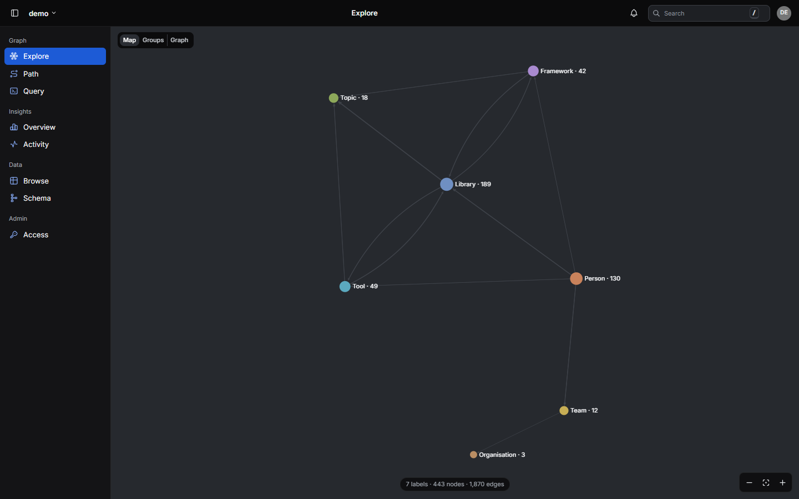
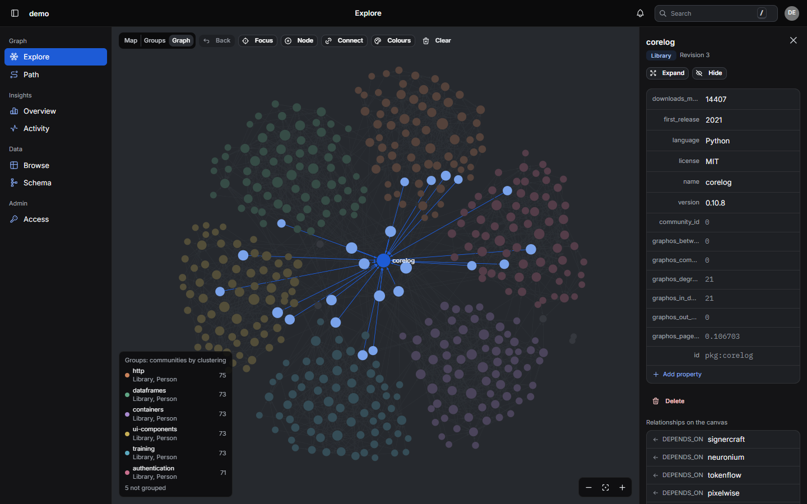
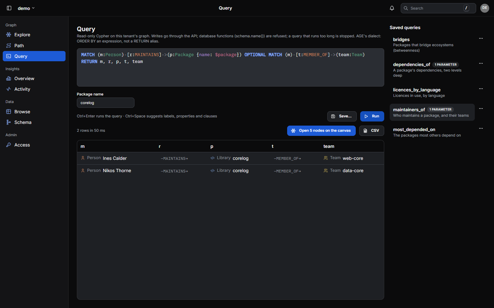

# graphos usage guide

A practical guide to integrating with graphos, a multi-tenant property-graph service (FastAPI on
PostgreSQL 16 + Apache AGE 1.6). The service code is the reference: routers live in
`services/graphos/src/graphos/api/` and wire contracts in `services/graphos/src/graphos/contracts/`.
The live OpenAPI schema is served at `/docs` and `/openapi.json`.

Examples use tenant `acme`, vertex labels `User`, `Document` and `Tag`, and edge labels `AUTHORED`,
`FOLLOWS`, `TAGGED_WITH` and `WRITTEN_BY`.

---

## 1. Quick start

### 1.1 Secrets, stack, signing in

```bash
bash scripts/init-secrets.sh                      # or: pwsh scripts/init-secrets.ps1
docker compose -f docker-compose.graphos.yml up -d
curl -s http://localhost:8080/readyz              # {"status":"ready","registered_tenants":0}

export G=http://localhost:8080
# The first admin is graphos / graphos, and its password must be changed before anything
# else (§2); jq reads the answers.
T=$(curl -s -X POST "$G/v1/auth/login" -H "Content-Type: application/json" \
  -d '{"user": "graphos", "password": "graphos"}' | jq -r .access_token)
export TOKEN=$(curl -s -X POST "$G/v1/me/password" -H "Authorization: Bearer $T" \
  -H "Content-Type: application/json" \
  -d '{"current": "graphos", "new": "choose-your-own-password"}' | jq -r .access_token)
```

`TOKEN` is valid for 15 minutes; sign in again (`POST /v1/auth/login` with the new password) for
another. `init-secrets.sh` is idempotent (it never overwrites a file). In
`services/graphos/deploy/secrets/` it creates two files: `graphos_pw.txt` (the database
superuser's password, used only by the init scripts) and `graphos_app_pw.txt` (the password of
`graphos_app`, the role the API connects as). The compose
file publishes the API on `127.0.0.1:8080` only; put a reverse proxy in front of it for anything
beyond local use, and set `GRAPHOS_FORWARDED_ALLOW_IPS` to the proxy's address (§11).

`graphos_app` is created by `services/graphos/deploy/db-init/01-app-role.sh`. Like every script in
`db-init/`, it runs only when the data volume is empty. A volume created before that script existed
has no `graphos_app` role: create it by hand with the SQL in `01-app-role.sh` (as the superuser), or
start from a fresh volume.

### 1.2 Register a tenant (admin, or `create_tenants`)

```bash
curl -s -X POST "$G/v1/tenants" \
  -H "Authorization: Bearer $TOKEN" -H "Content-Type: application/json" \
  -d '{"name": "acme",
       "vertex_labels": ["User", "Document", "Tag"],
       "edge_labels": ["AUTHORED", "FOLLOWS", "TAGGED_WITH"]}'
# → {"tenant":"acme",...,"n_resolve_rules":0,"n_resolver_indexes":0,"status":"bootstrapped"}
```

### 1.3 Write, then read

```bash
curl -s -X POST "$G/v1/acme/graph/nodes" \
  -H "Authorization: Bearer $TOKEN" -H "Content-Type: application/json" \
  -d '{"nodes": [
        {"id": "u1", "label": "User",     "properties": {"name": "Ada", "team": "core"}},
        {"id": "u2", "label": "User",     "properties": {"name": "Lin", "team": "core"}},
        {"id": "d1", "label": "Document", "properties": {"name": "Design notes", "lang": "en"}}]}'

curl -s -X POST "$G/v1/acme/graph/edges" \
  -H "Authorization: Bearer $TOKEN" -H "Content-Type: application/json" \
  -d '{"edges": [
        {"src_id": "u1", "src_label": "User", "dst_id": "d1", "dst_label": "Document",
         "type": "AUTHORED", "properties": {"at": "2025-11-12T10:00:00Z"}},
        {"src_id": "u2", "src_label": "User", "dst_id": "u1", "dst_label": "User", "type": "FOLLOWS"}]}'
# → {"tenant":"acme","edges_upserted":2,"edges_skipped":0,"by_type":{...},"elapsed_ms":…}

curl -s "$G/v1/acme/graph/nodes/u1" -H "Authorization: Bearer $TOKEN"
# → {"tenant":"acme","external_id":"u1","label":"User","properties":{"id":"u1","name":"Ada",...},
#    "rev":1,"etag":"\"844424930131969.1\"","elapsed_ms":…}
curl -s "$G/v1/acme/graph/neighbors?node_id=u1" -H "Authorization: Bearer $TOKEN"
curl -s "$G/v1/acme/graph/search?q=design&label=Document" -H "Authorization: Bearer $TOKEN"
```

### 1.4 Python client

```python
# pip install -e clients/python   (distribution graphos-client, import name graphos_client)
import asyncio
from graphos_client import EdgeUpsert, GraphosClient, NodeUpsert, PasswordAuth

async def main(user: str, secret: str) -> None:
    auth = PasswordAuth(user, secret)          # signs in, renews its token by itself
    async with GraphosClient(base_url="http://localhost:8080", tenant="acme", auth=auth) as g:
        await g.register_tenant(vertex_labels=["User", "Document", "Tag"],      # create_tenants
                                edge_labels=["AUTHORED", "FOLLOWS", "TAGGED_WITH"])
        await g.upsert_nodes([NodeUpsert(id="u1", label="User", properties={"name": "Ada"})])
        await g.upsert_edges([EdgeUpsert(src_id="u1", src_label="User", dst_id="d1",
                                         dst_label="Document", type="AUTHORED")])
        node = await g.get_node("u1")                                         # None on 404
        hits = await g.search("ada", label="User", limit=10)
        print(node, hits.nodes)

asyncio.run(main("app", "<the service account's secret>"))
```

The constructor takes keyword arguments only: `base_url`, `tenant`, `auth=None` (a
`PasswordAuth`), `token=None` (a bearer token used as is), `timeout_s=30.0`, `retries=3` and
`retry_backoff_s=0.5`. With neither `auth` nor `token`, it signs in as `GRAPHOS_USER` /
`GRAPHOS_PASSWORD` when both are set. `PasswordAuth` signs in before the first request, signs in
again at 80% of the token's lifetime, and once more on a `401` (then sends the request again; safe
for writes, since graphos checks the token before doing anything). Errors raise `GraphosError` (`.status_code`, `.detail`); a
503 raises its subclass `GraphosNotReady`. The client retries network errors and 5xx responses other
than 504, but never a read/write timeout, `edges:resolve` or `recompute-communities`. Without a
wrapper (use HTTP): `snapshot-import`, `catalogue`, `/v1/db/*`, `?force_shrink=true`, and `limit` on
`/communities`.

---

## 2. Users, sign-in and access

graphos has **users** and **grants**, not static tokens. A user is a person (who signs in to the web
UI) or a service account (a program); both sign in with a name and a password, a service account's
password being its secret. Only a scrypt hash of it is stored.

**Signing in.** `POST /v1/auth/login {"user", "password"}` answers an access token, valid
`expires_in` seconds (`GRAPHOS_ACCESS_TOKEN_TTL_S`, 900). Send it as `Authorization: Bearer <token>`.
A person also gets a `refresh_token`: `POST /v1/auth/refresh {"refresh_token"}` answers a new pair
and the old refresh token stops working; one used twice ends the whole session (someone else has
it). Sessions end after `GRAPHOS_SESSION_IDLE_S` (3600) without a refresh and
`GRAPHOS_SESSION_MAX_S` (43200) in all; `POST /v1/auth/logout {"refresh_token"}` ends one. A service
account gets no refresh token: its client signs in again (the Python client does it by itself).
Sign-in failures answer 401 with one message whatever the cause; `GRAPHOS_LOGIN_MAX_FAILURES` (5)
wrong passwords lock the account for `GRAPHOS_LOGIN_LOCKOUT_S` (900), and more than
`GRAPHOS_LOGIN_ATTEMPTS_PER_MIN` (20) attempts a minute from one address answer 429.

**The first admin.** On a first start (no user), graphos creates the admin user **`graphos`**
with the password **`graphos`** (as Neo4j starts with `neo4j` / `neo4j`), or with the password in
`GRAPHOS_ADMIN_PASSWORD_FILE` when that is set. That password must be changed at the first
sign-in, and graphos logs a warning at every start until it is: until then the admin's tokens allow only `POST /v1/me/password`,
`GET /v1/me` and logout (403 otherwise), and there is no setting to skip this. The file is read only
while graphos has no user. A lost admin password: `python -m graphos reset-admin-password` where
graphos runs (`docker compose exec graphos-api python -m graphos reset-admin-password`) prints a new
random one, again to be changed at the next sign-in, and restores a disabled or deleted `graphos`.
`GRAPHOS_LOCAL_ADMIN=false` refuses the `graphos` sign-in once other admins exist. Until the first
password is changed, anyone who can reach the API can sign in with it: keep graphos on a private
address (the compose file publishes it on `127.0.0.1` only) until you have.

**Levels.** A grant gives a subject (`user:<name>`) a level on a tenant, or on a name pattern where
`*` matches anything (`sol_*`, `*`). Levels include the ones before them:

| Level | May |
|---|---|
| `read` | every operation that changes nothing: reads, search, aggregates, the schema, the change feed, jobs |
| `write` | + node and edge writes (single, batch, bulk, snapshot import), `edges:resolve`, the cache |
| `maintain` | + publish schema (re-register: labels, types, declared pairs, hierarchy, indexes, `strict_endpoints`; remove a declared pair; inspect the spec), recompute groups, compute metrics |
| `owner` | + give and take access to this tenant (any level, `owner` included), unregister it, restore it, delete it with its data |

Two global rights: `create_tenants` on a pattern (register a new tenant whose name matches, and
become its `owner`, as the creator of a PostgreSQL database owns it; also re-register any existing
tenant that matches) and `admin` (everything: users, every grant, `/v1/db/*`, vacuum). A user's level
on a tenant is the highest of its grants that match; a wrong tenant answers 403 before any SQL.
`/openapi.json` shows the access each operation needs as its bearer scope (`read`, `write`,
`maintain`, `owner` or `admin`). Reads sent as `POST` (`nodes:scan`, `edges:scan`, `induced_edges`,
`scoped_subgraph`, `sample_subgraph`, `nodes/aggregate`, `edges/aggregate`, `community-ids`) need
only `read`.

**Managing access.**

| Endpoint | Who | Does |
|---|---|---|
| `GET /v1/users` | admin | users and service accounts |
| `POST /v1/users {"name", "kind": "person" \| "service"}` | admin | create; the answer carries its password once (a person changes it at the first sign-in) |
| `PATCH /v1/users/{name} {"disabled"}` | admin | disable or enable; a disabled user's tokens stop at once |
| `POST /v1/users/{name}:reset-secret` | admin | a new password or secret, shown once; every token and session of the user stops |
| `DELETE /v1/users/{name}` | admin | delete it and its grants |
| `GET /v1/grants?subject=&tenant=` | anyone | admins see every grant; others their own and those on the tenants they own |
| `POST /v1/grants {"subject", "tenant", "level"}` | admin, or the tenant's owner | grant; an owner only on its tenant's exact name, never a pattern, `create_tenants` or `admin` |
| `DELETE /v1/grants?subject=&tenant=&level=` | the same | revoke |
| `POST /v1/me/password {"current", "new"}` | a user | change your password (12 characters at least, not your name); every other session ends and the answer carries new tokens |

Changes apply at once on every replica: tokens carry their user's version, which a password change,
reset or disable bumps, and grants are read from memory on every request and reloaded on every
replica through a Postgres `NOTIFY`. graphos refuses to disable, delete or revoke its last admin.
The web UI's Access page does all of this for graphos users and service accounts. It lists grants
to single sign-on identities (`oidc-group:` and the others below) and removes them; add those with
`POST /v1/grants`.

**For example**, a service that creates one tenant per solution and writes to it:

```bash
curl -s -X POST "$G/v1/users" -H "Authorization: Bearer $TOKEN" -H "Content-Type: application/json" \
  -d '{"name": "loader", "kind": "service"}'                 # → {"user": {…}, "password": "<secret>"}
curl -s -X POST "$G/v1/grants" -H "Authorization: Bearer $TOKEN" -H "Content-Type: application/json" \
  -d '{"subject": "user:loader", "tenant": "sol_*", "level": "create_tenants"}'
# The service: GRAPHOS_USER=loader GRAPHOS_PASSWORD=<secret>; its client signs in and renews.
```

These endpoints need no token: `/healthz`, `/readyz`, `/metrics`, `/v1/info`, `/`, `/docs`, and
`/v1/auth/login`, `/refresh`, `/logout`, `/config`, `/oidc/start`, `/oidc/callback`.

`GET /v1/me` tells a signed-in user who it is: `{"consumer", "kind", "via", "admin",
"must_change", "tenants", "levels", "create_tenants", "preferences"}` (`via`: `password` or `oidc`), where `tenants` lists the registered tenants it may use
(all of them for an admin) and `levels` its level on each. The web UI uses it to offer the right
tenants and controls.

`preferences` is what the user chose in the web UI, kept by graphos so that it follows them to any
browser and nothing is stored in the browser: `theme` (`auto`, `light`, `dark`) and `last_tenant`
(opened at the next sign-in when the address names none). `PATCH /v1/me/preferences` changes them
(JSON Merge Patch: `{"theme": "dark"}`; `null` removes one) and answers all of them. Only those
names are kept, each with the values it takes (422 otherwise), so the document never holds free
text or personal data; it is stored as one JSON document per user and deleted with the user.

`GRAPHOS_AUTH_DISABLED=true` turns all of this off: every request is an anonymous admin. Use it for
local development only.

### Single sign-on (OpenID Connect)

graphos accepts people signed in at any OpenID Connect provider, found through its discovery
document; the setup is in [sso.md](sso.md). Register graphos at the provider **once**, as a public
client with PKCE (no secret) whose redirect URI is the UI's `/auth/callback`
(`https://graphs.example.com/auth/callback`), then set:

```
GRAPHOS_OIDC_ISSUER=https://idp.example.com/realms/acme   # <issuer>/.well-known/openid-configuration
GRAPHOS_OIDC_CLIENT_ID=graphos
GRAPHOS_OIDC_REDIRECT_URIS=["https://graphs.example.com/auth/callback"]
# Optional:
GRAPHOS_OIDC_AUDIENCE=graphos            # aud of provider tokens sent to the API; default: the client id
GRAPHOS_OIDC_SCOPES=openid profile email
GRAPHOS_OIDC_DISPLAY_NAME=SSO            # the button: "Sign in with SSO" (or the provider's name)
GRAPHOS_OIDC_CONSUMER_CLAIM=preferred_username
GRAPHOS_OIDC_GROUPS_CLAIM=groups         # dotted paths work: realm_access.roles
GRAPHOS_OIDC_ROLES_CLAIM=roles
```

**In the UI.** Every page load first tries a silent sign-in (`prompt=none`): someone already
signed in at the provider, for any application, comes straight back signed in, on the page they
asked for; only someone without a provider session sees the sign-in page, which offers
"Sign in with SSO" and the graphos password form. graphos keeps the PKCE verifier and nonce
(`graphos_meta.oidc_pending`, 5 minutes, single use), exchanges the code itself and validates the
ID token (signature against the provider's published keys, issuer, audience, nonce, expiry); the
provider's tokens never reach the browser, which receives graphos's own access token (in page
memory) and session (the HttpOnly `graphos_session` cookie). Signing out also ends the provider session (`end_session_endpoint`), with the ID
token as `id_token_hint` (kept server-side with the session) so the provider does not ask to
confirm. The UI needs
no setting of its own: it reads `GET /v1/auth/config`.

| Endpoint | Does |
|---|---|
| `GET /v1/auth/config` | `{"password": true, "oidc": {issuer, client_id, scopes, display_name} \| null}` |
| `POST /v1/auth/oidc/start {"redirect_uri", "return_to", "silent"}` | the provider's authorization URL to open |
| `POST /v1/auth/oidc/callback {"state", "code"}` (or `"error"`) | graphos's tokens and `return_to`; an `error` such as `login_required` answers 401 |
| `POST /v1/auth/logout` | `{"end_session_url"}` for a session signed in at the provider |

**Access.** A first sign-in creates nothing. What someone signed in at the provider may do comes
from grants on `oidc-sub:<sub>`, `oidc-group:<group>`, `oidc-role:<role>` and
`oidc-client:<client id>`, together:

```bash
curl -s -X POST "$G/v1/grants" -H "Authorization: Bearer $TOKEN" -H "Content-Type: application/json" \
  -d '{"subject": "oidc-group:graph-analysts", "tenant": "*", "level": "read"}'
curl -s -X POST "$G/v1/grants" -H "Authorization: Bearer $TOKEN" -H "Content-Type: application/json" \
  -d '{"subject": "oidc-role:graph-admin", "tenant": "*", "level": "admin"}'
```

Without a matching grant the person signs in but sees no tenant. Groups and roles are read from the
ID token, and from the provider's access token when it is a JWT for graphos's audience; they are
taken at sign-in, so a change at the provider applies at the next sign-in, while a grant change in
graphos applies at once. A session signed in at the provider renews with its refresh token for up
to `GRAPHOS_SESSION_MAX_S`; a person disabled at the provider keeps it until then (or until the idle
limit when unused).

**Programs** that already hold provider credentials (client-credentials grant) may send the
provider's access token as the bearer instead of a graphos service account: graphos validates it
(issuer, `GRAPHOS_OIDC_AUDIENCE`, signature, expiry) and applies the grants of its subject, groups,
roles and `oidc-client:<azp>`. The Python client takes such tokens through
`BearerAuth(source)`, where `source` is an async callable answering `(token, seconds valid)`.

graphos needs outbound HTTPS to the provider (discovery, keys, token endpoint). If the provider is
unreachable at start, graphos starts anyway and graphos passwords keep working.

---

## 3. Tenant registration

`POST /v1/tenants`: `create_tenants` on a matching pattern for a new tenant (the caller becomes its
owner), `maintain` on it (or a matching `create_tenants`) to re-register one. The body is
`TenantSpecBody`:

| Field | Type | Rule |
|---|---|---|
| `name` | str | `^[A-Za-z][A-Za-z0-9_]{0,62}$`. Becomes the AGE graph and Postgres schema name. |
| `vertex_labels` | list[str] | each must match `^[A-Z][A-Za-z0-9_]{0,62}$` |
| `edge_labels` | list[str \| `{name, resolve_rule}`] | same pattern; `resolve_rule` is covered in §9 |
| `property_indexes` | list of `{label, properties, kind, unique, name}` | indexes on vertex-label properties (see below) |
| `generated_columns` | list of `{label, column, property, type}` | stored columns computed from a property (see below) |
| `label_hierarchy` | dict child→parent | both labels must be in `vertex_labels`, and a label cannot be its own parent; reads on the parent see the child's rows |
| `meta` | dict[str, str \| null] | free-form notes about the tenant; on a merge, `null` removes a key |
| `search_indexes` | dict name → `{labels, properties, analyzer, language}` | named search indexes for ranked search (§5, *search*); name `^[a-z][a-z0-9_]{0,39}$` |
| `edge_endpoints` | dict edge type → list of `{src, dst}` (or `[src, dst]`) | the label pairs each relationship type may join; see *Declared endpoints* below. At most 5000 pairs per request. |
| `strict_endpoints` | bool, optional | refuse edge writes outside the declared pairs; omitted: unchanged (off for a new tenant) |
| `display` | `{vertex: {label: {color, caption, size_by, icon} \| null}, edge: {type: {color, caption} \| null}}` | how the web UI draws each label and edge type; see *Label styles* below |
| `property_schema` | `{mode, vertex: {label or *: entry \| null}, edge: {type or *: entry \| null}}` | the properties each label and edge type carries, and how strictly writes are held to them; see *Property schema* below |

**Merge vs replace.** By default, re-registering merges the incoming spec into the stored one.
Labels, indexes, generated columns, the hierarchy and rules are unioned, and `meta` keys are
overwritten; a `meta` key sent as `null` is removed (`{"name": "acme", "meta": {"draft": null}}`). Search indexes are merged by name: declaring a name again replaces its definition. A
bare `{"name": "acme"}` therefore never shrinks a tenant. `?force_shrink=true`
replaces the stored spec instead. Labels removed this way are **not** dropped from AGE; their tables
and data stay in place. In both modes graphos then serves the stored (merged) spec: the response's
`vertex_labels` / `edge_labels` are the merged sets, and a partial re-registration does not hide
labels registered earlier. A `label_hierarchy` that breaks the rule above returns 422.

**Declared endpoints.** A relationship type can declare the label pairs it joins:
`"edge_endpoints": {"CALLS": [["Function", "Function"]], "DEFINES": [{"src": "File", "dst": "Symbol"}]}`.
They are the schema's associations: `GET /v1/{tenant}/schema` serves them and the web UI draws the
schema from them. Each type and label must be registered, already or in the same request (else
422). Pairs are added to the declared ones on every registration and never removed by a merge; a
child label satisfies a pair declared for its parent (`File -[DEFINES]-> Function` is declared when
`Function` inherits `Symbol`). `DELETE /v1/tenants/{name}/edge_endpoints?type=&src=&dst=` removes
one pair (`maintain`; no data is touched). With `?force_shrink=true`, a request that states
`edge_endpoints` replaces the declared pairs; one that leaves the field out keeps them.

With `"strict_endpoints": true`, graphos refuses an edge write of a declared type between labels its
pairs do not cover: `POST …/graph/edges` answers 400 for the whole batch, `edges:bulk` counts the
line in `rows_invalid`, and `edges:resolve` leaves those label pairs out (its result says how many).
The message reads `File-[CALLS]->Class is not declared: CALLS may join Function->Function. …`; it
does not say "not registered", so clients that re-register on schema drift are not set off. A type
that declares no pairs accepts any pair, strict or not, and edges already stored are never touched.
Snapshot imports restore edges as they were saved. Declared pairs and the setting are stored apart
from the spec (`graphos_meta.edge_endpoints`, `graphos_meta.tenant_settings`), so a server that
predates them cannot drop them when it rewrites a spec.

**Label styles.** `display` says how the web UI draws each vertex label and edge type, the same for
everyone on the tenant:

```json
{"name": "acme", "display": {
  "vertex": {"Person": {"color": "#5FA584", "caption": "full_name", "size_by": "graphos_pagerank", "icon": "person"},
             "Document": {"color": "#C9825B", "caption": "title", "icon": "document"}},
  "edge": {"AUTHORED": {"color": "#8D97AE", "caption": "role"}}}}
```

`color` is `#RRGGBB` (stored upper case); `caption` the property drawn as the name (default `name`,
else the id); `size_by` a numeric property the node's size follows (a metric, §8); `icon` one of
`person`, `people`, `building`, `document`, `folder`, `code`, `function`, `database`, `server`,
`cloud`, `package`, `tag`, `link`, `calendar`, `location`, `mail`, `key`, `lock`, `shield`, `bug`,
`star`, `flag`, `chart`, `settings`, `globe`, `book`, `cpu`, `branch`, `message`, `box`. Every key
is optional. Each label or type must be registered, already or in the same request (else 422). On
a merge an entry declared again replaces the stored one and `null` removes one
(`{"display": {"vertex": {"Person": null}}}`); entries left out stay. A label without an entry takes
its parent's colour (`label_hierarchy`), else the UI's own. The dry run warns about a colour too
close to the light or the dark canvas. `GET /v1/{tenant}/schema` serves `display` to every reader;
it is in the schema file and the change feed (`display` entries as `vertex:Person`, `edge:AUTHORED`).
Cosmetic: no effect on data, queries or validation.

**Property schema.** `property_schema` declares the properties each vertex label and edge type
carries, and how strictly writes are held to them:

```json
{"name": "acme", "property_schema": {
  "mode": "warn",
  "vertex": {
    "*": {"properties": {"source": {"type": "string", "required": true}}},
    "Person": {"description": "Someone who writes", "properties": {
      "name": {"type": "string", "required": true},
      "email": {"type": "string", "pattern": "[^@]+@[^@]+", "recommended": true},
      "born": {"type": "string", "format": "date"}}}},
  "edge": {"AUTHORED": {"undeclared": "warn", "properties": {
    "role": {"type": "string", "enum": ["lead", "co", "editor"]},
    "share": {"type": "number", "minimum": 0, "maximum": 1}}}}}}
```

`mode` is `off` (stored, served and exported; nothing checked), `warn` (rows are checked, written
anyway and counted) or `strict` (a row with an error is refused). Omitted, it stays as registered
(`off` for a new tenant). An entry may set its own `mode` and
`undeclared`. Per property: `type` (`string`, `number`, `integer`, `boolean`, `array`, `object`,
`any`; JSON types, so `true` is not a number and `1.0` not an integer), `required` (absent or
`null` is an error), `recommended` (absent is a warning only, in any mode), `enum`, `pattern` (a
full match, Python `re`), `format` (`date`, or `date-time` with an offset or `Z`), `minimum` and
`maximum` (inclusive), `items` (an array's items: `type`, `enum`, `pattern`) and `description`.
`undeclared` says what happens to keys no definition names: `allow` (the default), `warn` or
`reject`. `id` may declare a `pattern` only; `graphos_*` and `community_id` are written by graphos
and cannot be declared.

Definitions combine: `*` first, then the label's ancestors (`label_hierarchy`), then the label's own
entry. A later entry may add rules to a property (`required`, a narrower `enum`) but not change its
type (else 422). Each label or type must be registered, and patterns must compile (else 422). On a
merge an entry declared again replaces the stored one and `null` removes one; entries left out stay.

Every write path checks the row as sent: `POST …/graph/nodes` and `…/edges` answer 422
(`application/problem+json`: `violations`, the first 100, and `total`) and write nothing; the bulk
and snapshot endpoints count the line in `rows_invalid` with the reason in `errors`; `PATCH` and
`POST …/properties` check the row the change leaves, under its lock. Responses count by
`<label or *>.<property>:<rule>`: `property_warnings` (written) and, on the bulk and snapshot
endpoints, `property_violations` (refused). `snapshot-import?properties=report` checks and counts
but refuses nothing, to restore data older than its definitions. Prometheus counts every problem
in `graphos_property_violations_total{tenant,kind,outcome,rule}`.

`POST /v1/{tenant}/graph/properties:check` (`maintain`; `Prefer: respond-async` runs it as a
job) reads the stored rows as if every rule applied, whatever the mode, so a schema can be tried in
`off` before it is turned on: per label and type, rows read, rows with errors and warnings, counts
by rule, some example ids (`examples`, default 10) and the undeclared names the rows carry.
`labels` and `types` narrow it. `GET /v1/{tenant}/schema` serves `property_schema` to every reader; it is in the schema
file (version 2 when present) and the change feed (entries as `vertex:Person`, the mode as
`property_mode`).

**Indexes created automatically.** Per vertex label: `<Label>_properties_gin` (GIN on
`properties`), `<Label>_id_unique` (unique on the `id` property, so ids are unique within a label),
`<Label>_community_id`, and `<Label>_name_trgm` (trigram GIN on `name`, serves `/graph/search`). Per
edge label: unique and plain `(start_id, end_id)` indexes, an `end_id` btree, and partial indexes on
`end_community_id` and `start_community_id`. Any other property is indexed by declaring it in
`property_indexes`.

**Property indexes.** A registration declares what to index, not how; graphos writes the SQL, as for
search indexes and resolve rules, and no SQL is accepted from a client. Each entry:

| Key | Default | Meaning |
|---|---|---|
| `label` | | a vertex label of the tenant (registered, or in the same request) |
| `properties` | | 1 to 4 property names, in index order |
| `kind` | `equality` | `equality`: a btree serving `where` filters (`=`, `!=`, `in`, `exists`) on those properties, as in `nodes:scan`; best for short values (ids, keys, kinds). `trigram`: a trigram GIN serving the substring match of `/graph/search?property=…` on one text property |
| `unique` | `false` | no two nodes of the label may share the values (`equality` only): a write that would gets 409, and declaring it over nodes that already share values gets 422 |
| `name` | `<Label>_<properties>_<kind>_idx` | the Postgres index name; an index of that name that already exists is kept as it is |

graphos builds each index with the expression its reads compile to, so the planner uses it, and
builds it `CONCURRENTLY`: writes go on while it is built.

**Generated columns.** `{label, column, property, type}` adds a stored column to a vertex label's
table, for reading it with SQL directly (reports, BI tools); graphos's own reads do not use it. `type`
is `text` (the value as text, any JSON type), `numeric` or `boolean` (the value when it is a JSON
number / boolean, otherwise `NULL`) or `jsonb`; a value of another type never fails a write. The
column name is lower case and may not be one graphos uses (`id`, `properties`, `start_id`, `end_id`,
`community_id`, `end_community_id`, `start_community_id`, any `graphos_…`). A column cannot change once registered
(422); adding one to a label that has nodes rewrites its table, so declare it early.

Before 0.6.0 both were SQL statements (`indexes`, and strings in `generated_columns`); a request
that still sends SQL in them gets 422, while the empty lists older clients send are accepted and
ignored. Specs stored by an earlier version are converted when the server
starts: see the [changelog](../CHANGELOG.md).

```bash
curl -s -X POST "$G/v1/tenants" \
  -H "Authorization: Bearer $TOKEN" -H "Content-Type: application/json" \
  --data-binary @- <<'EOF'
{
  "name": "acme",
  "vertex_labels": ["User", "Document", "Tag"],
  "edge_labels": ["AUTHORED", "FOLLOWS", "TAGGED_WITH"],
  "property_indexes": [
    {"label": "Document", "properties": ["lang"]},
    {"label": "User", "properties": ["email"], "unique": true}
  ]
}
EOF
```

A `where` clause on `lang` in `nodes:scan` then uses the first index; the second refuses a second user
with the same `email`.

| Call | Effect |
|---|---|
| `GET /v1/tenants[?unregistered=true]` | `{"tenants": [TenantInfo…]}`: the tenants the caller may maintain (all for an admin). With `unregistered=true`, also `"unregistered": [{"name", "kind", "vertex_labels", "edge_labels", "created_at", "unregistered_at", "unregistered_by"}…]`: the unregistered tenants the caller owns (every one for an admin, orphans included, see below) |
| `GET /v1/tenants/{name}` | one `TenantInfo` (404 if unknown); `maintain` |
| `GET /v1/tenants/{name}/spec` | the whole schema as a file (see *Export and import a schema*); `maintain` |
| `POST /v1/tenants?dry_run=true` | what a registration would change, writing nothing (same levels as registering) |
| `DELETE /v1/tenants/{name}` | **Unregisters the tenant and keeps its data.** Its registration (schema, declared endpoints, settings) is set aside and the grants on its name stay, so it can be restored as it was. Returns `{"tenant", "status": "unregistered"}` (404 if not registered); `owner`. |
| `DELETE /v1/tenants/{name}?drop_data=true` | **Deletes the tenant for good**, registered or unregistered: its AGE graph and data, its registration, K/V cache, community map, finished jobs, change records (a reader holding a cursor into them gets 410) and the grants on its name. Cannot be undone: download the dataset first. 409 while a job is queued or running on it, or when an export, an import or a long query holds its tables for more than 5 s. Returns `{"tenant", "status": "deleted"}`; `owner` (an orphan: admin). |
| `POST /v1/tenants/{name}/restore` | Registers an unregistered tenant again, as it was. 404 if there is none by that name, 409 if it is registered or an orphan; `owner`. |
| `DELETE /v1/tenants/{name}/edge_endpoints?type=&src=&dst=` | Removes one declared label pair; 404 if it is not declared. |

Any token on a tenant, read-only included, can read its shape with `GET /v1/{tenant}/schema`:
`{"name", "vertex_labels", "edge_labels", "label_hierarchy", "search_indexes", "rule_edge_labels",
"edge_endpoints", "strict_endpoints"}`.
It leaves out what only maintainers see (property indexes, generated columns, rule bodies, `meta`).

**Export and import a schema.** `GET /v1/tenants/{name}/spec` answers the tenant's whole schema as
a file (`<name>.schema.json`, format `graphos.schema`, version 1). The file **is a registration
body**: posting it to `POST /v1/tenants` registers that schema, and changing `name` imports it into
another tenant (created when new, with `create_tenants`). It is lossless: labels, edge labels with
their resolve rules (one `{name, resolve_rule}` entry per rule), `label_hierarchy`,
`edge_endpoints`, `strict_endpoints`, search and property indexes, generated columns and `meta`. It
holds no data, grants or computed values. Lists are sorted and keys in a fixed order, so two exports
of the same schema differ only in their `_export` header, and a diff in git shows only what changed.

```json
{
  "_export": {"format": "graphos.schema", "version": 1, "graphos": "0.7.0",
              "tenant": "acme", "exported_at": "2026-10-12T09:30:00Z"},
  "name": "acme",
  "vertex_labels": ["Document", "User"],
  "edge_labels": ["AUTHORED"],
  "…": "…"
}
```

Registration checks the `_export` header and ignores it otherwise: a file of another format, or of
a newer version than the server reads, is refused with 422; a body without one is a plain
registration. Import merges by default and replaces with `?force_shrink=true`, as any registration.

`?dry_run=true` checks the request as a registration would (names, label references, the label
hierarchy, a generated column that would change, a search index's labels and text-search language)
and answers what it would change, writing nothing:

```json
{"tenant": "acme", "exists": true, "mode": "merge", "status": "dry_run",
 "changes": {"added": {"vertex_labels": ["Invoice"], "property_indexes": ["Invoice(number) unique"]}},
 "warnings": ["generated column Document.kind is added to a label with about 120,000 nodes: its table is rewritten, writes to it wait meanwhile"]}
```

`changes` is what the change feed records when the registration is applied (`null` if nothing
would change; `registered: true` for a new tenant). `warnings` name what applying would cost or
could still fail on: a generated column on a label that has nodes, a unique property index over
values nodes already share (the dry run checks), a search index over more than 100,000 nodes, and,
when replacing, labels left out (their tables and data stay).

A registration carries at most 5,000 declared label pairs. A schema with more is imported in
several calls: the first with everything else (and `force_shrink` when replacing), the rest adding
pairs; the Python client's `import_schema` and the web UI do this.

While a tenant is unregistered, data-plane calls to it return 404. Its name is not free: registering
it again (`POST /v1/tenants`) restores it first, with the schema it had, for its owner or an admin,
and is refused (409) to anyone else, so a name someone else may create never hands them old data.
To free the name, delete the tenant with its data (`?drop_data=true`).

A graph unregistered before 0.8.2 kept no registration: it is listed as an `orphan` (admins only).
An admin registers it again with its schema, or deletes it with its data; anyone else is refused
(409) when registering its name.

---

## 4. Writing data

Nodes merge on `id` within their label and edges on `(src, dst, type)`; re-sending a payload is a
no-op. New property keys are added and omitted keys are kept. Edge endpoints must already exist: an
input edge with a missing endpoint is counted in `edges_skipped`, not raised. `nodes_upserted` and
`edges_upserted` count the **distinct** rows written: rows with the same `id` (or, for edges, the
same src/dst pair) in one batch collapse into one row, and the last one wins. Unregistered labels return
400 on JSON endpoints and count as invalid lines on NDJSON endpoints. Ids (`id`, `src_id`, `dst_id`)
are 1–512 characters; labels and `type` must match `^[A-Z][A-Za-z0-9_]{0,62}$`.

| Path | Endpoint | Body | Use when |
|---|---|---|---|
| Small batch | `POST /v1/{t}/graph/nodes`, `/edges` | JSON `{"nodes": [...]}` / `{"edges": [...]}`, 1–1000 rows | interactive or incremental writes |
| Property merge | `POST /v1/{t}/graph/nodes/{external_id}/properties[?label=]` | `{"properties": {...}}` (at least one key) | adding top-level values to an existing node without knowing its label (404 if the node is absent) |
| Patch a node | `PATCH /v1/{t}/graph/nodes/{external_id}[?label=]` | JSON Merge Patch | changing or removing properties of one node; returns the node as written |
| Patch an edge | `PATCH /v1/{t}/graph/edges/{type}?src=&dst=[&src_label=&dst_label=]` | JSON Merge Patch | changing or removing properties of one edge; returns the edge as written |
| NDJSON bulk | `POST /v1/{t}/graph/nodes:bulk`, `/edges:bulk` | NDJSON, one `NodeUpsert` / `EdgeUpsert` per line | large loads; bad lines are skipped and reported |
| Snapshot import | `POST /v1/{t}/graph/snapshot-import` | NDJSON mixing nodes and edges, with `_kind` on each line | one request for a mixed file |

**One node or edge by identity.** A node is named by its `id`, an edge by its type and the ids
of its two ends. Ids are unique within a label but not across labels, so an id can name a node in
two labels; an identity that matches more than one node or edge answers 409 with the candidate
labels, and nothing is written, until `label` (nodes) or `src_label` / `dst_label` (edges) picks
one. The patch is a JSON Merge Patch (RFC 7396), sent as `application/merge-patch+json` or
`application/json`: a key set to `null` is removed, a nested object merges key by key, any other
value (arrays included) replaces the old one, and keys not in the patch are kept. A node's `id`
cannot be patched (422). The row is read, locked, patched and written back in one transaction.
An id may contain `/` (a file path, say): the routes that take an id in the path read the rest of
the path as the id, encoded (`%2F`) or not.

```bash
curl -s -X PATCH "$G/v1/acme/graph/edges/AUTHORED?src=u1&dst=d1" \
  -H "Authorization: Bearer $TOKEN" -H "Content-Type: application/merge-patch+json" \
  -d '{"role": "editor", "draft": null}'
# → {"tenant":"acme","type":"AUTHORED","src_id":"u1","src_label":"User","dst_id":"d1",
#    "dst_label":"Document","properties":{"role":"editor"},"rev":2,
#    "etag":"\"1125899906842625.2\"","elapsed_ms":…}
```

**Revisions and `If-Match`.** Every node and edge has a revision: 1 when created, plus one on
every write to it (upserts, merges, patches and the community write-back; a write of the same
values counts too). Reads and writes of one node or edge return it as `rev` and as the `ETag`
header (also `etag` in the body), `"<graphid>.<rev>"`, so a node deleted and created again never
matches an old ETag. Send it back as `If-Match` on `PATCH`, `DELETE` or the property merge to
write only if nobody else has written since your read. On a mismatch the answer is 412 with the
current `ETag`, and nothing is written. `If-Match: *` means "if it still exists". With `If-Match`,
`DELETE /nodes/{id}` must name exactly one node (409 if the id is in several labels).
`GRAPHOS_REQUIRE_IF_MATCH=true` makes `If-Match` mandatory on those writes (428 without it);
batch upserts are not affected.

```bash
ETAG=$(curl -s -D - -o /dev/null "$G/v1/acme/graph/nodes/u1" -H "Authorization: Bearer $TOKEN" \
  | tr -d '\r' | sed -n 's/^etag: //Ip')
curl -s -X PATCH "$G/v1/acme/graph/nodes/u1" -H "Authorization: Bearer $TOKEN" \
  -H "If-Match: $ETAG" -H "Content-Type: application/merge-patch+json" -d '{"name": "Ada L."}'
# → 200 with the new ETag, or 412 if u1 changed after the GET
```

**Atomicity.** A small-batch call runs one transaction per label (nodes) or per
`(src_label, dst_label, type)` group (edges). The NDJSON endpoints commit in batches: 500 rows per label or edge
group for `:bulk`, and 5000 for `snapshot-import`. Each batch is its own transaction, so a stream
that fails partway leaves the earlier batches committed. Every write merges, so retrying the whole
stream is safe.

**How rows are written.** Every write endpoint (`/nodes`, `/edges`, `nodes:bulk`, `edges:bulk` and
`snapshot-import`) goes through the same SQL upsert; graphos writes no rows through Cypher. Each
batch is loaded into a staging table with binary `COPY`, then one `INSERT … ON CONFLICT` per label
or edge group merges it: `ON CONFLICT ((properties->'"id"')) DO UPDATE SET properties = properties
|| EXCLUDED.properties` for nodes, and `ON CONFLICT (start_id, end_id)` with the same property merge
for edges. There is no switch for this; it is the only write path. Node upserts rely on
`<Label>_id_unique` and edge upserts on the unique `(start_id, end_id)` index, both installed by
bootstrap. Registered tenants are re-bootstrapped at startup, so a tenant created before those
indexes existed gets them on the next restart.

### NDJSON bulk

```bash
cat > nodes.ndjson <<'EOF'
{"id": "t1", "label": "Tag", "properties": {"name": "architecture"}}
{"id": "d2", "label": "Document", "properties": {"name": "Runbook", "lang": "en", "tag_names": ["Architecture"]}}
EOF
curl -s -X POST "$G/v1/acme/graph/nodes:bulk" \
  -H "Authorization: Bearer $TOKEN" -H "Content-Type: application/x-ndjson" \
  --data-binary @nodes.ndjson
# → {"rows_received":2,"rows_invalid":0,"nodes_upserted":2,"by_label":{"Tag":1,"Document":1},"errors":[],...}
```

Invalid lines are counted in `rows_invalid`; the first 50 are listed in `errors` as
`"line N: …"`. If the stream itself fails, the response is 400 with the generic detail
`"stream error (<ExceptionType>); see server log"` (`snapshot-import`: `"snapshot import failed (<ExceptionType>); see server log"`); database error text stays in the server log. From Python, use `g.bulk_upsert_nodes([...])` and `g.bulk_upsert_edges([...])`.

### Snapshot import

`snapshot-import` buffers NDJSON lines and groups them by label or edge key, then writes each group
with the same COPY-staged SQL upsert as the `:bulk` endpoints. A line without `_kind` is treated as a
node; a line that is not valid JSON, or not a JSON object, is skipped and listed in `errors`.

```bash
cat > snapshot.ndjson <<'EOF'
{"_kind": "node", "id": "u3", "label": "User", "properties": {"name": "Kim"}}
{"_kind": "edge", "src_id": "u3", "src_label": "User", "dst_id": "u1", "dst_label": "User", "type": "FOLLOWS", "properties": {}}
EOF
curl -s -X POST "$G/v1/acme/graph/snapshot-import" \
  -H "Authorization: Bearer $TOKEN" -H "Content-Type: application/x-ndjson" \
  --data-binary @snapshot.ndjson
# → {"nodes_received":1,"edges_received":1,"nodes_upserted":1,"edges_upserted":1,"edges_skipped":0,...,"errors":[]}
```

Buffered nodes are flushed before every edge flush, mid-stream and at the end, so an edge never
misses an endpoint that appeared earlier in the same stream. Each 5000-row batch commits on its own:
the stream is not atomic, and a failure partway leaves the earlier batches written (re-sending the
stream is safe). A stream of more than 50,000,000 rows returns 413.

**Memory.** Bodies are streamed: `:bulk` and `snapshot-import` read the body line by line, and the
audit middleware hashes it chunk by chunk as they read.

### Dataset export and import

`GET /v1/{tenant}/graph/snapshot` exports the tenant as one file that `snapshot-import` reads back
(`graphos.snapshot`, version 1):

```text
{"_kind":"header","format":"graphos.snapshot","version":1,"graphos":"0.8.0","tenant":"acme",
 "exported_at":"…","computed":true,"counts":{"nodes":3,"edges":2},"schema":{…}}
{"_kind":"node","id":"u1","label":"User","properties":{"id":"u1","name":"Ada"}}
…
{"_kind":"edge","src_id":"u1","src_label":"User","dst_id":"d1","dst_label":"Document","type":"AUTHORED","properties":{}}
…
{"_kind":"end","counts":{"nodes":3,"edges":2}}
```

- The header carries the tenant's schema (the document of *Export and import a schema*, without its
  `_export` header) and counts; the end line, what was written. A file without its end line was cut
  off.
- Nodes come first, label by label in id order, each **once, with its own label** (a child label's
  nodes are not repeated under its parent); edges follow, type by type, in no set order within a
  type. An import therefore never meets an edge before its ends. Two exports of the same data hold
  the same lines; compare their edges as sets.
- Read in one consistent snapshot (`REPEATABLE READ`), with flat memory: each table through a
  server-side cursor, each edge's ends through a temporary table of every vertex built once per
  export. A dev copy of about 570,000 nodes and 10 million edges exported in 6 to 8 minutes with
  gzip (276 MB) and 13 minutes without (2.8 GB); the exporting process went from 45 MB to a peak of
  144 MB. The transaction stays open for the whole export,
  which holds back vacuum on the tenant's tables meanwhile; export large tenants off-peak.
- `labels` / `types` narrow it (an edge is exported only when both its ends are); `computed=false`
  leaves out `graphos_*` and `community_id`; `gzip=true` compresses it (`<tenant>.ndjson.gz`).
- Not in the file: graphids (reassigned on import; ids are the key), revisions, the community map
  (recompute after a restore), grants. `read`; each export is recorded in the audit log (message
  `read`) with who made it.

```bash
curl -s "$G/v1/acme/graph/snapshot?gzip=true" -H "Authorization: Bearer $TOKEN" -o acme.ndjson.gz
```

`snapshot-import` reads such a file:

- the header is checked (another format, or a newer version: 422) and reported back without its
  schema (`header`), with `complete` saying whether the end line arrived;
- a gzip body (it starts with the gzip magic bytes) is decompressed; a body that grows past
  `GRAPHOS_IMPORT_MAX_BYTES` (default 16 GiB, after decompression) stops with 413;
- `?mode=empty` imports only into a tenant without nodes (409 otherwise), for an exact restore;
  `mode=merge`, the default, adds to what is there;
- when the file's nodes carry `community_id`, each edge's copy of its ends' communities is restored
  from them (`edge_communities_set`), so community-scoped walks work without a recompute.

To restore into a new tenant, register the header's schema first (rename `name`), then import with
`mode=empty`; the Python client's `import_dataset(path, schema="apply", mode="empty", name=…)` and
the web UI's Overview page do both.

```bash
curl -s -X POST "$G/v1/acme_copy/graph/snapshot-import?mode=empty" \
  -H "Authorization: Bearer $TOKEN" -H "Content-Type: application/x-ndjson" \
  --data-binary @acme.ndjson.gz
# → {"nodes_upserted":3,"edges_upserted":2,"complete":true,"header":{…},"mode":"empty",…}
```

### Deletes

| Call | Effect |
|---|---|
| `DELETE /v1/{t}/graph/nodes/{node_id}[?label=]` | Delete the node(s) with that external id (in any label, or only in `label`) and their edges, in one transaction; idempotent (`nodes_deleted: 0` if absent) |
| `DELETE /v1/{t}/graph/edges/{type}?src=&dst=[&src_label=&dst_label=]` | Delete one edge; its end nodes stay; idempotent (`edges_deleted: 0` if absent); 409 when several edges match |
| `DELETE /v1/{t}/graph/nodes?property_key=team&property_value=core` | Delete every node whose property equals that string, and their edges, in one transaction; returns node and edge counts (each edge once) |

---

## 5. Reads that compose

Reads identify nodes by external `id`. Bootstrap enforces id uniqueness only *within* a label, so
keep ids unique across the whole tenant, for example `user:42` and `doc:42`. Where an id is in
several labels anyway, `GET /graph/nodes/{external_id}` answers 409 until `label` picks one; the
other reads return every match.

| Endpoint (`/v1/{t}` prefix) | Method | Key inputs (default / max) | Returns |
|---|---|---|---|
| `/graph/search` | GET | `q` (1–200 chars), `label`, `limit` (20 / 200); `index`, `fuzzy` (false), `min_score` (0); without `index`: `property` (`name`) | `nodes[{id, label, properties, score, matched}]`, `truncated`; `id` is the AGE graphid (integer), the external id is `properties.id` |
| `/graph/nodes/{external_id}` | GET | `label` | `label`, `properties` (404 if absent) |
| `/graph/edges/{type}` | GET | `src`, `dst`, `src_label`, `dst_label` | one edge: `src_label`, `dst_label`, `properties` (404 if absent) |
| `/graph/paths` | POST | `src`, `dst` (+ labels), `rel_types`, `direction` (`both`), `max_hops` (4 / 8), `limit` (1 / 100), `include_properties` | the shortest paths: `hops`, `paths[{hops, nodes[], edges[]}]`, `truncated` |
| `/graph/neighbors` | GET | `node_id`, `rel_types` (repeatable), `limit` (50 / 500) | 1-hop `neighbors[{neighbor_id, neighbor_label, direction, edge_type, …}]` |
| `/graph/expand` | GET | `node_id` (always required), `seeds` (repeatable), `rel_types`, `max_hops` (2 / 5), `direction` `in\|out\|both`, `limit` (100 / 1000), `communities` | `paths[{end_id, end_label, hops, rel_path}]` |
| `/graph/induced_edges` | POST | `node_ids` (1–1000), `rel_types`, `limit` (500 / 5000) | edges within the set |
| `/graph/nodes:scan` | POST | `labels`, `where`, `project`, `order_by`, `limit` (500 / 2000), `cursor` | `items`, `next_cursor` |
| `/graph/edges:scan` | POST | `types`, `where`, `project`, `limit` (500 / 2000), `cursor` | `items[{src_id, src_label, dst_id, dst_label, type, properties}]` |
| `/graph/sample_subgraph` | POST | `label` (required), `filter_property`/`filter_value`, `rel_types`, `per_rel` (50 / 500), `include_properties`, `edge_properties` | stratified `nodes`, `edges` |
| `/graph/scoped_subgraph` | POST | see below | `nodes[{id (external id), label, properties}]`, `edges`, `truncated` |
| `/graph/export` | GET | `node_ids`, `rel_types`, `limit_nodes` (5000 / 50000) | graphology JSON |
| `/graph/catalogue` | GET | `property` (repeatable), `refresh` | `by_property`: property → labels |

- **search** without `index` matches the `name` property with a case-insensitive `ILIKE '%q%'`,
  served by the trigram index `<Label>_name_trgm`, unranked. `q` is matched literally: `%` and `_`
  are escaped, not wildcards. With `index`, it ranks through a search index (below). Each hit's
  `id` is the AGE internal graphid, an integer; read the caller's external id from `properties.id`.
- **neighbors** and **expand** report the other node by external id (`neighbor_id`, `end_id`),
  with its full property bag alongside. They return an empty result, not 404, when the seed is missing. With
  `seeds`, one BFS runs from every seed; `node_id` is then ignored, but you must still send it.
  `communities` restricts end vertices to those `community_id` values. A tenant with no edge
  labels gives an empty result.
- **export** supports one format only, graphology JSON: `{attributes, options, nodes[{key,
  attributes}], edges[{key, source, target, undirected, attributes}]}`. A node's `key` is its
  external id. Its attributes add `label` (the `name` value, falling back to the id) and `_kind`
  (the vertex label).
- **sample_subgraph** takes up to `per_rel` edges of every edge type (or of `rel_types`), whatever
  the endpoint labels. `label` does not filter the sample: it names the vertex table that
  `include_properties` are read from, and endpoints outside it come back as id-only nodes. With
  `filter_property`/`filter_value`, only edges whose two endpoints are rows of `label` with that
  value are kept; the filter applies even when `include_properties` is empty (the default).

```bash
curl -s "$G/v1/acme/graph/expand?node_id=u1&seeds=u1&seeds=u2&rel_types=FOLLOWS&max_hops=2&direction=out" \
  -H "Authorization: Bearer $TOKEN"
curl -s -X POST "$G/v1/acme/graph/induced_edges" \
  -H "Authorization: Bearer $TOKEN" -H "Content-Type: application/json" \
  -d '{"node_ids": ["u1", "u2", "d1"], "rel_types": ["AUTHORED", "FOLLOWS"], "limit": 1000}'
```

### search without an index

Without `index`, search is a case-insensitive substring match on `name`, unranked, served by the
trigram index registration creates on `name`. `property=<name>` matches another property
instead (`property=path`, `property=qualified_name`); those are read row by row until `limit`
hits are found, which is quick when many nodes match and slow on a large tenant when few do.
For properties searched often, declare a search index.

```bash
curl -s "$G/v1/acme/graph/search?q=src/billing&property=path&limit=10" -H "Authorization: Bearer $TOKEN"
```

### search indexes

A search index is declared at registration, like a full-text index in Neo4j or an ArangoSearch
view: a name, the vertex labels it covers, the string properties it searches, and an analyzer.

```json
"search_indexes": {
  "names": {"labels": ["*"], "properties": ["name", "qualified_name"]},
  "docs":  {"labels": ["Document"], "properties": ["summary"], "analyzer": "text", "language": "english"}
}
```

| Field | Default | Rule |
|---|---|---|
| `labels` | `["*"]` | vertex labels, or `["*"]` for every label, including labels registered later |
| `properties` | `["name"]` | 1–8 string properties; a node scores by its best-matching one, reported as `matched` |
| `analyzer` | `identifier` | `identifier` or `text` |
| `language` | `simple` | `text` only: a Postgres text-search configuration (`english`, `german`, …; `simple` = no stemming) |

graphos builds the Postgres GIN indexes behind each (label, property) without blocking writes:
`<Label>_<property>_words_search` and `<Label>_<property>_joined_search` for `identifier`,
`<Label>_<property>_text_<language>_search` for `text`. An unknown label or language returns 422.

`GET …/graph/search?q=…&index=names` then returns hits ordered by `score` in [0, 1]:

- **`identifier`**, for names, identifiers, codes and paths. A value is read as lower-case words:
  camelCase and acronyms are split and every other character is a word break, so
  `parseHTTPResponse`, `parse_http_response` and `parse-http-response` are all
  `parse http response`, and so is the query `Parse HTTP response`. Exact, prefix and contained
  matches compare the words run together, so a query typed without separators matches too:
  `parsehttpresponse` and `getuserbyid` are exact, `parsehttp` a prefix. An exact match scores 1, a
  prefix [0.9, 1), a contained match [0.8, 0.9), a match on similar words (trigrams) below 0.8;
  within a tier, whole words and shorter values score higher. Similar words already catch most
  typos (`getUsrById`). `fuzzy=true` asks for misspellings too when nothing matches literally
  (`UserSerivce`), as `term~` does in Lucene; it reads much more of the index, so it is off by
  default. Queries under three characters match exact and prefix only. Letters outside ASCII are split and lower-cased by the database's
  `LC_CTYPE` (the stock image uses `en_US.UTF-8`).
- **`text`**, for prose: Postgres full-text search with stemming and stop words for `language`.
  `q` takes web-search syntax: `"exact phrase"`, `or`, `-excluded`. The score is `ts_rank_cd`
  normalised to rank / (rank + 1).

`label` narrows to one label the index covers (400 otherwise), `min_score` drops weaker hits, and
an unknown `index` is 404. Ranking is computed over a bounded set of candidates per label,
property and kind of match (200), so with very common words the best hit can be missed; add words
or a `label` to narrow it.

```bash
curl -s "$G/v1/acme/graph/search?q=parse%20http&index=names&limit=5" -H "Authorization: Bearer $TOKEN"
```

### paths

`POST /graph/paths` finds the shortest paths between two nodes. It searches from both ends at
once, one SQL statement per level over the edge indexes, always growing the smaller side, so a
path of n hops costs n statements. It returns every path of the shortest length it finds, up to
`limit`; `hops` is null when there is no path within `max_hops`. `direction` is relative to the
path: `out` follows edges the way they point from `src` to `dst`, `in` against it, `both` either
way (the default). Each edge on a path keeps its stored direction in `src_id` / `dst_id`, which
can run against the path with `in` or `both`. A level that would touch more than 100,000 edges
stops the search with `truncated: true`; narrow `rel_types` or `direction` and retry.

```bash
curl -s -X POST "$G/v1/acme/graph/paths" -H "Authorization: Bearer $TOKEN" \
  -H "Content-Type: application/json" \
  -d '{"src": "u1", "dst": "u7", "direction": "both", "max_hops": 4, "limit": 5}'
# → {"hops":2,"paths":[{"hops":2,"nodes":[{"id":"u1","label":"User"},{"id":"d1","label":"Document"},
#    {"id":"u7","label":"User"}],"edges":[{"type":"AUTHORED","src_id":"u1","dst_id":"d1"},
#    {"type":"AUTHORED","src_id":"u7","dst_id":"d1"}]}],"truncated":false,"visited":…,...}
```

The vertices on the paths are read back by graphid. AGE does not index vertex graphids, so that
is one scan per label on the paths unless `GRAPHOS_VERTEX_GRAPHID_INDEXES=true`.

### nodes:scan

- `where`: `{"property", "op", "value"}` clauses combined with AND. `op` is `=`, `!=`, `in`,
  `not in`, `exists` or `not exists`. Values are compared **as text** (pass booleans as
  `"true"`/`"false"`); `in` / `not in` need a non-empty list.
- `project`: defaults to `["id"]`; `["*"]` returns the full property bag.
- `order_by`: `"id"` (default) or another property name, `"_node"` (graphid order, always indexed),
  a list of `{"property", "desc"}` clauses, or `null` for no ordering (422 if combined with `cursor`).
  Rows equal on every key are ordered by graphid, so paging never skips or repeats one.
- Each item's `label` is the label the node was written under. Scanning a parent label in
  `label_hierarchy` also returns its children's nodes, each under its child label; scanning both
  a parent and its child returns the child's nodes twice under the same `(id, label)`, so
  de-duplicate on that pair.

```bash
curl -s -X POST "$G/v1/acme/graph/nodes:scan" \
  -H "Authorization: Bearer $TOKEN" -H "Content-Type: application/json" \
  -d '{"labels": ["Document"],
       "where": [{"property": "lang", "op": "=", "value": "en"},
                 {"property": "archived", "op": "not exists"}],
       "project": ["name", "lang"], "limit": 500}'
# → {"items":[{"id":"d1","label":"Document","properties":{...}}],"next_cursor":"…"|null,"scanned":…,...}
```

To page, send `next_cursor` back unchanged with the same body until it is `null`. A page also ends
early at 10 MiB of payload, and then `truncated_by_payload_cap` is true. In Python, `async for item
in g.scan_nodes_iter(labels=["Document"], project=["name"])` handles paging, and
`scan_edges_iter(types=[...])` does the same for edges.

### scoped_subgraph

Returns the vertices whose `scope_property` equals the string `scope_value`, plus the edges among
them. graphos gives no meaning to the property names. Each node is `{id, label, properties}`, where
`id` is the external id and `properties` holds only the `include_properties` keys.

| Field | Default / limit |
|---|---|
| `scope_property`, `scope_value` | required; the value must be at least 1 character |
| `group_property` + `group_values` | keep only these values (up to 64), with `node_cap` split evenly across them |
| `include_properties` | `["name"]`, up to 32 |
| `exclude_property` + `exclude_substrings` | drop vertices whose property contains any of the substrings (case-insensitive, up to 64) |
| `node_cap` / `edge_limit` | 1200 (1–4000) / 8000 (1–12000) |
| `rel_types` | optional edge-type filter |

`group_values` requires `group_property`, and `exclude_substrings` requires `exclude_property`.

```bash
curl -s -X POST "$G/v1/acme/graph/scoped_subgraph" \
  -H "Authorization: Bearer $TOKEN" -H "Content-Type: application/json" \
  -d '{"scope_property": "team", "scope_value": "core",
       "group_property": "role", "group_values": ["lead", "member"],
       "include_properties": ["name", "role"],
       "exclude_property": "name", "exclude_substrings": ["bot"],
       "node_cap": 600, "rel_types": ["FOLLOWS"], "edge_limit": 4000}'
```

The scope filter is one scan over `_ag_label_vertex`. On large tenants, declare an index on the
scope property.

---

### Cypher console (opt-in)

For people who know Cypher, graphos can run **read-only** Cypher on one tenant's graph. It is off
unless an operator sets `GRAPHOS_CYPHER=true`; `GET /v1/info` then says `"cypher": true` and the
web UI shows a Query page: an editor that colours Cypher and suggests the tenant's labels, edge
types and property names as you type (Ctrl+Space asks), the result as a table and on the canvas,
and the tenant's saved queries.

```bash
curl -s -X POST "$G/v1/acme/cypher" -H "Authorization: Bearer $TOKEN" -H 'Content-Type: application/json' \
  -d '{"query": "MATCH (a:Person)-[w:WROTE]->(d:Doc {kind: $kind}) RETURN a, w, d LIMIT 50",
       "params": {"kind": "guide"}}'
# → {"columns": ["a", "w", "d"], "rows": [[{"node": {...}}, {"edge": {...}}, {"node": {...}}], ...],
#    "graph": {"nodes": [...], "edges": [...]}, "truncated": false, "elapsed_ms": 12}
```

- **Cells:** a vertex is `{"node": {id, label, properties}}` (`id` is the graphos id), an edge
  `{"edge": {type, properties, src_id, src_label, dst_id, dst_label}}` (ends `null` when they are
  not returned), a path a list of them. `graph` holds the returned nodes and the edges between
  them: return the nodes with their edges (`RETURN a, w, d`, or a path) to see them as a graph.
- **Columns** are named after the `RETURN` items (`AS` aliases, else the expression); `RETURN *`
  works, its columns named `c1`, `c2`, … .
- **Parameters** are used as `$name`.
- **Read-only:** `CREATE`, `SET`, `DELETE`, `MERGE` answer 400; write through the API, which keeps
  revisions, the change feed and the audit log right.
- **Only Cypher's own functions:** a call of a database function by its schema-qualified name
  (`pg_catalog.version()`) is refused (400) before the query reaches the database.
- **Limits:** `GRAPHOS_CYPHER_MAX_ROWS` rows (5,000; `truncated` says when more matched, and
  `"limit"` asks for fewer); `GRAPHOS_CYPHER_TIMEOUT_S` (30 s), after which the query is stopped
  (504; graphos also terminates a query AGE is slow to stop, and if even that is not seen, closes
  the connection so the caller is answered); one query per user at a time and
  `GRAPHOS_CYPHER_POOL_SIZE` (2) in all (429 when busy). Cancelling the request stops the query.
- **No variable-length patterns** (`-[:R*1..3]->`) **nor `vertex_stats()`** (400): AGE serves them
  from an in-memory copy of the whole graph, which it refuses to build from tables carrying more than
  its own columns, as graphos's do (revisions, communities). Worse, the failed attempt leaves a lock
  of AGE's taken in that database process, and the next such query there waits on it forever,
  beyond any cancel or timeout. Write the hops out (`-[:R]->()-[:R]->()`, with `OPTIONAL MATCH` for
  the further ones) or use `POST …/graph/paths`. And after any failed query the console closes its
  connection rather than reuse it.
- **Who:** `GRAPHOS_CYPHER_LEVEL` on the tenant (`read` by default). Each run is in the audit log.
- **AGE's dialect:** AGE 1.6 implements openCypher with gaps; for example `ORDER BY` cannot name a
  `RETURN` alias (order by the expression). `MATCH (n:Person)` includes the nodes of child labels
  (`label_hierarchy`); `label(n)` is a node's own label.

**Saved queries** are named, parameterised queries a tenant's maintainers keep for its readers:
`PUT /v1/{tenant}/cypher/saved/{name}` with `{"description", "query", "params": {"kind":
{"type": "string", "label": "Kind"}}, "show": "table" | "graph"}` (`maintain`);
`GET /v1/{tenant}/cypher/saved`; `POST /v1/{tenant}/cypher/saved/{name}:run` with `{"params": …}`
(each parameter of its declared type, 422 otherwise); `DELETE …/saved/{name}`. They go with the
tenant's data. Python: `cypher(query, params)`, `saved_queries()`, `save_query(...)`,
`run_saved_query(name, params)`, `delete_saved_query(name)`.

## 6. Aggregates

| Endpoint (`/v1/{t}` prefix) | Inputs (default / max) | Result |
|---|---|---|
| `POST /graph/nodes/aggregate` | `label`, `group_by`, `values`, `limit` (200 / 5000) | `groups[{value, count}]`, highest count first; a parent label includes its children |
| `POST /graph/edges/aggregate` | `group_by_src`, `group_by_dst`, `rel_types`, `src_values`, `dst_values`, `require_different`, `limit` (200 / 5000) | `groups[{src_value, dst_value, rel_type, count}]` |
| `GET /graph/labels/{label}/histogram` | `property` (required), `limit` (100 / 1000) | `bins[{value, count}]`, `n_total`, `n_distinct` (`-1` when truncated); a missing value counts as `""` |
| `GET /graph/labels/{label}/top` | `by_edge` (required), `direction` `out\|in\|both` (`out`), `k` (20 / 200) | `rows[{node_id, edge_count}]` |
| `GET /graph/stats` | – | exact per-label counts (a parent label includes its children), `n_vertices` and `n_edges` (each node and edge once), `total_bytes` |
| `GET /graph/map` | `exact` (false) | `labels[{label, count}]` (each label's own nodes), `links[{src_label, type, dst_label, count, estimated}]`, `estimated` |
| `GET /graph/map/hubs` | `label` (required), `limit` (40 / 200) | `nodes[{id, label, properties, degree, estimated}]`, most connected first |

```bash
curl -s -X POST "$G/v1/acme/graph/edges/aggregate" \
  -H "Authorization: Bearer $TOKEN" -H "Content-Type: application/json" \
  -d '{"group_by_src": "team", "group_by_dst": "team",
       "rel_types": ["FOLLOWS"], "require_different": true, "limit": 1000}'
curl -s "$G/v1/acme/graph/labels/User/top?by_edge=FOLLOWS&direction=in&k=10" \
  -H "Authorization: Bearer $TOKEN"
```

`histogram` and `top` return 400 when `{label}` or `by_edge` is not registered. The Python methods
are `aggregate_nodes`, `aggregate_edges`, `label_histogram(label, property=…)`,
`label_top_by_edge(label, by_edge=…)`, `tenant_stats()`, `graph_map(exact=…)` and
`map_hubs(label, limit=…)`.

### graph map

`GET /graph/map` is a tenant at a glance: every vertex label with its node count, and every
(source label, relationship type, target label) with its edge count. It reads AGE's storage
directly (an edge carries its ends' labels in their graph ids), so no vertex table is joined.
Edge tables the planner estimates above 300,000 rows are read through `TABLESAMPLE SYSTEM`
(about 200,000 rows) and their counts scaled and flagged `estimated`: about a second on a tenant
of ten million edges, with counts within a few percent; a pair with only a handful of edges in a
very large table can be missed. `exact=true` counts every edge (seconds on such a tenant).
`GET /graph/map/hubs?label=` returns that label's best-connected nodes (edges in and out, every
type, sampled the same way), a place to start exploring a label; 404 for an unknown label.

```bash
curl -s "$G/v1/acme/graph/map" -H "Authorization: Bearer $TOKEN"
# → {"labels":[{"label":"User","count":1200},…],"links":[{"src_label":"User","type":"AUTHORED",
#    "dst_label":"Document","count":5400,"estimated":false},…],"estimated":false,…}
curl -s "$G/v1/acme/graph/map/hubs?label=User&limit=10" -H "Authorization: Bearer $TOKEN"
```

---

## 7. K/V cache

A per-tenant store for opaque JSON values, such as expensive aggregates. Reads check an in-process
LRU first (256 entries per replica), then `graphos_meta.cache` in Postgres. With several replicas,
a `PUT` or `DELETE` through one evicts the key on the others at once; an entry is never served from
memory for longer than `GRAPHOS_CACHE_MAX_AGE_S` (30 s).

| Call | Body / result |
|---|---|
| `PUT /v1/{t}/graph/cache/{key}` | `{"value": <any JSON>, "ttl_seconds": 1…2592000 \| null}` → `{key, expires_at, bytes_written, …}` |
| `GET /v1/{t}/graph/cache/{key}` | `{value, expires_at, cached_at, source: "lru"\|"pg"}`; 404 if missing or expired |
| `DELETE /v1/{t}/graph/cache/{key}` | 204, idempotent |

Keys are 1–256 characters; any other length returns 400. A `null` TTL means the entry never expires.

```bash
curl -s -X PUT "$G/v1/acme/graph/cache/team-matrix" \
  -H "Authorization: Bearer $TOKEN" -H "Content-Type: application/json" \
  -d '{"value": {"core": {"core": 12}}, "ttl_seconds": 600}'
```

The Python methods are `cache_put(key, value, ttl_seconds=…)`, `cache_get(key)` (returns `None` on
404) and `cache_delete(key)`. To store a value on a node instead, use
`upsert_node_properties(external_id, {...})`.

---

## 8. Communities (Louvain)

Louvain is an optional extra because python-igraph is GPL-2.0-or-later: `pip install
"graphos[louvain]"`, or build the image with `--build-arg GRAPHOS_EXTRAS=louvain`. The bundled compose
file includes it unless `GRAPHOS_EXTRAS=` is set. On an image without it (the published one), add the
overlay instead of rebuilding: `docker compose -f docker-compose.graphos.yml -f
docker-compose.louvain.yml up -d` makes graphos-api download python-igraph into its own container on
its first start (PyPI must be reachable then) and start as usual; restarts reuse it. Without it,
`recompute-communities` returns **501**;
`GET /v1/info` reports availability in `features.louvain`.

What each algorithm finds and what it is for, with the demo tenant as an example, is in
[Graph algorithms](algorithms.md); this section is the reference.

`POST /v1/{tenant}/recompute-communities` requires `maintain` on the tenant. It answers when the recompute is done,
or at once as a background job with `Prefer: respond-async` (§11). The graph computation runs in a
child process, so the API keeps serving other requests meanwhile; cancelling the job terminates it.
The result depends only on the edges, not on the order rows are stored in.

| Field | Default | Rule |
|---|---|---|
| `rel_types` | all | edge types to include |
| `rel_weights` | 1.0 each | `{type: weight}` |
| `node_filter` | none | `{property: scalar \| [scalars]}`, where a scalar means `=` and a list means `IN`; both endpoints of an edge must match |
| `resolution` | 1.0 | greater than 0, at most 10 |
| `min_community_size` | 3 | at least 1; smaller communities get no id |
| `dry_run` | false | compute without writing `community_id` |

```bash
curl -s -X POST "$G/v1/acme/recompute-communities" \
  -H "Authorization: Bearer $TOKEN" -H "Content-Type: application/json" \
  -d '{"rel_types": ["FOLLOWS", "AUTHORED"], "rel_weights": {"AUTHORED": 0.5},
       "node_filter": {"team": ["core", "infra"]}, "min_community_size": 3}'
# → {"n_nodes":…,"n_communities":…,"n_assigned":…,"n_singletons":…,"modularity":…,"elapsed_ms":…,...}
```

Each assigned vertex gets an integer `community_id` property, which only graphos writes (writes
that set or remove it are refused, as `graphos_*`, §8). Ids carry over between runs: a new
cluster keeps the id of the previous cluster it overlaps with at Jaccard ≥ 0.5. An advisory lock
allows one recompute per tenant at a time; a concurrent call returns **409**.

Reading communities requires only tenant scope.

| Call | Notes |
|---|---|
| `GET /graph/communities?min_size=1&include_members=false&limit=50` | `limit` 0–500, where 0 means no cap; members are capped at 500 per community |
| `GET /graph/community-summary?top=10` | `top` up to 100 |
| `POST /graph/community-ids` `{"ids": [...]}` | returns `community_by_id`. Only the first 500 ids are looked up, and `truncated` is set when there were more. Unknown or unassigned ids are left out. |
| `GET /graph/expand?...&communities=4&communities=9` | BFS limited to those communities |
| `GET /graph/communities/map?limit=150` | the community map, below |

Each recompute also stores a **community map**, summarised from the edges it clustered: for each
community its size, members per label, best-connected member (`hub`) and internal edge count,
and the edges between communities per relationship type. `GET /graph/communities/map` reads it
back, largest communities first with the links among them: exact, and instant on any tenant
size, as current as the last recompute (`computed_at`, `modularity`). Until a recompute has run
since this was added, it answers `available: false`.

### Graph metrics

`POST /v1/{tenant}/graph/metrics:compute` (`maintain` on the tenant) computes metrics over the tenant's edges with
rustworkx (a default dependency, Apache-2.0) and stores them on each node:

| `metrics` entry | Properties written |
|---|---|
| `degree` | `graphos_degree`, `graphos_in_degree`, `graphos_out_degree` (parallel edges and self-loops count) |
| `pagerank` | `graphos_pagerank` (damping `damping`, default 0.85) |
| `components` | `graphos_component`: weakly connected, 0 = the largest; ids carried over between runs like community ids |
| `betweenness` | `graphos_betweenness`: exact, normalised. Skipped (with a warning) when more nodes take part than `GRAPHOS_BETWEENNESS_MAX_NODES` (20 000) |

Default `metrics`: `degree`, `pagerank`, `components`. `rel_types` and `node_filter` limit the
edges, as for a community recompute; only nodes with an edge of those types take part, and a node
that no longer does loses its values. Scores are rounded to 6 significant digits and **only values
that changed are written**: a re-run on an unchanged graph writes nothing, bumps no revision and
records no change; otherwise one change record summarises the run. `dry_run` computes and reports
without writing. The response reports nodes, edges, `n_changed`, `n_cleared`, components and timings;
`Prefer: respond-async` runs it as a job (`compute_metrics`).

Runs happen only when called: writes never trigger one, so values lag the graph until the next run
(call it after a bulk load, or on a schedule). The first run writes every node taking part, in
statements of 25 000 nodes within one transaction (all or nothing); on a graph of about 500 000
nodes and 10 million edges it takes minutes, most of it updating the nodes' indexes. A later run
on an unchanged graph reads the edges, computes and compares, and writes nothing.

A tenant runs **one whole-graph job at a time**: a metrics run and a community recompute exclude
each other (`409` while one runs, and as queued jobs). Read the values with the nodes, or the top
ones with `nodes:scan`: `"order_by": [{"property": "graphos_pagerank", "desc": true}]` (nodes
without the value are left out).

**`graphos_*` and `community_id` are reserved.** graphos writes these properties itself (the
metrics, and the community recompute's groups, §8), so writes that use one (node or edge, single,
batch or bulk, a merge-patch removing one included) are refused with `400`. Snapshot and dataset
import are the exception: they write them as the file has them, so an export restores with its
computed values.

---

## 9. Rule-based edges (`resolve_rule`)

An edge-label entry can carry a `resolve_rule`. graphos compiles it to SQL and creates src→dst edges
by matching property values that are already stored on nodes. These are the **only** accepted keys
(`contracts/tenants.py`); any other key returns 422.

| Key | Type | Meaning |
|---|---|---|
| `src_has_array` | property | source array of scalars; set exactly one of this and `src_array_of_objects` |
| `src_array_of_objects` | property | source array of objects; requires `src_match_field` |
| `src_match_field` | property | field inside each object; only valid with `src_array_of_objects` |
| `dst_value_from` | str (required) | a property name, or `concat(arg, …)` where each arg is a property name or a `'literal'` |
| `match_op` | `eq` (default), `eq_ci` or `eq_norm` | `eq_ci` lowercases both sides; `eq_norm` lowercases, trims and collapses whitespace on both sides |
| `require_different` | list[property] | `src.p <> dst.p` for each property |
| `require_same` | list[property] | `src.p = dst.p` for each property |
| `require_dst_label` | non-empty list[label] | allowed destination labels |
| `require_dst_property` | non-empty `{property: [str, …]}` | allowed destination values |

Property names must match `^[A-Za-z_][A-Za-z0-9_]*$`. Several entries can share one edge `name`, and
all of their rules run.

```bash
curl -s -X POST "$G/v1/tenants" \
  -H "Authorization: Bearer $TOKEN" -H "Content-Type: application/json" \
  --data-binary @- <<'EOF'
{
  "name": "acme",
  "vertex_labels": ["User", "Document", "Tag"],
  "edge_labels": [
    "AUTHORED", "FOLLOWS",
    {"name": "TAGGED_WITH",
     "resolve_rule": {"src_has_array": "tag_names", "dst_value_from": "name",
                      "match_op": "eq_ci", "require_dst_label": ["Tag"]}},
    {"name": "WRITTEN_BY",
     "resolve_rule": {"src_array_of_objects": "authors", "src_match_field": "email",
                      "dst_value_from": "email", "require_dst_label": ["User"]}}
  ]
}
EOF

curl -s -X POST "$G/v1/acme/graph/edges:resolve" \
  -H "Authorization: Bearer $TOKEN" -H "Content-Type: application/json" \
  -d '{"edge_types": ["TAGGED_WITH"]}'           # {} runs every registered rule
# → {"results":[{"edge_type":"TAGGED_WITH","edges_written":…,"duration_ms":…,"warning":null}],"total_edges_written":…,...}
```

`edges:resolve` needs tenant scope; an edge type without a rule returns 400. Inserts use
`ON CONFLICT (start_id, end_id) DO NOTHING`, so re-runs only add missing edges. Candidate labels and
supporting indexes come from the property catalogue (`GET /graph/catalogue`). graphos records which
labels carry which properties as nodes are written, so the catalogue is current after every commit;
indexes are derived at registration, so re-register after loading data to get them. A property no
node carries any more may still be listed until `?refresh=true`, which re-reads every node. Python:
`g.resolve_edges(edge_types=[...])`; register rules over HTTP (`register_tenant` is typed for plain
edge-label strings).

---

## 10. Change feed

Every write to a tenant is recorded in an ordered feed, in the same transaction as the write, so a
record exists exactly when the data committed and a write that fails or rolls back leaves none. A
consumer keeps a cursor and reads what changed after it, or follows the feed live. Records say what
changed, not the new values: re-read what you need.

| Endpoint (`/v1/{t}` prefix) | Returns |
|---|---|
| `GET /changes?after=&limit=` (100 / 1000) | `changes[]` after the cursor (from the oldest kept without one), `next` (pass it as `after`), `more` (the page was full) |
| `GET /changes/head` | `cursor`: where to start following after reading the data afresh |
| `GET /changes/stream?after=` | Server-Sent Events: a `change` event per record with the cursor as its `id`; resumes after `Last-Event-ID` |
| `GET /changes/history?before=&op=&limit=` | the past, **newest first**: the records before `before` (the newest without one), only the `op`s given (repeatable); `older` (pass it as `before`), `more`. For showing what happened (the UI's Activity page); to follow the feed use `after` or the stream |

Read access is enough for all four. A record:

```json
{"cursor": "48211.903", "at": "2026-10-06T09:14:03Z", "op": "patch", "kind": "node",
 "label": "User", "ids": ["u1"], "edges": null, "rev": 4, "count": 1, "detail": null,
 "consumer": "editor", "trace_id": "0af7651916cd43dd8448eb211c80319c"}
```

| Write | Records |
|---|---|
| node upsert (small batch, `nodes:bulk`, snapshot) | one per committed batch and label: `op: upsert`, `ids` of the nodes written |
| edge upsert | one per committed batch and edge group: `edges` as `[src_id, dst_id]` pairs written (skipped rows are not listed), `src_label` / `dst_label` |
| property merge, node or edge patch | `merge` / `patch` with the one id or pair and the new `rev` |
| node delete (by id or by property) | `delete`, one per label, with the ids; `detail.edges_removed` counts the edges deleted with them (for the whole statement), `detail.where` the property for a delete by property |
| edge delete | `delete` with the pair |
| `edges:resolve` | one `resolve` summary per edge type, `count` edges, no ids: re-read the type |
| Louvain write-back | one `communities` summary, `count` nodes, no ids |
| graph metrics write-back | one `metrics` summary, `count` nodes whose values changed, no ids |
| schema change (registration that changes something, declared pair removed, unregister) | `op: schema`, `kind: tenant`: `detail.added` / `detail.removed` per part (`vertex_labels`, `edge_labels`, `edge_endpoints`, `label_hierarchy`, `search_indexes`, `resolve_rules` by edge type, `property_indexes` as `Document(lang)` / `User(email) unique`, `generated_columns` as `Document.lang (text, from lang)`; records from before 0.6.0 hold `indexes` and `generated_columns` by count), `detail.strict_endpoints` as `[before, after]`, `detail.registered` / `detail.unregistered`. A re-registration that changes nothing records nothing |

New ops may be added; a consumer should treat an op it does not know as informational.

`consumer` is the signed-in user (a job's records name who submitted it, with `trace_id` set to
`job:<id>`); `trace_id` is the request's W3C trace id when it sent `traceparent`.

**Order and delivery.** The feed never skips a committed change: a record becomes visible once
every write transaction that started before it has finished, so a slow write delays the records
after it rather than being overtaken. The delay is the length of the longest write transaction
running anywhere on the database server at that moment, usually milliseconds; a long write-back
(Louvain on a large graph) holds the feed of every tenant until it ends, and loses nothing.
Delivery is at least once: a client that resumes from an older cursor sees records again. Feed
order is transaction *start* order, so two records of the same node can show the later revision
first; re-read the item, or compare `rev`.

**Syncing from scratch.** Take `GET /changes/head`, then read the data (`nodes:scan`,
`edges:scan`), then follow the feed from the head. A change the read already saw may be delivered
again; none is missed.

**Live.**

```bash
curl -N "$G/v1/acme/changes/stream" -H "Authorization: Bearer $TOKEN" -H "Last-Event-ID: 48211.903"
# retry: 2000
#
# id: 48212.17
# event: change
# data: {"cursor":"48212.17","op":"upsert","kind":"node","label":"User","ids":["u9"],...}
```

A commit wakes the stream at once (Postgres `LISTEN` / `NOTIFY`); streams also look every
`GRAPHOS_CHANGES_POLL_S` seconds, so a lost notification only delays an event. An idle stream sends
a `: keep-alive` comment every `GRAPHOS_CHANGES_HEARTBEAT_S` seconds (15) for proxies (graphos also
sends `X-Accel-Buffering: no`). When graphos stops, open streams are closed after
`GRAPHOS_SHUTDOWN_GRACE_S` (5 s); clients reconnect with `Last-Event-ID` and continue.

**Retention.** Records older than `GRAPHOS_CHANGES_RETENTION_H` hours (168) are pruned in batches of
5,000, a short transaction each. A cursor whose records were pruned gets **410**, on a page request
or when a stream starts; a stream that falls that far behind ends with an `event: gone`. Either way,
resync from the head.

Python: `changes(after)`, `changes_head()`, `iter_changes(after)` (pages until caught up) and
`stream_changes(after)`, which follows the stream forever, reconnecting with back-off and
`Last-Event-ID`, and raises `GraphosError` 410 when it is time to resync.

```python
async with GraphosClient(base_url=G, token=TOKEN, tenant="acme") as g:
    cursor = await g.changes_head()
    ...                                   # read the data
    async for change in g.stream_changes(cursor):
        refresh(change.kind, change.label, change.ids or change.edges)
```

---

## 11. Operations

| Endpoint | Auth | Purpose |
|---|---|---|
| `GET /healthz` | none | process alive: `{"status": "ok"}`, no database access |
| `GET /readyz` | none | database round-trip: `{"status": "ready", "registered_tenants": <count>}`, or 503 with `{"status": "not_ready", "reason"}` only (`db_unreachable` on a database failure; the error goes to the server log) |
| `GET /v1/info` | none | version, `postgres_version`, `age_version`, `tenants` (a count), `features.louvain` |
| `GET /metrics` | none | Prometheus exposition; restrict it at the proxy if you expose it |
| `GET /v1/db/stats` | admin | database size, plus per-table live/dead tuples, sizes and vacuum times (top 200 tables) |
| `GET /v1/db/slow-queries?limit=25` | admin | `pg_stat_statements` top list (`limit` up to 200); `available: false` when the extension is missing |
| `POST /v1/db/vacuum` | admin | `{"tables": ["acme.User"], "full": false, "analyze": true}`. Leaving out `tables` vacuums the **whole database**. `full: true` takes exclusive locks. |

The endpoints without auth report tenant counts, never names; admins list tenants with
`GET /v1/tenants`.

### Web UI

`services/graphos-ui` is a web UI for exploring, editing and following a tenant. Explore opens a
large tenant on its graph map (or its communities, under Groups) and a small one on its whole
graph; the canvas adds neighbours a page at a time with undo, is laid out by force, on a circle or
in layers, and saves as PNG, SVG or JSON. It also has shortest paths, counts per label, live
activity, a table view of a label (and CSV), a Query page where the Cypher console is on, and the
schema, which admins can extend and whose label styles maintainers set.
It is an nginx image with no backend of its own: it serves the app and forwards `/api/` to
graphos on the same origin, so graphos needs no CORS setup. Each person signs in as themselves,
with a graphos password or through single sign-on, so the UI shows only what their level allows (a `read` user gets a
read-only UI; schema editing needs `maintain`; the Access page is for owners and admins) and edits
are attributed to the person who made them. The access token lives in page memory; the session that
renews it is one cookie, `graphos_session` (HttpOnly, so no page script can read it; Secure;
SameSite=Strict), and nothing is kept in local or session storage. A reload or a new tab stays signed
in until the session ends (an hour unused, twelve hours at most) or the person signs out, which clears
the cookie. Start it with the rest of the stack:

```bash
docker compose -f docker-compose.graphos.yml --profile ui up -d    # http://127.0.0.1:8081
```

or run `ghcr.io/pomentum/graphos-ui` with `GRAPHOS_API_UPSTREAM` pointing at graphos. See
[services/graphos-ui/README.md](../services/graphos-ui/README.md).







### Several replicas

Any number of `graphos-api` replicas can share one database behind a load balancer. A tenant
registered, extended or unregistered through one replica is picked up by the others at once (they
`LISTEN` for it), and a replica that missed the announcement looks an unknown tenant up before
answering 404 and re-reads every registration each `GRAPHOS_REGISTRY_SYNC_S` (30 s). Background
jobs run once across replicas, and change-feed streams can reconnect to any replica. Two things
stay per replica: the rate limit (each allows the configured rate) and the sign-in throttle. Users
and grants are kept in step through `NOTIFY` (and re-read every minute), so a change made on one
replica applies on all.

### Background jobs

Community recompute, graph metrics, `edges:resolve`, `properties:check` and vacuum can take minutes on a large graph. Send them with
`Prefer: respond-async` to run them as a background job: graphos validates the request exactly as
it would synchronously (so a bad body, scope or tenant still fails at once), queues it and answers
**202** with the job, `Location: /v1/jobs/{id}`, `Retry-After: 2` and
`Preference-Applied: respond-async`. Without the header the endpoints behave as before.

```bash
curl -s -X POST "$G/v1/acme/recompute-communities" \
  -H "Authorization: Bearer $TOKEN" -H "Content-Type: application/json" \
  -H "Prefer: respond-async" -d '{"rel_types": ["FOLLOWS"]}'
# → 202 {"id": "…", "kind": "recompute_communities", "tenant": "acme", "status": "queued", …}
curl -s "$G/v1/jobs/<id>" -H "Authorization: Bearer $TOKEN"
# → {"status": "succeeded", "result": {<the body the synchronous call returns>}, …}
```

| Endpoint | Purpose |
|---|---|
| `GET /v1/jobs/{id}` | `status` (`queued`, `running`, `succeeded`, `failed`, `cancelled`); on success `result` is the synchronous response body, on failure `error` is `{"status", "detail"}`: what the synchronous call would have answered |
| `GET /v1/jobs?tenant=&status=&limit=50` | newest first; `status` is repeatable (`status=queued&status=running`: what runs now) |
| `POST /v1/jobs/{id}:cancel` | a queued job is cancelled at once; a running one is stopped: its database statement is cancelled and a community computation's process is terminated; 409 once finished |

**Direct calls are listed too.** The same four operations called *without* the header are recorded
as jobs with `"sync": true` while they run: the caller still waits for the response as before, but
anyone with access to the tenant sees the call in `GET /v1/jobs` (who started it, since when), and
it can be cancelled like a background job, in which case the waiting caller gets **409**
(`cancelled: job … was cancelled while running`). Its outcome is kept like a job's. A direct
whole-graph call (recompute or metrics) is refused with 409 while a job of either kind is queued or
running for the tenant.

A job id is a UUID. Jobs are visible to admins and to tokens with access to their tenant; vacuum
jobs, which have no tenant, to admins only; anything else answers 404. Cancelling a recompute or
vacuum job needs admin scope, as starting one does. One whole-graph job (recompute or metrics) per
tenant can be queued or running at a time; another is refused with **409**.

Every API replica runs queued jobs, `GRAPHOS_JOB_CONCURRENCY` at a time (default 1), and the
database hands each job to exactly one replica. A job whose replica stops (crash or shutdown) is
recorded as failed; jobs are never re-run automatically. Finished jobs are kept for
`GRAPHOS_JOB_RETENTION_H` hours (default 168).

**Metrics.** graphos exports `graphos_requests_total{method,route,status}`,
`graphos_request_duration_seconds{method,route}`, `graphos_db_pool_size{state=total|idle|active}`,
`graphos_registered_tenants` and `graphos_rate_limited_total{token_id}`. `route` is the path
template, not the concrete URL; `token_id` is the first 12 hex characters of the SHA-256 of the
token, never the token itself. The default `prometheus_client` process and runtime collectors are
also exported.

**Audit log.** Each audited request (writes, by default) emits one JSON log line, `write`, with
`method`, `path`, `tenant`, `consumer` (the user name, `anonymous` without auth),
`args_hash`, `status` and `elapsed_ms`.

**JIT.** Off for graphos's connections (`GRAPHOS_DB_JIT=true` turns it on). On
graphos's heaviest queries it gained nothing measurable; on tenants without
statistics it spent seconds compiling queries that run in milliseconds.

**Statement timeout.** Every pooled connection runs with `statement_timeout =
GRAPHOS_STATEMENT_TIMEOUT_S` (default 60). This Postgres setting is the only per-statement limit;
the pool sets no client-side command timeout. When it fires, the response is **504** with an
`application/problem+json` body: `{"type", "title": "Query timed out", "status": 504, "detail"}`.
Writes behave the same way: `/nodes`, `/edges`, `:bulk` and `snapshot-import` also answer 504.
Narrow the request and retry. Long operations raise the limit for their own statements: tenant
registration, internal schema setup and the startup reload of stored tenants (1800 s),
`edges:resolve` (1800 s), Louvain stages (600 s, and 300 s per edge label), vacuum (3600 s) and
the dataset export (900 s per statement; it reads through cursors, each fetch a short statement).

**Rate limiting.** Off by default. Set `GRAPHOS_RATE_LIMIT_ENABLED=true` to allow each signed-in
user `GRAPHOS_RATE_LIMIT_RPS` requests per sliding window of `GRAPHOS_RATE_LIMIT_WINDOW_S` seconds
(defaults 100 and 1.0). The limiter keeps its state in memory, per replica, keyed by a SHA-256 hash
of the user name (first 12 hex characters), so renewing a token does not reset it. Only valid tokens
are limited; an unknown or expired bearer string goes straight to auth (401) and creates no bucket
and no metric series. Over
the limit, requests get **429** with a `Retry-After` header and a `{"detail", "retry_after_s"}`
body. `/healthz`, `/readyz`, `/metrics` and requests without a bearer token are never limited.

**Configuration.** Variables come from `config.py` and take the `GRAPHOS_` prefix.

| Variable | Default |
|---|---|
| `DB_HOST` / `DB_PORT` / `DB_NAME` / `DB_USER` | `graphos-db` / 5432 / `graphos` / `graphos` (the compose file sets `graphos_app`) |
| `DB_PASSWORD` or `DB_PASSWORD_FILE` | one of the two is required |
| `DB_POOL_MIN_SIZE` / `DB_POOL_MAX_SIZE` | 2 / 16 |
| `STATEMENT_TIMEOUT_S` | 60 |
| `BIND_HOST` / `BIND_PORT` | `0.0.0.0` / 8080 |
| `FORWARDED_ALLOW_IPS` | `127.0.0.1`: comma-separated addresses whose `X-Forwarded-*` headers are trusted; set it to your reverse proxy |
| `LOG_LEVEL` / `LOG_JSON` | `INFO` / true |
| `AUDIT_ENABLED` / `AUDIT_ENDPOINTS_ONLY_WRITES` | true / true |
| `RATE_LIMIT_ENABLED` / `RATE_LIMIT_RPS` / `RATE_LIMIT_WINDOW_S` | false / 100 / 1.0 |
| `AUTH_DISABLED` | false; `true` makes every request an anonymous admin |
| `ADMIN_PASSWORD_FILE` | unset: the first admin is `graphos` / `graphos` (§2) |
| `ACCESS_TOKEN_TTL_S`, `SESSION_IDLE_S`, `SESSION_MAX_S` | 900, 3600, 43200 |
| `LOGIN_MAX_FAILURES`, `LOGIN_LOCKOUT_S`, `LOGIN_ATTEMPTS_PER_MIN`, `PASSWORD_MIN_LENGTH` | 5, 900, 20, 12 |
| `AUTH_ISSUER`, `AUTH_SIGNING_KEY_FILE`, `LOCAL_ADMIN` | `graphos`, unset (a key is generated and kept in `graphos_meta.signing_keys`), true |
| `OIDC_ISSUER`, `OIDC_CLIENT_ID`, `OIDC_AUDIENCE`, `OIDC_REDIRECT_URIS` | unset (no single sign-on); audience defaults to the client id; any http(s) redirect URI when empty |
| `OIDC_SCOPES`, `OIDC_DISPLAY_NAME`, `OIDC_CONSUMER_CLAIM`, `OIDC_GROUPS_CLAIM`, `OIDC_ROLES_CLAIM`, `OIDC_HTTP_TIMEOUT_S` | `openid profile email`, `SSO`, `preferred_username`, `groups`, `roles`, 10 |

As a non-superuser, the API role cannot run `LOAD 'age'` (graphos tries once per connection and
ignores the refusal), so AGE must be in the server's `shared_preload_libraries`; the compose file
sets it. At startup each stored tenant is re-bootstrapped; a tenant whose bootstrap fails is logged
and skipped, and the service starts anyway.

---

## 12. Limits and errors

Error bodies are FastAPI's `{"detail": ...}`. For 422 validation errors, `detail` is a list. The 504
timeout is the exception: it returns `application/problem+json`.

| Limit | Value |
|---|---|
| writes | small batch 1–1000 rows; ids 1–512 chars; `snapshot-import` ≤ 50,000,000 rows |
| point reads | `search` `q` 1–200 chars, `limit` ≤ 200; `neighbors` ≤ 500; `expand` hops ≤ 5, `limit` ≤ 1000; `paths` hops ≤ 8, ≤ 100 paths, ≤ 100,000 edges per search level |
| set reads | `induced_edges` ≤ 1000 ids / 5000 edges; `*:scan` ≤ 2000 rows and 10 MiB per page; `scoped_subgraph` ≤ 4000 nodes / 12000 edges; `sample_subgraph` `per_rel` ≤ 500; `export` ≤ 50000 nodes |
| aggregates | `limit` ≤ 5000; histogram ≤ 1000; top `k` ≤ 200; `community-ids` first 500 (`truncated`) |
| cache | key 1–256 chars; TTL ≤ 30 days |

| Status | When |
|---|---|
| 400 | unregistered label or edge type on a write, an edge outside its type's declared label pairs with `strict_endpoints`, Cypher/SQL error, bad `where` value or `cursor`, edge type without a rule, bad cache key |
| 401 | missing or malformed `Authorization` header, unknown or expired token, or a failed sign-in |
| 403 | no access to the tenant, a level below what the operation needs (`read` / `write` / `maintain` / `owner`), the endpoint needs admin, or a password that must be changed first |
| 404 | tenant not registered; node (`GET`, `PATCH`, `POST …/properties`), edge (`GET`, `PATCH`), unregistered edge type in the path, or cache key not found; unknown tenant on `GET`/`DELETE /v1/tenants/{name}` |
| 409 | removing the last admin; `recompute-communities` already running (or queued as a job) for the tenant; cancelling a finished job; an id or edge that matches in several labels (pass `label` / `src_label` / `dst_label`); a write that would give two nodes the values of a unique property index |
| 410 | a change-feed cursor whose records were pruned (§10) |
| 412 | `If-Match` did not match: the node or edge changed (or is gone) since it was read |
| 413 | `snapshot-import` over 50M rows |
| 422 | body or query validation (patterns, ranges, `resolve_rule`, `label_hierarchy`), or `order_by: null` sent with a `cursor`; a registration that sends SQL (`indexes`, or a string in `generated_columns`), declares a property index or generated column on a label that is not a vertex label, changes a registered generated column, or declares a unique index over values nodes already share; a property-schema entry for an unregistered label, a pattern that does not compile, or a narrowing that changes a type; a write a `strict` property schema refuses (`application/problem+json` with `violations`) |
| 429 | rate limited (when enabled) |
| 501 | Louvain extra not installed |
| 503 | `/readyz` not ready |
| 504 | statement timeout on a read or a write (`application/problem+json`) |
